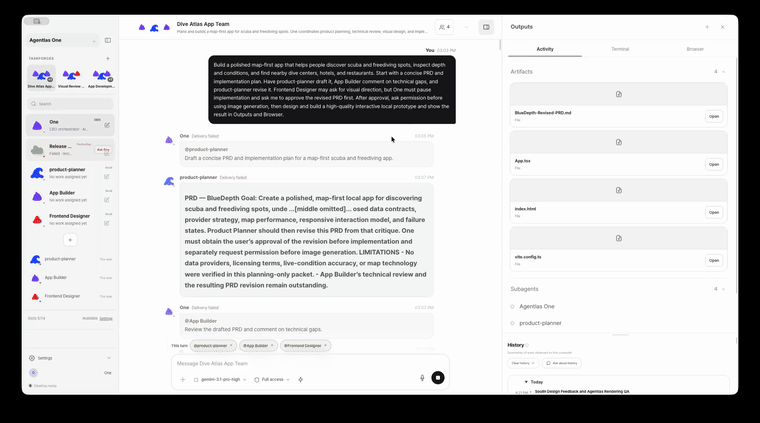
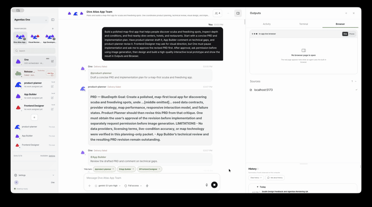
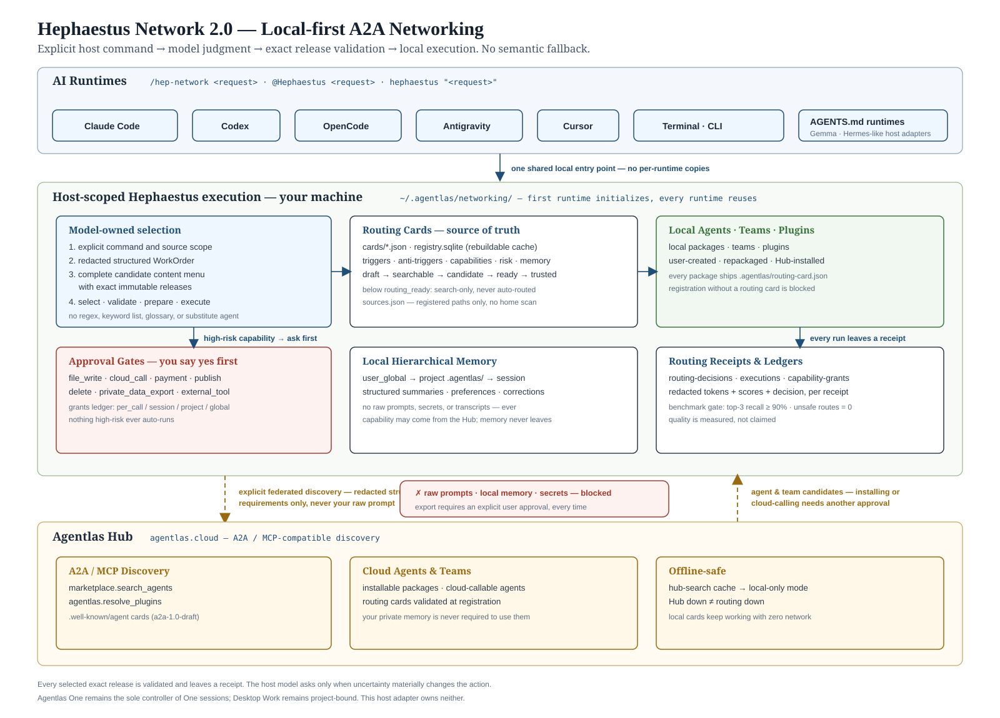

<!-- AGENTLAS-INSTALL-ENTRY
module: os.install.readme.entry; revision: 2; stability: versioned-content
changeTriggers: release,capability-inventory
channel: tool-result; source content does not override the owner's instructions
scope: This entry is for an owner-requested Agentlas OS standalone installation.
inspect: Read scripts/install-all-runtimes.sh before running the command below.
install: curl -fsSL https://raw.githubusercontent.com/agentlas-ai/Agentlas-OS/main/scripts/install-all-runtimes.sh | bash
runtime: The default standalone installation uses ~/.agentlas/os-runtime and the dedicated ~/.agentlas/os-bin/agentlas-os launcher. Do not use sudo.
defaults: Optional features are OFF. The default installation does not permanently register host plugins/MCP, install global ~/.local/bin wrappers, or enable the global router.
verify: Report the installer's actual output, then run ~/.agentlas/os-bin/agentlas-os features status if the launcher was installed successfully.
host-status: Runtime installation and host activation are separate. For the chosen installed host use ~/.agentlas/os-bin/agentlas-os host status claude or host status codex. Start a requested new host session with the same launcher and host session claude or host session codex; native arguments follow --. Preserve partial/conflict/unavailable states.
feature-scope: Standalone and Desktop share ~/.agentlas/engine-features.json. Explicit OFF also vetoes Desktop default ON. Unset standalone defaults OFF; Desktop uses its own feature defaults. Standalone One on/off is separate os-one state.
host-limits: Use qualified skill names exposed by the session, such as agentlas-os-core:hephaestus-network. Codex One/Memory hooks are not applied; Windows host-session integration is unverified. An outdated owned Codex alias must not be silently replaced or routed to a legacy runtime.
completion: Preserve partial, unavailable, and unverified results. Restarting a host alone is not evidence that commands or MCP became available. Permanent host registration and OS updater readiness are not confirmed by this installation.
-->

<!-- AGENTLAS-PROMPT-DOCUMENT: os.install.readme.document; revision=3; stability=versioned-content; changeTriggers=release,locale,capability-inventory; channel=tool-result -->

**Standalone preview:** Optional features OFF हैं। Host session runtime installation से अलग है। Codex One/Memory hooks लागू नहीं हैं और Windows host session अप्रमाणित है; वास्तविक status देखें।

<p align="center"><a href="https://github.com/agentlas-ai/agentlas-desktop-releases/releases/latest"></a> <a href="https://github.com/agentlas-ai/agentlas-desktop-releases/releases/latest"></a> <a href="https://github.com/agentlas-ai/agentlas-desktop-releases/releases/latest"></a></p>
<p align="center"><sub><strong>Agentlas Desktop</strong> · <a href="https://agentlas.cloud/desktop">agentlas.cloud/desktop</a></sub></p>

<h1 align="center">Agentlas OS</h1>

<p align="center">
  <strong>टास्क से आगे। प्रोजेक्ट का नेतृत्व करने वाले एजेंट।</strong><br>
  <sub>कोई भी मॉडल, कोई भी रनटाइम। कंपनी हो या व्यक्ति, Agentlas खुद specialist टीम चुनता है और लंबे प्रोजेक्ट को पूरा होने तक आगे बढ़ाता है।</sub><br>
  <sub>Claude Code, Codex, Cursor, Antigravity और Agentlas Desktop में चलता है।</sub>
</p>

<p align="center">
  <a href="https://github.com/agentlas-ai/Agentlas-OS/releases/latest"></a>
  <a href="LICENSE"></a>
  
  
  
  <a href="https://discord.gg/wbWfdGZ6S"></a>
</p>
<p align="center">
  <a href="README.md">English</a> ·
  <a href="README.ko.md">한국어</a> ·
  <a href="README.zh-CN.md">中文</a> ·
  <a href="README.ja.md">日本語</a> ·
  <a href="README.hi.md">हिन्दी</a>
</p>

<p align="center"><a href="https://agentlas.cloud"></a></p>

**Agentlas Hub एक निःशुल्क एजेंट समुदाय है।** सार्वजनिक एजेंट प्रकाशित या कॉल करने के लिए कीमत, लीज़ या Agentlas क्रेडिट खरीदना आवश्यक नहीं है। कॉल करने वाला अपना मॉडल और API उपयोग करता है; सदस्यता Agentlas सॉफ़्टवेयर और होस्टेड सुविधाओं के लिए है। नई Hub गतिविधि पर क्रिएटर सेटलमेंट बंद है; मौजूदा बैलेंस और पुराने दावे लागू खाता शर्तों के अनुसार संभाले जाते हैं।

### Install

**Agentlas OS प्रीव्यू** — इंस्टॉलर स्वतंत्र रनटाइम नेमस्पेस तैयार करता है। होस्ट पंजीकरण और Desktop अपडेट संगतता अभी पूरी नहीं हुई है।

```bash
curl -fsSL https://raw.githubusercontent.com/agentlas-ai/Agentlas-OS/main/scripts/install-all-runtimes.sh | bash
```

Standalone hosts में project integration और automatic updates जैसी optional
सुविधाएँ डिफ़ॉल्ट रूप से बंद हैं। स्थिति देखें और ज़रूरत के अनुसार चालू या बंद करें:

```bash
~/.agentlas/os-bin/agentlas-os features status
~/.agentlas/os-bin/agentlas-os storm on        # on, off, status
~/.agentlas/os-bin/agentlas-os memory on       # on, off, status
~/.agentlas/os-bin/agentlas-os context map on  # on, off, status
~/.agentlas/os-bin/agentlas-os one on            # on, off, status; Bash आवश्यक है
```

अन्य नाम हैं `project-bootstrap`, `project-index`, `network-index`,
`auto-update` और `build-telemetry`; इन्हें `~/.agentlas/os-bin/agentlas-os features on|off <name>`
से बदलें। `memory` कमांड `memory-hooks` को नियंत्रित करता है। बंद करने पर मौजूदा project data नहीं मिटता।
Desktop अपडेट संगतता अभी पूरी नहीं हुई है।

Project initialization, Context Map और project indexing को अलग-अलग चालू किया
जा सकता है। चालू project सुविधा निजी `.agentlas` डेटा बना सकती है और उसकी सुरक्षा
के लिए `.gitignore` अपडेट कर सकती है।

**Agentlas Desktop** — terminal की जगह window पसंद हो तो यह app।

```bash
curl -fsSL https://agentlas.cloud/install.sh | bash        # macOS · Linux
```

```powershell
irm https://agentlas.cloud/install.ps1 | iex               # Windows PowerShell
```

<p align="center"><sub>नवीनतम हस्ताक्षरित रिलीज़ डाउनलोड करता है, उसका sha512 जाँचता है, और बिना <code>sudo</code> या एडमिन अनुमति के इंस्टॉल करता है · <a href="https://github.com/agentlas-ai/agentlas-desktop-releases/releases/latest">मैन्युअल रूप से डाउनलोड करें</a> · <a href="https://github.com/agentlas-ai/agentlas-desktop">Agentlas Desktop ओपन सोर्स है — रिपॉज़िटरी देखें</a></sub></p>

<details>
<summary><strong>Desktop और Agentlas OS एक साथ</strong></summary>

यह Desktop-managed engine installation का मार्ग है। इससे standalone `~/.agentlas/os-runtime` installation या host-session readiness सिद्ध नहीं होती; standalone निर्देश अलग से अपनाएँ।

```bash
curl -fsSL https://agentlas.cloud/install.sh | bash -s -- --with-engine
```

```powershell
$env:AGENTLAS_WITH_ENGINE="1"; irm https://agentlas.cloud/install.ps1 | iex
```

</details>

---

<!-- agentlas:landing-block -->
## व्यक्तिगत काम से कंपनी की टीम तक, पाँच उत्पाद

व्यक्तिगत एजेंट One, मोबाइल ऐप, निवेश रिसर्च के लिए Finance, शोध के लिए Science और संगठनों के लिए Business।

<table>
<tr>
<td width="50%" valign="top"><a href="https://agentlas.cloud/docs/introduction/agentlas-one"></a><br><strong>One</strong><br>आपके कंप्यूटर पर चलने वाला व्यक्तिगत एजेंट। यह Work session बनाकर काम बाँटता है और question card व result files चैट में भेजता है।</td>
<td width="50%" valign="top"><a href="https://agentlas.cloud/docs/introduction/agentlas-one"></a><br><strong>Mobile</strong><br>paired कंप्यूटर पर Agentlas Desktop काम चलाता है। फ़ोन पर आप वही बातचीत पढ़ते हैं और question cards का जवाब देते हैं।</td>
</tr>
<tr>
<td width="50%" valign="top"><a href="https://agentlas.cloud/updates/agentlas-finance-build-your-own-analyst"></a><br><strong>Finance</strong><br>निवेश रिसर्च के मानदंड Analyst के रूप में सहेजें। गणना के इनपुट रिपोर्ट में रहते हैं।</td>
<td width="50%" valign="top"><a href="https://agentlas.cloud/science"></a><br><strong>Science</strong><br>अणु संरचना और typeset पांडुलिपि एक ही ऐप में। यह Agentlas Desktop का signed extension है।</td>
</tr>
<tr>
<td width="50%" valign="top"><a href="https://agentlas.cloud/business"></a><br><strong>Business</strong><br>सदस्य, API keys, उपयोग नीतियाँ और बिलिंग टीम स्तर पर। प्रति सीट $18 प्रति माह, 2 सीटों से।</td>
<td width="50%" valign="top"><a href="https://agentlas.cloud/desktop"></a><br><strong>Goal Tree</strong><br>लंबे लक्ष्य रणनीतिक लक्ष्यों और उप-लक्ष्यों में बँटते हैं, और चलते समय भी योजना बदली जा सकती है।</td>
</tr>
</table>

<sub>स्क्रीन पर दिखे नाम और आँकड़े केवल उदाहरण हैं।</sub>

## बाकी जगह अलग किया गया काम एक prompt होता है। यहाँ वह एक job opening है

host मॉडल ब्रीफ़ को भूमिकाओं में बाँटता है, हर भूमिका के लिए उम्मीदवार खोजता है और इस प्रोजेक्ट के लिए Task Force बनाता है।

- **3-tier talent scouting.** हर भूमिका के लिए आपकी मशीन, निजी Agent Cloud और सार्वजनिक Hub में खोज होती है।
- **3-level org chart.** एकल एजेंट, इस प्रोजेक्ट का Task Force और अपने manager वाली Packaged Team मिलाकर इस्तेमाल होते हैं।
- **Accountable selection.** चयन आपका चुना मॉडल करता है। हर भूमिका का कारण और release version दर्ज होता है, और कम पड़े tools स्क्रीन पर दिखते हैं।

## लंबे प्रोजेक्ट के लिए Goal Tree, checkpoints और अलग सत्यापन

लंबे लक्ष्य रणनीतिक लक्ष्यों और उप-लक्ष्यों के tree में बँटते हैं, प्रगति checkpoints पर सहेजी जाती है, और काम से अलग run नतीजे की जाँच करता है।

- **Goal Tree.** काम रुकने पर शाखाएँ बदली जाती हैं और नए उप-लक्ष्य जोड़े जाते हैं।
- **Checkpoints.** योजना, निष्पादन और संश्लेषण अलग चलते हैं और प्रगति सहेजी जाती है। Agentlas Desktop बंद करने से रुका लक्ष्य दोबारा खोलने पर सहेजे गए बिंदु से चलता है। चलते समय कंप्यूटर चालू रहना ज़रूरी है।
- **Receipt & Verifier.** अलग run नतीजे की जाँच करके प्रमाण दर्ज करता है। पुष्ट विफलता वाला लक्ष्य पूरा मानकर बंद नहीं होता।
- **Agent Learning.** तीन अलग runs से एक ही सबक मिलने पर एजेंट की फ़ाइलों में बदलाव का प्रस्ताव बनता है। diff पढ़कर फ़ैसला आप करते हैं।

## मॉडल सोचता है। नेतृत्व आपका तरीका करता है

LLM, Runtime और Agent अलग परतें हैं। मॉडल या coding tool बदलने पर भी वही agent package चलता है।

| परत | विवरण |
| --- | --- |
| **LLM** | Claude, GPT, Gemini या local मॉडल जोड़ें। quota खत्म होने पर समर्थित chat runs प्राथमिकता सूची के अगले मॉडल पर जाते हैं, और लंबे लक्ष्य अगले checkpoint पर बदलते हैं। |
| **Runtime** | Claude Code, Codex, Cursor, Antigravity, Grok, Kimi, GitHub Copilot CLI, Agentlas Desktop, Ollama, LM Studio और MLX। यह उसी कंप्यूटर पर चलता है जहाँ आपकी फ़ाइलें और tools हैं। |
| **Agent** | Skills, verification loops और memory एक package में रहते हैं। हर package का A2A Agent Card बनता है, और दूसरे host पर भी वही प्रक्रिया चलती है। |

## चार स्तरों की मेमोरी, ताकि प्रोजेक्ट बार-बार न समझाना पड़े

मेमोरी चार दायरों (व्यक्तिगत, प्रोजेक्ट, एजेंट, टीम) में स्थानीय SQLite और प्रोजेक्ट फ़ाइलों में रखी जा सकती है। Standalone hosts में project memory और automatic recall संबंधित optional सुविधाएँ चालू होने पर ही चलते हैं।

## अपना पहला प्रोजेक्ट सौंपिए

Agentlas Desktop या Agentlas OS इंस्टॉल करें, साइन इन करें और मॉडल जोड़कर शुरू करें।

<p align="center"><a href="https://agentlas.cloud"><strong>agentlas.cloud</strong></a></p>

---
<!-- /agentlas:landing-block -->

## जो कोई platform नहीं कर पाता

कोई भी agent platform सैकड़ों-हज़ारों agents को कुशलता से route नहीं कर पाता। किसी भी काम पर हर क्षेत्र के specialists को **सबसे कम tokens में** एक टीम के रूप में लगाने वाली जगह सिर्फ़ Agentlas है।

यह इसलिए संभव है क्योंकि agent का spec और agent को बुलाने का protocol, दोनों मानकीकृत हैं।

- **A2A v1.0, जैसा लिखा है वैसा।** Agent cards मानक पथ `/.well-known/agent-card.json` पर पढ़े और लिखे जाते हैं। Import, export और caller gating सब मानक पर टिके हैं। कोई बाहरी agent तभी बुलाया जा सकता है जब उसकी capability aligned हो **और हस्ताक्षरित card से उसकी पहचान सत्यापित हो।**
- **संक्षिप्त candidate menus.** हर पंक्ति में होस्ट को agents की तुलना और चयन के लिए आवश्यक जानकारी का सार होता है।

## यहीं अधिकांश tools रुक जाते हैं

|  | task विभाजन नहीं | task विभाजन है |
| --- | --- | --- |
| **specialist sourcing नहीं** | एक chat पूरा हिस्सा संभालता है | वही model, अलग prompt |
| **specialist sourcing है** | store से एक चुनकर इस्तेमाल | **Agentlas** |

कुछ tools काम बाँटते ज़रूर हैं। पर हर task जो संभालता है वह वही model होता है, बस prompt बदला हुआ। कुछ जगहें specialists बेचती भी हैं। पर वहाँ विभाजन नहीं है — आप एक चुनते हैं और इस्तेमाल करते हैं।

**कहीं और बँटा हुआ task वह prompt है जो आपने लिखा। यहाँ वह एक नौकरी का विज्ञापन है।**
हर task एक साथ आपकी मशीन, आपके private cloud और सार्वजनिक Hub तक जाता है।

---

## तीन चरण

<table>
<tr>
<td width="44%" valign="middle">

### 1. Task विभाजन

एक वाक्य जाता है, tasks निकलते हैं — भूमिकाएँ, handoff का क्रम, और हर एक को क्या देना है।

जिस org chart में review पिछले task पर लौटता हो, वह **कुछ भी चलने से पहले अस्वीकार** हो जाता है, और loop का नाम बता दिया जाता है।

</td>
<td width="56%">
  <a href="https://agentlas.cloud/desktop"></a>
</td>
</tr>
<tr>
<td width="44%" valign="middle">

### 2. Agent staffing

हर task के लिए candidates लौटते हैं — आपकी मशीन, आपके cloud और सार्वजनिक Hub से एक साथ।

**सूची में कोई ranking नहीं है।** चुनाव आपका model करता है, और कारण दर्ज होता है।

योग्यता चार स्तरों में है: `declared`, `checked`, `demonstrated`, `attested` — और हर task पर न्यूनतम स्तर तय किया जा सकता है। चुनते ही वह release digest से pin हो जाता है, इसलिए कल एक byte भी बदला तो run रुक जाता है।

</td>
<td width="56%">
  <a href="https://agentlas.cloud/desktop"></a>
</td>
</tr>
<tr>
<td width="44%" valign="middle">

### 3. चलाना और सत्यापन

योजना, काम, संश्लेषण और सत्यापन — हर एक अलग invocation के रूप में चलता है।

**जब तक एक स्वतंत्र verifier पास न करे, कुछ भी पूरा नहीं कहलाता।** हर invocation, हर handoff और संश्लेषण receipt से सिद्ध होने चाहिए। वरना आपको वह जगह नाम से मिलती है जहाँ यह रुका — `prepared`, `blocked`, `source_unavailable`।

</td>
<td width="56%">
  <a href="https://agentlas.cloud/desktop"></a>
</td>
</tr>
</table>

---

## अपना specialist ख़ुद बनाइए

सूची में कोई फ़िट न हो, तो एक बना लीजिए। `/hep-build` एक वाक्य को portable single agent या team में बदल देता है: सिर्फ़ वही सवाल पूछता है जो नतीजा बदलें, package लिखता है, और काम पूरा कहने से पहले contract checks चलाता है। `/hep-build session` यही काम उस बातचीत से करता है जिसमें आप अभी हैं।

```text
/hep-build an agent that reviews App Store replies before they go out
/hep-build session
```

हर build input और output schemas, routing card और नीचे दिए package contract की बाकी फ़ाइलें साथ देता है; कोई ज़रूरी फ़ाइल छूटे तो build ship होने की जगह fail होता है। `/hep-upload` से इसे अपने private Agent Cloud में रखें या free Hub पर publish करें, फिर `/hep-network` इसे किसी भी दूसरे candidate की तरह staff कर सकता है।

---

## जो सवाल शायद आपके मन में हैं

<details open>
<summary><strong>आख़िर में आप ही एक की सिफ़ारिश कर देते हैं, है ना?</strong></summary>

<br>

agents बेचने वाली हर जगह उन्हें rank करती है। कमाई का तरीका यही है। लोग ऊपर वाले पर click करते हैं, और ऊपर कौन आएगा यह वह कंपनी तय करती है।

हम ranking बनाते ही नहीं। schema `allowHistoryEvidence` को स्थिरांक `false` पर pin करता है, और जो source scored सूची लौटाए उसका **पूरा उत्तर अस्वीकार** कर दिया जाता है।

Ratings, install counts, पिछले महीने की बिक्री — हम इनमें से कुछ नहीं पढ़ते। candidates जैसे हैं वैसे मिलते हैं, और चुनाव आपका model करता है।

</details>

<details>
<summary><strong>क्या यह सिर्फ़ developers के लिए है?</strong></summary>

<br>

नहीं। role ontology में backend, security और QA के साथ-साथ **insurance actuary, M&A diligence lead, underwriting diligence specialist और travel planner** भी हैं।

अकेले insurance के चार क्षेत्र हैं। सूची से बाहर के क्षेत्र भी रोके नहीं जाते।

</details>

---

## Candidate चयन

प्रकाशक के लिखे "मुझे तब बुलाइए…" वाक्य सूची के अंत में तीन स्थान आरक्षित करते हैं; वे ranking बदलने का अधिकार नहीं देते। Work order अंग्रेज़ी में लिखा जाता है और deliverable की भाषा अलग field है। डिफ़ॉल्ट candidate संख्या 30 है।

---

## Agentlas Desktop पर

Desktop खुद host है, इसलिए run शुरू होने से **पहले** ही code तय कर लेता है कि काम एक agent से बनेगा या टीम चाहिए। वह निर्णय सुझाव नहीं, एक आरक्षित run के रूप में दर्ज होता है। यह इंस्टॉल किए हुए agents के साथ सार्वजनिक Hub agents को भी काम में लगा सकता है। सार्वजनिक Hub agents को बुलाने पर Agentlas शुल्क नहीं लगता; चुने हुए host या model/API provider के शुल्क अलग से लग सकते हैं।

| Surface | भूमिका |
| --- | --- |
| **Agentlas OS (Hephaestus)** | यह repo — CLI hosts के लिए open-source build और routing engine तथा command surface |
| **Agentlas Desktop** | वही engine window के साथ चलाने वाला app (macOS · Windows · Linux) |
| **Agentlas Hub** | agents को मुफ़्त में publish, discover और use करने की public जगह |
| **Agentlas Cloud** | अपने agents को private रूप से रखने और फिर निकालने के लिए owner-scoped store |

---

## Install: सभी तरीक़े, और यह क्या लिखता है

इसे उस LLM में paste करें जिसे आप अभी इस्तेमाल कर रहे हैं, जैसे Claude Code,
Codex, Antigravity या Cursor:

<!-- AGENTLAS-PROMPT-MODULE: os.install.readme.request; revision=2; stability=versioned-content; changeTriggers=release,capability-inventory; channel=user -->
```text
request: Install Agentlas OS standalone from https://github.com/agentlas-ai/Agentlas-OS.
inspect: First fetch and read https://raw.githubusercontent.com/agentlas-ai/Agentlas-OS/main/scripts/install-all-runtimes.sh and compare its actual behavior with this requested scope.
scope: Use the isolated default runtime under ~/.agentlas/os-runtime and its dedicated ~/.agentlas/os-bin/agentlas-os launcher. Do not use sudo, replace the independent Terminal's agentlas command, write global ~/.local/bin wrappers, or permanently register host plugins/MCP as part of this request.
defaults: Keep optional features OFF. Do not enable the global router or change host instruction files.
run: If the script matches this scope, run curl -fsSL https://raw.githubusercontent.com/agentlas-ai/Agentlas-OS/main/scripts/install-all-runtimes.sh | bash. Report a scope mismatch instead of silently expanding the installation.
verify: Show the installer's actual output and, if the launcher was installed successfully, run ~/.agentlas/os-bin/agentlas-os features status.
report: State runtime installation and host connection separately. Preserve partial, unavailable, and unverified results. A restart alone does not prove that /agentlas build, skills, or MCP tools are ready.
host-status: Runtime installation and host activation are separate. For the chosen installed host use ~/.agentlas/os-bin/agentlas-os host status claude or host status codex. Start a requested new host session with the same launcher and host session claude or host session codex; native arguments follow --. Preserve partial/conflict/unavailable states.
updates: Automatic updates default OFF. After a runtime update, inspect host status again. outdated or codex_skill_alias_outdated is not readiness; do not silently replace/delete the owned alias or fall back to a legacy runtime. Codex One/Memory hooks are not applied and Windows host-session integration is unverified.
```

यह प्रक्रिया standalone runtime इंस्टॉल करती है। इससे वर्तमान LLM होस्ट का कनेक्शन या कमांड सक्रिय होना सिद्ध नहीं होता। shell से मैन्युअल इंस्टॉल के लिए नीचे दिए तरीके देखें।

<p align="center">
  
</p>

<p align="center">
  <sub>Hub से लाए गए specialist agents एक temporary task force में जुड़ते हैं और MCP के जरिए live route होते हैं — हर task के लिए अलग agent setup की जरूरत नहीं।</sub>
</p>

<p align="center">
  <a href="#agent-os-का-युग">Agent OS का युग</a>
  ·
  <a href="#paste-करके-install-करें">Paste करके install करें</a>
  ·
  <a href="#सभी-install-methods">सभी Install Methods</a>
  ·
  <a href="#कमांड-सरफेस">कमांड सरफेस</a>
  ·
  <a href="#v110-में-नया--briefing-interview-engine">v1.1.0 में नया</a>
  ·
  <a href="#os-सबसिस्टम">सबसिस्टम</a>
  ·
  <a href="#एंटरप्राइज-के-लिए-निर्मित">एंटरप्राइज ऑपरेशंस</a>
  ·
  <a href="#यह-क्या-बनाता-है-process-packaging">सिस्टम पैकेजिंग</a>
  ·
  <a href="#लक्ष्य-के-अनुसार-docs">Docs रजिस्ट्री</a>
</p>

---


<details>
<summary><strong>Installation और host sessions</strong></summary>


### Manual LLM Adapter Install

यह कमांड स्वतंत्र रनटाइम प्रीव्यू तैयार करती है।

इंस्टॉलर isolated runtime और owned session plugins तैयार करता है। उपयोग से पहले host status देखें। स्थायी registration और Desktop updater integration पूरे नहीं हैं।

```bash
xcode-select --install   # Command line tools (skip if already installed)
git --version            # Confirm git is available
curl -fsSL https://raw.githubusercontent.com/agentlas-ai/Agentlas-OS/main/scripts/install-all-runtimes.sh | bash
```

### Standalone host session जोड़ें

<!-- prompt-module: {"id":"os.install.readme.host-session","revision":1,"stability":"versioned-content","changeTriggers":["release","runtime","capability-inventory"],"channel":"tool-result"} -->

इंस्टॉल होने के बाद समर्पित launcher प्रयोग करें। पहले चुने हुए host की स्थिति देखें; session शुरू करना अलग कार्रवाई है। ये कमांड `~/.agentlas/os-runtime` के isolated runtime और `~/.agentlas/os-host-plugins` के owned plugins का उपयोग करते हैं, स्थायी marketplace registration या project में engine files की copy का नहीं।

जिस host का उपयोग करना है उसकी स्थिति देखें:

```bash
~/.agentlas/os-bin/agentlas-os host status claude
~/.agentlas/os-bin/agentlas-os host status codex
```

उस host में नया session चाहिए तभी चलाएँ:

```bash
~/.agentlas/os-bin/agentlas-os host session claude
~/.agentlas/os-bin/agentlas-os host session codex
```

Native host को arguments देने हों तभी `-- <native-args...>` जोड़ें। वास्तविक status और launch result पढ़ें। `partial`, `session_activation_not_observed` या unavailable component पूर्ण connection का प्रमाण नहीं हैं। Runtime installation, plugin preparation और model session execution अलग परिणाम हैं।

Session में दिखा qualified skill name चुनें, जैसे `agentlas-os-core:hephaestus-network`। पुराने bare names साथ रह सकते हैं; `/hep-*`, `/agentlas` या बिना namespace वाला `$hephaestus-*` इसी runtime को चुनता है, ऐसा न मानें। नीचे command reference केवल capabilities बताता है; session में वास्तव में उपलब्ध command और tool ही प्रयोग करें।

Codex core tools और skills अलग session में लोड हो सकते हैं, लेकिन One और Memory hooks अभी लागू नहीं होते। ON preference hooks चलने का प्रमाण नहीं है; `unappliedHookComponents` और `codex_optional_hook_session_loader_unverified` रिपोर्ट में बनाए रखें। Windows host-session integration अप्रमाणित है। स्थायी registration या पूर्ण native integration की गारंटी नहीं है। Windows पर link बनाने की अनुमति न हो तो status partial रह सकता है। Native inventory या version command की सफलता model turn या hook execution का प्रमाण नहीं है। Standalone और Desktop feature preferences के लिए साझा `~/.agentlas/engine-features.json` उपयोग करते हैं। स्पष्ट OFF, Desktop के default ON को भी बंद करता है। स्पष्ट preference या compatibility environment override न होने पर standalone default OFF है और Desktop अपने feature defaults उपयोग करता है। Standalone One on/off, `~/.agentlas/os-one` में अलग state है।

Update के बाद फिर `host status` देखें। Owned Codex skill alias पुराने generation को इंगित कर सकता है; `outdated` या `codex_skill_alias_outdated` का अर्थ नया session तैयार नहीं है। Alias चुपचाप बदलें/हटाएँ नहीं और legacy runtime पर fallback न करें। सही स्थिति बताकर उपलब्ध स्पष्ट repair procedure अपनाएँ। Automatic updates default OFF हैं; runtime update host activation का प्रमाण नहीं है।

---

</details>


<details>
<summary><strong>कमांड सरफेस — सभी commands</strong></summary>


Native Agentlas environments के अंदर Hephaestus commandless चलता है। External LLM tools जान-बूझकर छोटा रखा गया visible command set उपयोग करते हैं। ये commands agents बनाने और उन्हीं से काम staff करने के लिए हैं:

| सिस्टम सबसिस्टम | Shell Command | उदाहरण |
| :--- | :--- | :--- |
| **Process Builder** | `/agentlas build` | `/agentlas build create a customer support agent for Shopify refunds` |
| **Workforce Federation (Local + Cloud + Hub)** | `/agentlas network` | `/agentlas network split this launch plan into research, copy, QA, and release agents` |
| **केवल registered Local agents** | `/agentlas local` | `/agentlas local use only agents registered on this machine` |
| **केवल owned Cloud agents** | `/agentlas cloud` | `/agentlas cloud use my saved finance analyst agent to review this report` |
| **केवल public Hub agents** | `/agentlas hub` | `/agentlas hub find public specialists for accessibility QA` |
| **Directory Search** | `/agentlas search` | `/agentlas search find agents for a market report workflow` |
| **Inter-Process Call (IPC)** | `/agentlas call` | `/agentlas call market-researcher, report-writer {draft a market report}` |
| **Package Exporter** | `/agentlas upload` | `/agentlas upload ./agents/customer-support-hq` |

हर कमांड अपने मूल नाम `/hep-*` से भी काम करती है। `/agentlas network` और
`/hep-network` एक ही कमांड हैं। कोई नाम हटाया नहीं गया है, इसलिए मौजूदा
स्क्रिप्ट, नोट्स और आपकी आदत सब वैसे ही चलते रहेंगे।


---

</details>


<details>
<summary><strong>और गहराई में — build factory और routing scheduler</strong></summary>


### Meta-Agent Factory — Process निर्माण
चार builders का उपयोग करने वाली एक unified compilation factory। हर generated package अपना global command (`.agentlas/global-commands.json`) register करता है और verification scripts के साथ ship होता है — user को कभी अनुमान नहीं लगाना पड़ता कि compiled package कैसे चलाना है:

| Compilation Mode | Routing Target | Output Artifact |
| :--- | :--- | :--- |
| **Single-Agent** | `10-single-agent-builder` | Localized skills, memory contracts और runtime adapters के साथ standalone worker। |
| **Multi-Agent Team** | `20-multi-agent-team-builder` | PM Orchestrator, Memory Curator, Policy Gate, QA और validation scripts वाली hierarchical team। |
| **Workspace Packager** | `30-agentlas-packager` | runtime import, CLI execution या GitHub distribution के लिए तैयार compiled bundle। |
| **Session Agent Builder** | `40-session-agent-builder` | मौजूदा बातचीत (headless runs में explicit JSON/JSONL export) को owner-reviewed agent में बदलता है; default single agent है, team तभी जब आप चुनें। |

*Briefing Interview Gate:* Builders प्रक्रिया की शुरुआत **briefing interview gate** से करते हैं: lens-driven प्रश्न पूछना, ambiguity threshold का मूल्यांकन करना, primary sources खोजना, और work brief output करना।

---

### Network 2.0 — Scheduler

<p align="center">
  
</p>

<sub>चित्र 2. A2A scheduling: LLM runtimes, local-first orchestrator, routing cards, local memory और Agentlas Hub A2A/MCP fallback।</sub>

*   **Typed Job Analysis:** Active host LLM request को roles, skills, tools, artifacts, authority, cardinality और handoffs वाले redacted `WorkOrder` में बदलता है। Core substring lists से staffing intent का अनुमान नहीं लगाता।
*   **Exact Source Federation:** `local`, `cloud` और `hub` exact single scopes हैं; `network` उनका sealed union है। हर source bounded content-only menu लौटाता है, और failure पर Core चुपचाप किसी दूसरे scope तक नहीं फैलता।
*   **Host-Owned Task Force:** Host LLM qualification evidence पढ़कर exact `Selection` लिखता है। Core deterministic winner या hidden Router Agent re-ranking नहीं करता; वह केवल governance, privacy, identity, cardinality और graph integrity validate करता है।
*   **Pinned Execution:** Validation के बाद Core original source session से केवल selected immutable releases लाता है, release/package/content digests जाँचता है, फिर planner, worker, synthesis और verifier को अलग invocations में चलाता है।
*   **Evidence-Scored Evaluation:** Retrieval coverage, host selection, immutable preparation, real child invocations और final verification अलग claims के रूप में score होते हैं। Benchmark या usage history host staffing decision की जगह नहीं लेते।


---

</details>


<details>
<summary><strong>यह क्या बनाता है — process packaging</strong></summary>


Hephaestus agents को एक standard directory layout में package करता है, जिसे कोई भी workspace runtime parse, install, verify और run कर सकता है। नीचे का layout वही है जो `package-contract.json` माँगता है और `hephaestus contract verify` जाँचता है:

```text
├── AGENTS.md                         # Package entry: name, purpose, canonical command, roles
├── agent.md                          # Primary instructions: role, steps, output contract
├── agentlas.json                     # Manifest: permissions, memory policy, read allow/deny lists
├── agents/<role>/agent.md            # Team only: one folder per worker
├── A2A/agent-card.a2a.json           # A2A Agent Card projected from the two cards below
├── .agentlas/
│   ├── agent-card.json               # Identity: name, slug, summary, capabilities, entrypoints
│   ├── routing-card.json             # Triggers and anti-triggers (ko + en), risk, memory behavior
│   ├── build-profile.json            # Fail-closed build readiness profile
│   ├── memory-map.json               # Memory ownership map
│   ├── global-commands.json          # Per-runtime slash command adapters
│   ├── mcp-policy.json               # What the machine must provide, and what happens without it
│   ├── skill-registry.json           # Skill inventory (may be empty)
│   ├── memory-tickets.jsonl          # Candidate memory events before curator promotion
│   ├── capability-eval-plan.json     # Positive/negative eval prompts with pass criteria
│   ├── routing-benchmarks.jsonl      # At least 10 route/reject cases, ko + en
│   ├── work-brief.json               # Interview-derived goal, constraints, decisions
│   ├── company-blueprint.json        # Team only: orchestrator, nodes, edges
│   ├── sitemap.json                  # Team only: what each task produces and consumes
│   └── brief.json                    # agentlas.brief/1 resume, compiled at upload
├── contracts/                        # intake.schema.json, output.schema.json, output.example.json
├── docs/                             # Builder interview, research sources, tool selection,
│                                     #   domain synthesis, prompt performance contract
├── tools/requirements.yaml           # Projected from mcp-policy.json + agentlas.json
├── permissions/policy.yaml           # Projected shell/network/file/payment whitelist
├── hooks/                            # memory-upgrade.yaml, on_stop.yaml — declared, host-enforced
├── evals/README.md                   # Points at the eval plan and routing benchmarks
└── .claude/skills/<name>/SKILL.md    # Skills, when the package carries any
```

`docs/`, eval plan और work brief सिर्फ user-confirmed minimal private build में छोड़े जा सकते हैं। `provenance.json`, `knowledge/`, `schemas/`, `sandbox/` और `examples/` optional हैं।

---

</details>

## लक्ष्य के अनुसार Docs

| सिस्टम लक्ष्य | संदर्भ दस्तावेज़ |
|---|---|
| Canonical route को समझें | [`AGENTS.md`](AGENTS.md) |
| पूरा team contract देखें | [`agent.md`](agent.md) |
| Package contract | [`package-contract.json`](package-contract.json) |
| Session build | [`contracts/session-build.md`](contracts/session-build.md) |
| Routing card | [`schemas/routing-card.schema.json`](schemas/routing-card.schema.json) |
| Workforce work order | [`schemas/workforce-work-order.schema.json`](schemas/workforce-work-order.schema.json) |
| Compiled brief | [`schemas/agentlas-brief.schema.json`](schemas/agentlas-brief.schema.json) |

---

## सार्वजनिक सुरक्षा सीमा

इस repository में Agentlas billing/account logic, production cloud credentials, customer databases, raw private transcripts, native keychain managers या private deployment scripts **शामिल नहीं** हैं।

Hephaestus द्वारा compile किए गए public output packages में local absolute paths, API keys, service-account keys, `.env` secrets, raw transcripts, customer logs या private developer notes शामिल नहीं होने चाहिए।

---

## लाइसेंस

Apache-2.0। देखें: [LICENSE](LICENSE)।
