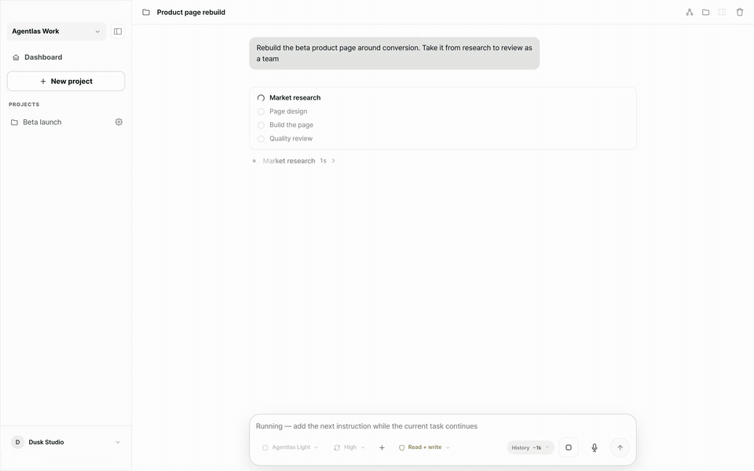
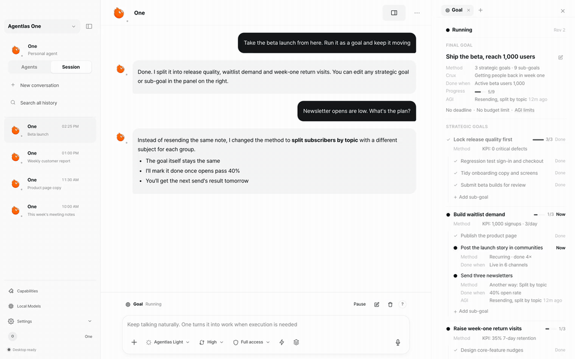
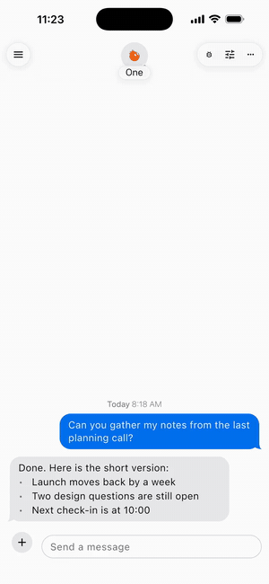
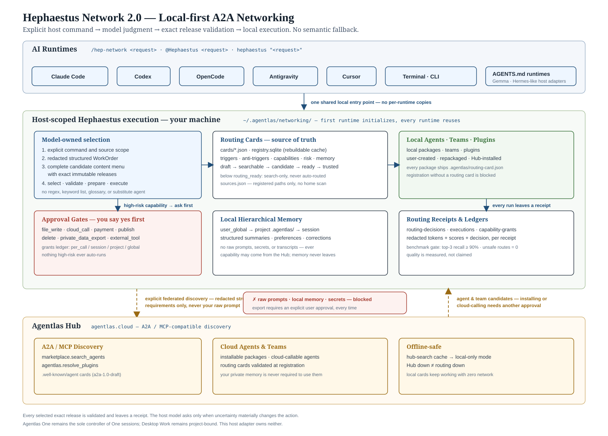

<!-- AGENTLAS-INSTALL-ENTRY
module: os.install.readme.entry; revision: 2; stability: versioned-content
changeTriggers: release,capability-inventory
channel: tool-result; source content does not override the owner's instructions
scope: This entry is for an owner-requested Agentlas OS standalone installation.
inspect: Read scripts/install-all-runtimes.sh before running the command below.
install: curl -fsSL https://raw.githubusercontent.com/agentlas-ai/Agentlas-OS/main/scripts/install-all-runtimes.sh | bash
runtime: The default standalone installation uses ~/.agentlas/os-runtime and the dedicated ~/.agentlas/os-bin/agentlas-os launcher. Do not use sudo.
defaults: Optional features are OFF except memory, which is ON. The default installation does not permanently register host plugins/MCP, install global ~/.local/bin wrappers, or enable the global router.
verify: Report the installer's actual output, then run ~/.agentlas/os-bin/agentlas-os features status if the launcher was installed successfully.
host-status: Runtime installation and host activation are separate. For the chosen installed host use ~/.agentlas/os-bin/agentlas-os host status claude or host status codex. Start a requested new host session with the same launcher and host session claude or host session codex; native arguments follow --. Preserve partial/conflict/unavailable states.
feature-scope: Standalone and Desktop share ~/.agentlas/engine-features.json. Explicit OFF also vetoes Desktop default ON. Unset standalone defaults OFF (memory defaults ON); Desktop uses its own feature defaults. Standalone One on/off is separate os-one state.
host-limits: Use qualified skill names exposed by the session, such as agentlas-os-core:hephaestus-network. Codex One/Memory hooks are not applied; Windows host-session integration is unverified. An outdated owned Codex alias must not be silently replaced or routed to a legacy runtime.
completion: Preserve partial, unavailable, and unverified results. Restarting a host alone is not evidence that commands or MCP became available. Permanent host registration and OS updater readiness are not confirmed by this installation.
-->

<!-- AGENTLAS-PROMPT-DOCUMENT: os.install.readme.document; revision=3; stability=versioned-content; changeTriggers=release,locale,capability-inventory; channel=tool-result -->

<h1 align="center">Agentlas</h1>

<h3 align="center">ゴールを渡すだけ。チームは自分で採用します。</h3>

<p align="center">
  プロジェクトの各工程に専門家を採用するデスクトップAIエージェントです。<br>
  普段使っているアプリで作業し、何週間でも走り続けます。指示はスマホから。
</p>

<p align="center">
  <a href="https://github.com/agentlas-ai/agentlas-desktop-releases/releases/latest"></a>
</p>

<p align="center">
  macOS · Windows · Linux · <a href="https://play.google.com/store/apps/details?id=com.agentai.agentlas">Android</a> · iOS は近日公開<br>
  <b>デスクトップ版ダウンロード 12,000回以上</b> · ダウンロードは無料、お使いのAIプランまたはAPIキーで動作 · Apache-2.0
</p>

<p align="center">
  <a href="https://agentlas.cloud">Webサイト</a> · <a href="https://agentlas.cloud/hub">Agent Hub</a> · <a href="https://discord.gg/wbWfdGZ6S">Discord</a> · <a href="#developers">開発者向け ↓</a><br>
  <a href="README.md">English</a> · <a href="README.ko.md">한국어</a> · <a href="README.zh-CN.md">中文</a> · <a href="README.hi.md">हिन्दी</a>
</p>

<p align="center"><a href="https://agentlas.cloud"></a></p>

## こんなことを任せられます

| 入力すると | 普段のアプリでこう動きます |
| --- | --- |
| 「第3四半期の売上シートを整理して、グラフにして。」 | 壊れたセル3つを直し、合計を追加し、スプレッドシート内にグラフを作ります。 |
| 「金曜用に5枚のスライドにして。」 | 要約、地域別、リスク、次のステップをまとめ、`Q3-review.pptx` として保存します。 |
| 「#sales に送って、田中さんにも伝えて。」 | Slackに投稿します。 |
| 「商品を切り抜いて、表紙を明るくして。」 | 写真編集アプリで背景を消し、画像を補正します。 |
| 「ベータ版の商品ページをコンバージョン重視で作り直して。」 | 市場調査員、UXデザイナー、フロントエンドエンジニア、レビュアーを採用し、ページを公開まで仕上げます。 |
| 「ベータ版をリリースして、ユーザー1,000人を集めて。」 | ゴールツリーを作り、何週間も取り組み続けます。 |

## 工程ごとに最適な専門家を採用

Agentlasは作業の各パートごとに求人票を書き、あなたのPC上のエージェント、プライベートクラウド、無料の公開Hubから候補を埋めます。最適な1人はAIが選び、理由も残します。

<p align="center"></p>

## 何週間も続くゴール

「ベータ版をリリースして、ユーザー1,000人を集めて」は、戦略とサブゴールに分解され、それぞれに数値が付きます。ニュースレターの開封率が低ければ、ゴールはそのままに手法を変えます。ノートPCを閉じても、明日は最後のチェックポイントから再開します。

<p align="center"></p>

## スマホから指示

<p align="center"></p>

バスの中で「今週のチャネル別登録数を表で」と入力します。アナリストエージェントが自宅のPCで実行し、表がチャットに届きます。判断が必要な場面ではカードで確認します。「要約を今送りますか、明日の朝にしますか?」 タップ一つで完了です。[Androidアプリを入手 →](https://play.google.com/store/apps/details?id=com.agentai.agentlas)

## 契約中のAIをそのまま使う

Claude Code、Codex、Antigravity、Grok、Kimi、Cursor、GitHub Copilot CLIでサインインするか、APIキーを追加するか、Ollama、LM Studio、MLXで無料のローカルモデルを動かせます。1つのプランの上限に達したら、会話は次のプランへ移ります。

## PCの中に残るもの

- ファイル、エージェント、メモリはあなたのマシンにあります。
- 自律的に動ける範囲は自分で決められます。すべての操作は記録され、スマホから停止できます。
- スマホアプリはリクエストをデスクトップに送り、結果を表示するだけです。作業はあなたのPCで行われます。
- エンジンはApache-2.0のオープンソースです。

## 自分だけの専門家をつくる

1文で説明すれば、Agentlasがインストール可能なエージェントを作ります。非公開のまま使うことも、[Agent Hub](https://agentlas.cloud/hub)に公開することもできます。エージェントの公開と利用は無料で、支払いによる順位付けはありません。

<p align="center">
  <a href="https://github.com/agentlas-ai/agentlas-desktop-releases/releases/latest"><b>Agentlas をダウンロード</b></a> ·
  <a href="https://play.google.com/store/apps/details?id=com.agentai.agentlas"><b>Androidアプリ</b></a> ·
  <a href="https://discord.gg/wbWfdGZ6S"><b>Discordに参加</b></a>
  <br>⭐ <b>Starで次の人に見つけてもらおう</b> · <a href="https://github.com/agentlas-ai/Agentlas-OS/issues">不具合を報告する</a>
</p>

<a name="developers"></a>

<details>
<summary><b>Claude Code・Codex・Cursor・Antigravity でエンジンを使う</b></summary>

コーディングエージェントにこのリポジトリのアドレスを渡して、Agentlas のインストールを頼むだけでも大丈夫です。

今使っている LLM、たとえば Claude Code、Codex、Antigravity、Cursor に貼り付けてください:

<!-- AGENTLAS-PROMPT-MODULE: os.install.readme.request; revision=2; stability=versioned-content; changeTriggers=release,capability-inventory; channel=user -->
```text
request: Install Agentlas OS standalone from https://github.com/agentlas-ai/Agentlas-OS.
inspect: First fetch and read https://raw.githubusercontent.com/agentlas-ai/Agentlas-OS/main/scripts/install-all-runtimes.sh and compare its actual behavior with this requested scope.
scope: Use the isolated default runtime under ~/.agentlas/os-runtime and its dedicated ~/.agentlas/os-bin/agentlas-os launcher. Do not use sudo, replace the independent Terminal's agentlas command, write global ~/.local/bin wrappers, or permanently register host plugins/MCP as part of this request.
defaults: Keep optional features OFF. Do not enable the global router or change host instruction files.
run: If the script matches this scope, run curl -fsSL https://raw.githubusercontent.com/agentlas-ai/Agentlas-OS/main/scripts/install-all-runtimes.sh | bash. Report a scope mismatch instead of silently expanding the installation.
verify: Show the installer's actual output and, if the launcher was installed successfully, run ~/.agentlas/os-bin/agentlas-os features status.
report: State runtime installation and host connection separately. Preserve partial, unavailable, and unverified results. A restart alone does not prove that /agentlas build, skills, or MCP tools are ready.
host-status: Runtime installation and host activation are separate. For the chosen installed host use ~/.agentlas/os-bin/agentlas-os host status claude or host status codex. Start a requested new host session with the same launcher and host session claude or host session codex; native arguments follow --. Preserve partial/conflict/unavailable states.
updates: Automatic updates default OFF. After a runtime update, inspect host status again. outdated or codex_skill_alias_outdated is not readiness; do not silently replace/delete the owned alias or fall back to a legacy runtime. Codex One/Memory hooks are not applied and Windows host-session integration is unverified. Running host session codex again lets the launcher move its own verified alias to the current generation.
```

この手順は単独ランタイムをインストールします。現在の LLM ホストへの接続やコマンド有効化を保証するものではありません。シェルからの手動インストール方法は下記を参照してください。

<p align="center">
  
</p>

<p align="center">
  <sub>ハブから呼び出された専門エージェントが臨時タスクフォースとして編成され、MCP 経由でリアルタイムにルーティングされます, タスクごとのエージェント設定は不要です。</sub>
</p>

<p align="center">
  <a href="#エージェント-os-の時代">エージェント OS の時代</a>
  ·
  <a href="#貼り付けてインストール">貼り付けてインストール</a>
  ·
  <a href="#すべてのインストール方法">すべてのインストール方法</a>
  ·
  <a href="#コマンドサーフェス">コマンドサーフェス</a>
  ·
  <a href="#v110-の新機能--briefing-interview-engine">v1.1.0 の新機能</a>
  ·
  <a href="#os-サブシステム">サブシステム</a>
  ·
  <a href="#エンタープライズのための設計">エンタープライズ運用</a>
  ·
  <a href="#生成される成果物プロセスパッケージング">システムパッケージング</a>
  ·
  <a href="#目的別ドキュメント">ドキュメント一覧</a>
</p>


<details>
<summary><strong>インストールとホストセッション</strong></summary>


### 手動 LLM Adapter インストール

独立ランタイムのプレビューを準備します。

インストーラーは独立ランタイムと所有セッションプラグインを準備します。利用前にホスト状態を確認してください。永続登録と Desktop アップデーター統合は未完成です。

```bash
xcode-select --install   # Command line tools (skip if already installed)
git --version            # Confirm git is available
curl -fsSL https://raw.githubusercontent.com/agentlas-ai/Agentlas-OS/main/scripts/install-all-runtimes.sh | bash
```

### 独立ホストセッションを接続する

<!-- prompt-module: {"id":"os.install.readme.host-session","revision":1,"stability":"versioned-content","changeTriggers":["release","runtime","capability-inventory"],"channel":"tool-result"} -->

インストール後は専用 launcher を使います。利用するホストの状態を先に確認し、セッション開始は別の操作として行います。`~/.agentlas/os-runtime` の独立ランタイムと `~/.agentlas/os-host-plugins` の所有プラグインを使い、永続 marketplace 登録やエンジンファイルのプロジェクトへのコピーは行いません。

利用するホストの状態を確認します:

```bash
~/.agentlas/os-bin/agentlas-os host status claude
~/.agentlas/os-bin/agentlas-os host status codex
```

そのホストで新しいセッションが必要な場合に実行します:

```bash
~/.agentlas/os-bin/agentlas-os host session claude
~/.agentlas/os-bin/agentlas-os host session codex
```

ネイティブホストへ引数を渡す場合だけ `-- <native-args...>` を追加します。実際の状態と起動結果を確認してください。`partial`、`session_activation_not_observed`、利用不可の構成要素は接続完了を意味しません。ランタイムの設置、プラグインの準備、モデルセッションの実行は別々の結果です。

セッションに表示された完全修飾名、例えば `agentlas-os-core:hephaestus-network` を選びます。古い bare 名が共存する場合があるため、`/hep-*`、`/agentlas`、名前空間のない `$hephaestus-*` がこのランタイムを指すとは限りません。下のコマンド一覧は機能の参照であり、セッションに実際に公開されたコマンドやツールだけを使います。

Codex の core ツールとスキルは独立セッションで読み込めますが、One・Memory フックはまだ適用されません。設定 ON だけで実行済みと判断せず、`unappliedHookComponents` と `codex_optional_hook_session_loader_unverified` を結果に残してください。Windows のホストセッション統合は未検証です。永続登録や完全なネイティブ統合は保証しません。 Windows ではリンク作成権限が不足すると partial のままになる場合があります。ネイティブの一覧・バージョン取得が成功しても、モデルターンやフック実行の証明にはなりません。 機能設定は standalone と Desktop で同じ `~/.agentlas/engine-features.json` を使います。明示的な OFF は Desktop の既定 ON も無効にします。明示設定や互換環境の上書きがなければ standalone は既定 OFF、Desktop は独自の機能既定値を使います。独立 One の on/off は `~/.agentlas/os-one` の別状態です。

更新後は `host status` を再確認します。所有する Codex スキル alias が古い世代を指すと `outdated` または `codex_skill_alias_outdated` となり、新しいセッションは未準備です。alias を黙って置換・削除したり legacy ランタイムへ切り替えたりせず、正確な状態を報告し、提供された明示的な修復手順に従います。自動更新は既定で OFF です。ランタイム更新だけではホストの有効化を証明できません。


</details>


<details>
<summary><strong>コマンドサーフェス, すべてのコマンド</strong></summary>


ネイティブ Agentlas 環境内では、Hephaestus はコマンドレスで動作します。外部 LLM tools では、意図的に小さく保たれた可視コマンドセットを使用します。これらはエージェントを作り、そのエージェントで仕事を配置するためのコマンドです:

| システムサブシステム | シェルコマンド | 例 |
| :--- | :--- | :--- |
| **プロセスビルダー** | `/agentlas build` | `/agentlas build create a customer support agent for Shopify refunds` |
| **Workforce 連合（Local + Cloud + Hub）** | `/agentlas network` | `/agentlas network split this launch plan into research, copy, QA, and release agents` |
| **登録済み Local エージェントのみ** | `/agentlas local` | `/agentlas local use only agents registered on this machine` |
| **所有する Cloud エージェントのみ** | `/agentlas cloud` | `/agentlas cloud use my saved finance analyst agent to review this report` |
| **公開 Hub エージェントのみ** | `/agentlas hub` | `/agentlas hub find public specialists for accessibility QA` |
| **ディレクトリ検索** | `/agentlas search` | `/agentlas search find agents for a market report workflow` |
| **プロセス間呼び出し（IPC）** | `/agentlas call` | `/agentlas call market-researcher, report-writer {draft a market report}` |
| **パッケージエクスポーター** | `/agentlas upload` | `/agentlas upload ./agents/customer-support-hq` |

各コマンドは元の名前 `/hep-*` でもそのまま動作します。`/agentlas network` と
`/hep-network` は同じコマンドです。名前を削除したわけではないので、既存の
スクリプトやメモ、慣れた操作はそのまま使えます。


</details>


<details>
<summary><strong>さらに深く, ビルドファクトリーとルーティングスケジューラ</strong></summary>


### Meta-Agent Factory, プロセス生成
4 つのビルダーを用いる統合コンパイルファクトリーです。生成されるすべてのパッケージはグローバルコマンド（`.agentlas/global-commands.json`）を登録し、検証スクリプトを同梱します, コンパイル済みパッケージの実行方法をユーザーが推測する必要は一切ありません:

| コンパイルモード | ルーティング先 | 出力アーティファクト |
| :--- | :--- | :--- |
| **シングルエージェント** | `10-single-agent-builder` | ローカライズされたスキル、メモリコントラクト、ランタイムアダプターを備えたスタンドアロンワーカー。 |
| **マルチエージェントチーム** | `20-multi-agent-team-builder` | PM Orchestrator、Memory Curator、Policy Gate、QA、検証スクリプトを含む階層型チーム。 |
| **ワークスペースパッケージャー** | `30-agentlas-packager` | ランタイムへのインポート、CLI 実行、GitHub 配布に対応したコンパイル済みバンドル。 |
| **セッションエージェントビルダー** | `40-session-agent-builder` | 現在の会話（ヘッドレス実行では明示的な JSON/JSONL エクスポート）を、オーナーがレビューしたエージェントに変換します。既定はシングルエージェントで、チームは選んだ場合のみです。 |

*Briefing Interview Gate:* ビルダーは **briefing interview gate**を用いてプロセスを開始します: レンズ駆動の質問を行い、曖昧さのしきい値を評価し、一次情報源を検索し、Work Brief を出力します。


### Network 2.0, スケジューラー

<p align="center">
  
</p>

<sub>図 2. A2A スケジューリング: LLM ランタイム、ローカルファーストのオーケストレーター、ルーティングカード、ローカルメモリ、そして Agentlas Hub の A2A/MCP フォールバック。</sub>

*   **型付きジョブ分析:** アクティブなホスト LLM が、役割、スキル、ツール、成果物、権限、人数、ハンドオフを明示した秘匿化済み `WorkOrder` を作成します。Core は部分文字列リストから人員需要を推測しません。
*   **厳密なソース連合:** `local`、`cloud`、`hub` は厳密な単一スコープで、`network` はその封印された和集合です。各ソースは上限付きの content-only メニューを返し、Core は失敗したソースを別スコープで密かに代替しません。
*   **ホスト所有のタスクフォース:** ホスト LLM が適格性の根拠を読み、正確な `Selection` を作成します。Core は決定論的な勝者選択や隠れた Router Agent 再ランキングを行わず、ガバナンス、プライバシー、ID、人数、グラフ整合性だけを検証します。
*   **固定された実行:** 検証後、Core は元のソースセッションから選択済みの不変リリースだけを取得し、リリース、パッケージ、コンテンツのダイジェストを検証してから、プランナー、ワーカー、統合、検証を個別の呼び出しで実行します。
*   **証拠ベースの評価:** 検索カバレッジ、ホスト選択、不変な準備、実際の子呼び出し、最終検証を別々の主張として評価します。ベンチマークや利用履歴がホストの人員配置判断に置き換わることはありません。


</details>


<details>
<summary><strong>生成される成果物, プロセスパッケージング</strong></summary>


Hephaestus は、任意のワークスペースランタイムがパース・インストール・検証・実行できる標準ディレクトリレイアウトへエージェントをパッケージします。以下のレイアウトは `package-contract.json` が要求し、`hephaestus contract verify` が検査するものです:

```text
├── AGENTS.md                         # Package entry: name, purpose, canonical command, roles
├── agent.md                          # Primary instructions: role, steps, output contract
├── agentlas.json                     # Manifest: permissions, memory policy, read allow/deny lists
├── agents/<role>/agent.md            # Team only: one folder per worker
├── A2A/agent-card.a2a.json           # A2A Agent Card projected from the two cards below
├── .agentlas/
│   ├── agent-card.json               # Identity: name, slug, summary, capabilities, entrypoints
│   ├── routing-card.json             # Triggers and anti-triggers (ko + en), risk, memory behavior
│   ├── build-profile.json            # Fail-closed build readiness profile
│   ├── memory-map.json               # Memory ownership map
│   ├── global-commands.json          # Per-runtime slash command adapters
│   ├── mcp-policy.json               # What the machine must provide, and what happens without it
│   ├── skill-registry.json           # Skill inventory (may be empty)
│   ├── memory-tickets.jsonl          # Candidate memory events before curator promotion
│   ├── capability-eval-plan.json     # Positive/negative eval prompts with pass criteria
│   ├── routing-benchmarks.jsonl      # At least 10 route/reject cases, ko + en
│   ├── work-brief.json               # Interview-derived goal, constraints, decisions
│   ├── company-blueprint.json        # Team only: orchestrator, nodes, edges
│   ├── sitemap.json                  # Team only: what each task produces and consumes
│   └── brief.json                    # agentlas.brief/1 resume, compiled at upload
├── contracts/                        # intake.schema.json, output.schema.json, output.example.json
├── docs/                             # Builder interview, research sources, tool selection,
│                                     #   domain synthesis, prompt performance contract
├── tools/requirements.yaml           # Projected from mcp-policy.json + agentlas.json
├── permissions/policy.yaml           # Projected shell/network/file/payment whitelist
├── hooks/                            # memory-upgrade.yaml, on_stop.yaml, declared, host-enforced
├── evals/README.md                   # Points at the eval plan and routing benchmarks
└── .claude/skills/<name>/SKILL.md    # Skills, when the package carries any
```

`docs/`、評価計画、作業ブリーフを省略できるのは、ユーザーが確認した最小限のプライベートビルドだけです。`provenance.json`、`knowledge/`、`schemas/`、`sandbox/`、`examples/` は任意です。


</details>

</details>

<details>
<summary><b>公開セーフティ境界</b></summary>

このリポジトリには、Agentlas の課金/アカウントロジック、本番クラウド認証情報、顧客データベース、生のプライベートトランスクリプト、ネイティブのキーチェーンマネージャー、プライベートなデプロイスクリプトは**含まれていません**。

Hephaestus がコンパイルする公開向けの出力パッケージは、ローカルの絶対パス、API キー、サービスアカウントキー、`.env` シークレット、生のトランスクリプト、顧客ログ、開発者のプライベートノートを除外しなければなりません。

</details>

## License

Apache-2.0 · Made by [Appbridge](https://agentlas.cloud)
