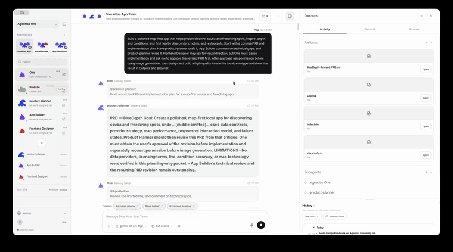
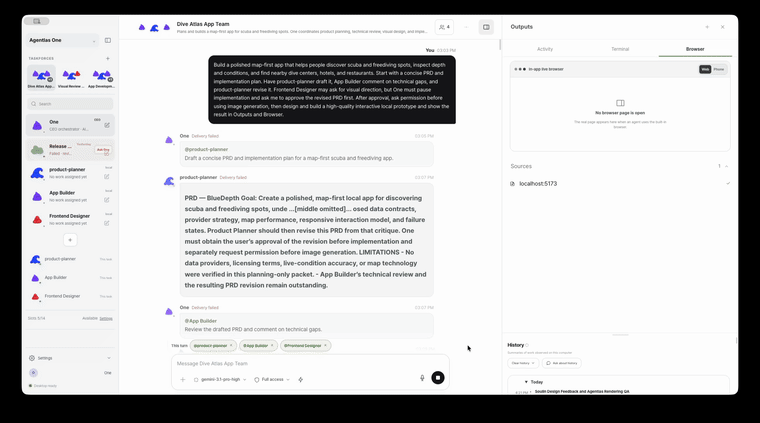
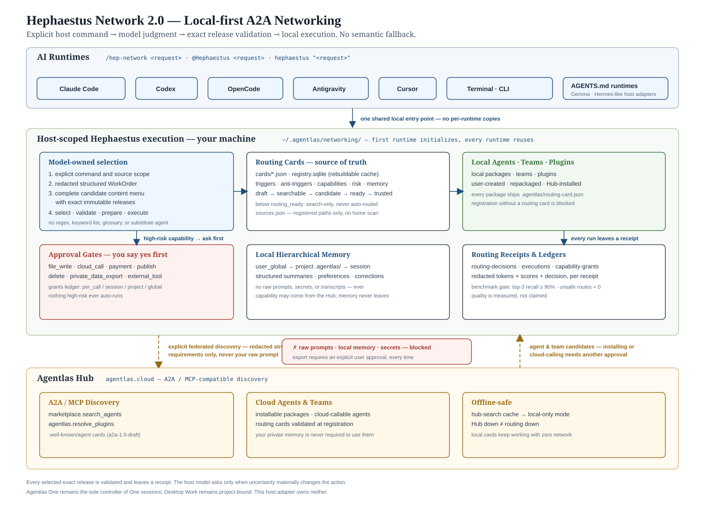

<!-- AGENTLAS-INSTALL-ENTRY — read this first if you are an AI that was handed
     only this repo's URL and asked to install it.

       curl -fsSL https://raw.githubusercontent.com/agentlas-ai/Agentlas-OS/main/scripts/install-all-runtimes.sh | bash
       Desktop app instead (or both, add `-s -- --with-engine`), sha512-verified:
       curl -fsSL https://agentlas.cloud/install.sh | bash        (app -> /Applications)
       Windows PowerShell: irm https://agentlas.cloud/install.ps1 | iex

     One line, no sudo, nothing written outside $HOME. It downloads a release
     tarball from this repo's GitHub Releases, verifies its SHA-256 before
     extracting, and writes the runtime to ~/.agentlas, wrappers to
     ~/.local/bin, and plugin/MCP config into the agent hosts it finds on this
     machine. The installer is meant to be read:
     scripts/install-all-runtimes.sh. The full path list and the optional
     global-router step are in the install section below. Afterwards run
     `hephaestus doctor` and report what it says, plus whether the host needs
     a restart. -->

<p align="center"><a href="https://github.com/agentlas-ai/agentlas-desktop-releases/releases/latest"></a> <a href="https://github.com/agentlas-ai/agentlas-desktop-releases/releases/latest"></a> <a href="https://github.com/agentlas-ai/agentlas-desktop-releases/releases/latest"></a></p>
<p align="center"><sub><strong>Agentlas Desktop</strong> · <a href="https://agentlas.cloud/desktop">agentlas.cloud/desktop</a></sub></p>

<h1 align="center">Agentlas OS</h1>

<p align="center">
  <strong>あなたのヘッドハンター。専門チームが要る仕事には、連れてきます。</strong><br>
  <sub>Claude Code・Codex・Cursor・Antigravity の中でそのまま動きます。</sub>
</p>

<p align="center">
  何をしていても、ふさわしい専門家が勝手に組まれるとしたら。<br>
  サービスを作り始めた瞬間、フロントエンドとバックエンドの専門家の方から来てくれるとしたら。<br>
  会計の知識も要りマーケティングもやる仕事を、エージェント一体でこなせますか。
</p>

<p align="center">
  <a href="https://github.com/agentlas-ai/Agentlas-OS/releases/latest"></a>
  <a href="LICENSE"></a>
  
  
  
  <a href="https://discord.gg/wbWfdGZ6S"></a>
</p>
<p align="center">
  <a href="README.md">English</a> ·
  <a href="README.ko.md">한국어</a> ·
  <a href="README.zh-CN.md">中文</a> ·
  <a href="README.ja.md">日本語</a> ·
  <a href="README.hi.md">हिन्दी</a>
</p>

**Agentlas Hub は無料のエージェントコミュニティです。**公開エージェントの公開・呼び出しに価格設定、リース、Agentlas クレジットの購入は不要です。呼び出し側が自分のモデルと API を使用し、サブスクリプションは Agentlas のソフトウェアとホスト機能を対象とします。新しい Hub 活動のクリエイター精算は終了し、既存残高と過去の請求は適用されるアカウント規約に従います。

### インストール

**Agentlas OS** — このマシンの Claude Code、Codex、Antigravity、Cursor などのホストに入れます。<code>sudo</code> 不要、<code>$HOME</code> の外には何も書きません。インストール後はエージェントホストを再起動し、<code>hephaestus doctor</code> を実行してください。

```bash
curl -fsSL https://raw.githubusercontent.com/agentlas-ai/Agentlas-OS/main/scripts/install-all-runtimes.sh | bash
```

**Agentlas Desktop** — ターミナルよりウィンドウがよければ、このアプリを。

```bash
curl -fsSL https://agentlas.cloud/install.sh | bash        # macOS · Linux
```

```powershell
irm https://agentlas.cloud/install.ps1 | iex               # Windows PowerShell
```

<p align="center"><sub>最新の署名済みリリースを取得し sha512 を確認してから、<code>sudo</code> や管理者権限なしでインストールします · <a href="https://github.com/agentlas-ai/agentlas-desktop-releases/releases/latest">手動でダウンロード</a> · <a href="https://github.com/agentlas-ai/agentlas-desktop">Agentlas Desktop はオープンソースです — リポジトリを見る</a></sub></p>

<details>
<summary><strong>Desktop と Agentlas OS を一緒に</strong></summary>

```bash
curl -fsSL https://agentlas.cloud/install.sh | bash -s -- --with-engine
```

```powershell
$env:AGENTLAS_WITH_ENGINE="1"; irm https://agentlas.cloud/install.ps1 | iex
```

</details>

---

## どのプラットフォームにもできないこと

数百、数千のエージェントを効率よくルーティングできるエージェントプラットフォームは存在しません。どんな仕事にも各分野の専門家を**最小のトークンで**チームとして配置できるのは Agentlas だけです。

エージェントの規格と、エージェントを呼ぶプロトコルの両方を標準化したから成り立ちます。

- **A2A v1.0 をそのまま。** エージェントカードは標準パス `/.well-known/agent-card.json` で読み書きします。インポート、エクスポート、呼び出し側の検証がすべて標準の上にあります。外部エージェントは能力が整合し、**かつ署名済みカードで身元が確認された**ときだけ呼べます。
- **1 タスク・候補 20 件：40,873B → 10,087B。** 候補を減らしたのではなく、行を圧縮しています。正解が名簿に載る確率はそのままで、トークンだけが 4 分の 1 になります。
- **ローカルプロファイル 849 件**、**公開リスト 188 件**の規模で計測した値です。

## ほとんどのツールはここで止まります

|  | タスク分割なし | タスク分割あり |
| --- | --- | --- |
| **専門家の調達なし** | チャット一つが丸ごと処理 | 同じモデル、プロンプトだけ差し替え |
| **専門家の調達あり** | ストアから一つ選んで使う | **Agentlas** |

タスクを分けてくれるツールはあります。しかし分かれたタスクを受け持つのは、同じモデルにプロンプトを変えただけのものです。専門家を売る場所もあります。しかしそこには分割がありません。一つ選んで使うだけです。

**他所で分かれたタスクは、あなたが書いたプロンプトです。ここでは求人票です。**
タスク一つひとつが、あなたのマシン、あなたのプライベートクラウド、公開 Hub の三か所に同時に出ます。

---

## 三つのステップ

<table>
<tr>
<td width="44%" valign="middle">

### 1. タスク分割

一文を入れるとタスクが出てきます。役割、引き継ぐ順序、それぞれが出すべき成果物まで。

レビューが前のタスクへ戻る組織図は**実行前に差し戻され**、どこで回っているかを名前で教えます。

</td>
<td width="56%">
  <a href="https://agentlas.cloud/desktop"></a>
</td>
</tr>
<tr>
<td width="44%" valign="middle">

### 2. エージェント配置

タスクごとに候補が返ります。あなたのマシン、あなたのクラウド、公開 Hub から一度に。

**名簿に順位はありません。** 選ぶのはあなたのモデルで、理由が記録されます。

資格は `declared`・`checked`・`demonstrated`・`attested` の四段階で、タスクごとに下限を課せます。選んだ瞬間そのリリースはダイジェストで固定され、翌日 1 バイトでも違えば実行が止まります。

</td>
<td width="56%">
  <a href="https://agentlas.cloud/desktop"></a>
</td>
</tr>
<tr>
<td width="44%" valign="middle">

### 3. 実行と検証

計画、作業、統合、検証がそれぞれ別の呼び出しとして走ります。

**独立した検証者が通して初めて完了です。** すべての呼び出し、すべての引き継ぎ、統合がレシートで証明されなければなりません。そうでなければ止まった場所を名前で返します — `prepared`、`blocked`、`source_unavailable`。

</td>
<td width="56%">
  <a href="https://agentlas.cloud/desktop"></a>
</td>
</tr>
</table>

---

## 専門家を自分でつくる

リストに合う人がいなければ、つくればいい。`/hep-build` は一文を持ち運べるシングルエージェントまたはチームに変えます。結果を変える質問だけを尋ね、パッケージを書き、完了と言う前に契約チェックを走らせます。`/hep-build session` は、いま進めている会話から同じことをします。

```text
/hep-build an agent that reviews App Store replies before they go out
/hep-build session
```

どのビルドも入力・出力スキーマ、ルーティングカード、そして後述のパッケージ契約の残りを一緒に出します。必須ファイルが一つでも欠けたビルドは、出荷されずに失敗します。`/hep-upload` で非公開の Agent Cloud に置くか無料の Hub に公開すれば、`/hep-network` がほかの候補と同じように配置できます。

---

## たぶん気になること

<details open>
<summary><strong>結局そちらが薦めてくるのでは？</strong></summary>

<br>

エージェントを売る場所はどこも順位をつけます。それが稼ぎ方だからです。人は上にあるものを押し、誰が上に来るかはその会社が決めます。

私たちは順位を作りません。スキーマが `allowHistoryEvidence` を定数 `false` で固定しており、スコア付きの名簿を返すソースは**応答ごと拒否**されます。

評価、インストール数、先月の販売数 — どれも読みません。候補はそのまま渡され、選ぶのはあなたのモデルです。

</details>

<details>
<summary><strong>開発者だけのものですか？</strong></summary>

<br>

いいえ。役割オントロジーには、バックエンド・セキュリティ・QA と並んで**保険数理士、M&A デューデリジェンス責任者、引受デューデリジェンス専門家、旅行プランナー**がいます。

保険だけで領域が四つあります。リストにない領域も塞ぎません。

</details>

---

## 自分たちの案を入れて、そして外しました

発行者自身が書いた「こういうときに呼んで」という文をランキング信号に入れてみました。正解が 1 位に来る割合が **73.1% から 57.0% へ下がりました**。外しました。今その文は名簿末尾の三席を予約するだけです。順位を変える権限ではなく、消されない権利だけ。

日本語で尋ねると正解のエージェントは **144 位**でした。同じ問いを英語にすると **1 位**。だからワークオーダーは英語で書き、成果物の言語は別のフィールドで受け取ります。

候補を 10、20、30、50 件見せたとき、正解が名簿に入る割合は **73、83、87、93%** でした。既定値は 30 です。

---

## Agentlas Desktop では

Desktop はホストそのものなので、実行が始まる**前に**コードが決めます。一人で足りる仕事か、チームが要る仕事か。その判断は提案ではなく、予約された実行として記録されます。インストール済みのエージェントに加え、公開 Hub のエージェントも配置できます。公開 Hub のエージェント呼び出しに Agentlas の料金はかかりませんが、選択したホストやモデル・API プロバイダの料金が別途発生する場合があります。

| サーフェス | 役割 |
| --- | --- |
| **Agentlas OS (Hephaestus)** | このリポジトリ — CLI ホスト向けのオープンソースのビルド・ルーティングエンジンとコマンドサーフェス |
| **Agentlas Desktop** | 同じエンジンをウィンドウで動かすアプリ（macOS · Windows · Linux） |
| **Agentlas Hub** | エージェントを無料で公開・発見・利用できる公開スペース |
| **Agentlas Cloud** | 自分のエージェントを非公開で保管し、再び取り出すための所有者専用ストア |

---

## インストール：すべての方法と、何をどこに書くか

今使っている LLM、たとえば Claude Code、Codex、Antigravity、Cursor に貼り付けてください:

```text
この GitHub リポジトリから Hephaestus をインストールしてください:
https://github.com/agentlas-ai/Agentlas-OS

marketplace plugin だけをインストールして終了せず、次の session にも残る
host command adapters まで書き込む公式 one-touch installer を実行してください:
curl -fsSL https://raw.githubusercontent.com/agentlas-ai/Agentlas-OS/main/scripts/install-all-runtimes.sh | bash

installer 自身の検証出力を報告してください。次の session で `/agentlas build`
（またはその host に対応する command surface）が使えない場合は install 完了と
報告せず、使えることを確認したら host の再起動または plugin の再読み込みを
案内してください。
```

すでに使っている LLM の中で Hephaestus をすぐ有効化したいときに使ってください。
shell で手動インストールする場合は、下の全インストール方法を参照してください。

<p align="center">
  
</p>

<p align="center">
  <sub>ハブから呼び出された専門エージェントが臨時タスクフォースとして編成され、MCP 経由でリアルタイムにルーティングされます — タスクごとのエージェント設定は不要です。</sub>
</p>

<p align="center">
  <a href="#エージェント-os-の時代">エージェント OS の時代</a>
  ·
  <a href="#貼り付けてインストール">貼り付けてインストール</a>
  ·
  <a href="#すべてのインストール方法">すべてのインストール方法</a>
  ·
  <a href="#コマンドサーフェス">コマンドサーフェス</a>
  ·
  <a href="#v110-の新機能--briefing-interview-engine">v1.1.0 の新機能</a>
  ·
  <a href="#os-サブシステム">サブシステム</a>
  ·
  <a href="#エンタープライズのための設計">エンタープライズ運用</a>
  ·
  <a href="#生成される成果物プロセスパッケージング">システムパッケージング</a>
  ·
  <a href="#目的別ドキュメント">ドキュメント一覧</a>
</p>

---


<details>
<summary><strong>すべてのインストール方法 — ソース・オフライン・ホスト別</strong></summary>


### 手動 LLM Adapter インストール

現在の LLM が自分で setup を実行できない場合だけ使ってください。共有 Hephaestus
runner と、対応 LLM tools 向けの command adapters をインストールします。

```bash
xcode-select --install   # Command line tools (skip if already installed)
git --version            # Confirm git is available
curl -fsSL https://raw.githubusercontent.com/agentlas-ai/Agentlas-OS/main/scripts/install-all-runtimes.sh | bash
```
これにより、ニュートラルランナーが `~/.agentlas/runtime/current/bin/hephaestus` にインストールされ、Claude Code、Codex、Antigravity、Cursor、OpenCode、OpenClaw、Hermes、Kimi Code CLI、goose、GitHub Copilot CLI 用のコマンド・スキル・MCP アダプターと、Grok 用のメモリフックが登録されます。ローカルモデルは MCP エントリポイント `hephaestus mcp serve` を使います。インストーラーは、登録後に各ランタイムサーフェスを検証します。

### ランタイム別プラグインドライバー

<details>
<summary>Claude Code プラグイン</summary>

OS のターミナルから:
```bash
claude plugin marketplace add https://github.com/agentlas-ai/Agentlas-OS --sparse .claude-plugin claude/plugins
claude plugin install hephaestus@agentlas-core-engine
```
*注: Claude Code の marketplace plugin command には常に namespace が
付くため、この plugin-only の経路では `/hephaestus:agentlas` を使います。
新しい session ごとに文書どおりの bare `/agentlas build` 補完を使うには、上の
one-touch installer を使用してください。これは
`~/.claude/commands/agentlas.md` も書き込みます。Claude Code は
`claude plugins ...` もサポートしますが、この README では単数形の
`claude plugin ...` を使用します。*

</details>

<details>
<summary>Codex プラグイン</summary>

OS のターミナルから:
```bash
codex plugin marketplace add agentlas-ai/Agentlas-OS --ref v1.2.66
codex plugin add hephaestus@agentlas-core-engine
```
*注: Codex アプリ内では `/plugin marketplace add` は利用できません。上記の 2 つのコマンドを OS のターミナルで実行してください。OS ターミナルの CLI コマンドは単数形（`codex plugin`）ですが、Codex アプリ内のプラグインブラウザーのスラッシュコマンドは複数形（`/plugins`）です。Codex 0.117+ ではカスタム `/prompts:*` コマンドが廃止されたため、インストール後は `$hephaestus-network <request>` でプラグインスキルを呼び出します。*

</details>

<details>
<summary>プロジェクトにファイルをコピー（手動ドライバー）</summary>

リポジトリをクローンし、`AGENTS.md`、`agent.md`、`agents/`、`skills/`、`modes/`、`schemas/`、`templates/`、`.agentlas/` をワークスペースにコピーします。ランタイムフォルダー（`.claude/`、`codex/`、`antigravity/`、`.agents/`）は、同一の正準コアに対するアダプターとして機能します。

</details>

**話しかけるだけ:** インストール後は、ネイティブ Agentlas インターフェース内で平易な自然言語で話しかければ、タスクは自動的にルーティングされます。外部 LLM tools では、以下に示す明示的なコマンドを使用してください。どのようなエージェントが存在するのか分からないときは、まず `/agentlas search` から始めてください。

---

</details>


<details>
<summary><strong>コマンドサーフェス — すべてのコマンド</strong></summary>


ネイティブ Agentlas 環境内では、Hephaestus はコマンドレスで動作します。外部 LLM tools では、意図的に小さく保たれた可視コマンドセットを使用します。これらはエージェントを作り、そのエージェントで仕事を配置するためのコマンドです:

| システムサブシステム | シェルコマンド | 例 |
| :--- | :--- | :--- |
| **プロセスビルダー** | `/agentlas build` | `/agentlas build create a customer support agent for Shopify refunds` |
| **Workforce 連合（Local + Cloud + Hub）** | `/agentlas network` | `/agentlas network split this launch plan into research, copy, QA, and release agents` |
| **登録済み Local エージェントのみ** | `/agentlas local` | `/agentlas local use only agents registered on this machine` |
| **所有する Cloud エージェントのみ** | `/agentlas cloud` | `/agentlas cloud use my saved finance analyst agent to review this report` |
| **公開 Hub エージェントのみ** | `/agentlas hub` | `/agentlas hub find public specialists for accessibility QA` |
| **ディレクトリ検索** | `/agentlas search` | `/agentlas search find agents for a market report workflow` |
| **プロセス間呼び出し（IPC）** | `/agentlas call` | `/agentlas call market-researcher, report-writer {draft a market report}` |
| **パッケージエクスポーター** | `/agentlas upload` | `/agentlas upload ./agents/customer-support-hq` |

各コマンドは元の名前 `/hep-*` でもそのまま動作します。`/agentlas network` と
`/hep-network` は同じコマンドです。名前を削除したわけではないので、既存の
スクリプトやメモ、慣れた操作はそのまま使えます。


---

</details>


<details>
<summary><strong>さらに深く — ビルドファクトリーとルーティングスケジューラ</strong></summary>


### Meta-Agent Factory — プロセス生成
4 つのビルダーを用いる統合コンパイルファクトリーです。生成されるすべてのパッケージはグローバルコマンド（`.agentlas/global-commands.json`）を登録し、検証スクリプトを同梱します — コンパイル済みパッケージの実行方法をユーザーが推測する必要は一切ありません:

| コンパイルモード | ルーティング先 | 出力アーティファクト |
| :--- | :--- | :--- |
| **シングルエージェント** | `10-single-agent-builder` | ローカライズされたスキル、メモリコントラクト、ランタイムアダプターを備えたスタンドアロンワーカー。 |
| **マルチエージェントチーム** | `20-multi-agent-team-builder` | PM Orchestrator、Memory Curator、Policy Gate、QA、検証スクリプトを含む階層型チーム。 |
| **ワークスペースパッケージャー** | `30-agentlas-packager` | ランタイムへのインポート、CLI 実行、GitHub 配布に対応したコンパイル済みバンドル。 |
| **セッションエージェントビルダー** | `40-session-agent-builder` | 現在の会話（ヘッドレス実行では明示的な JSON/JSONL エクスポート）を、オーナーがレビューしたエージェントに変換します。既定はシングルエージェントで、チームは選んだ場合のみです。 |

*Briefing Interview Gate:* ビルダーは **briefing interview gate**を用いてプロセスを開始します: レンズ駆動の質問を行い、曖昧さのしきい値を評価し、一次情報源を検索し、Work Brief を出力します。

---

### Network 2.0 — スケジューラー

<p align="center">
  
</p>

<sub>図 2. A2A スケジューリング: LLM ランタイム、ローカルファーストのオーケストレーター、ルーティングカード、ローカルメモリ、そして Agentlas Hub の A2A/MCP フォールバック。</sub>

*   **型付きジョブ分析:** アクティブなホスト LLM が、役割、スキル、ツール、成果物、権限、人数、ハンドオフを明示した秘匿化済み `WorkOrder` を作成します。Core は部分文字列リストから人員需要を推測しません。
*   **厳密なソース連合:** `local`、`cloud`、`hub` は厳密な単一スコープで、`network` はその封印された和集合です。各ソースは上限付きの content-only メニューを返し、Core は失敗したソースを別スコープで密かに代替しません。
*   **ホスト所有のタスクフォース:** ホスト LLM が適格性の根拠を読み、正確な `Selection` を作成します。Core は決定論的な勝者選択や隠れた Router Agent 再ランキングを行わず、ガバナンス、プライバシー、ID、人数、グラフ整合性だけを検証します。
*   **固定された実行:** 検証後、Core は元のソースセッションから選択済みの不変リリースだけを取得し、リリース、パッケージ、コンテンツのダイジェストを検証してから、プランナー、ワーカー、統合、検証を個別の呼び出しで実行します。
*   **証拠ベースの評価:** 検索カバレッジ、ホスト選択、不変な準備、実際の子呼び出し、最終検証を別々の主張として評価します。ベンチマークや利用履歴がホストの人員配置判断に置き換わることはありません。


---

</details>


<details>
<summary><strong>生成される成果物 — プロセスパッケージング</strong></summary>


Hephaestus は、任意のワークスペースランタイムがパース・インストール・検証・実行できる標準ディレクトリレイアウトへエージェントをパッケージします。以下のレイアウトは `package-contract.json` が要求し、`hephaestus contract verify` が検査するものです:

```text
├── AGENTS.md                         # Package entry: name, purpose, canonical command, roles
├── agent.md                          # Primary instructions: role, steps, output contract
├── agentlas.json                     # Manifest: permissions, memory policy, read allow/deny lists
├── agents/<role>/agent.md            # Team only: one folder per worker
├── A2A/agent-card.a2a.json           # A2A Agent Card projected from the two cards below
├── .agentlas/
│   ├── agent-card.json               # Identity: name, slug, summary, capabilities, entrypoints
│   ├── routing-card.json             # Triggers and anti-triggers (ko + en), risk, memory behavior
│   ├── build-profile.json            # Fail-closed build readiness profile
│   ├── memory-map.json               # Memory ownership map
│   ├── global-commands.json          # Per-runtime slash command adapters
│   ├── mcp-policy.json               # What the machine must provide, and what happens without it
│   ├── skill-registry.json           # Skill inventory (may be empty)
│   ├── memory-tickets.jsonl          # Candidate memory events before curator promotion
│   ├── capability-eval-plan.json     # Positive/negative eval prompts with pass criteria
│   ├── routing-benchmarks.jsonl      # At least 10 route/reject cases, ko + en
│   ├── work-brief.json               # Interview-derived goal, constraints, decisions
│   ├── company-blueprint.json        # Team only: orchestrator, nodes, edges
│   ├── sitemap.json                  # Team only: what each task produces and consumes
│   └── brief.json                    # agentlas.brief/1 resume, compiled at upload
├── contracts/                        # intake.schema.json, output.schema.json, output.example.json
├── docs/                             # Builder interview, research sources, tool selection,
│                                     #   domain synthesis, prompt performance contract
├── tools/requirements.yaml           # Projected from mcp-policy.json + agentlas.json
├── permissions/policy.yaml           # Projected shell/network/file/payment whitelist
├── hooks/                            # memory-upgrade.yaml, on_stop.yaml — declared, host-enforced
├── evals/README.md                   # Points at the eval plan and routing benchmarks
└── .claude/skills/<name>/SKILL.md    # Skills, when the package carries any
```

`docs/`、評価計画、作業ブリーフを省略できるのは、ユーザーが確認した最小限のプライベートビルドだけです。`provenance.json`、`knowledge/`、`schemas/`、`sandbox/`、`examples/` は任意です。

---

</details>

## 目的別ドキュメント

| システム上の目的 | 参照ドキュメント |
|---|---|
| 正準ルートを理解する | [`AGENTS.md`](AGENTS.md) |
| チームコントラクト全体を見る | [`agent.md`](agent.md) |
| パッケージ契約 | [`package-contract.json`](package-contract.json) |
| セッションビルド | [`contracts/session-build.md`](contracts/session-build.md) |
| ルーティングカード | [`schemas/routing-card.schema.json`](schemas/routing-card.schema.json) |
| Workforce 作業指示書 | [`schemas/workforce-work-order.schema.json`](schemas/workforce-work-order.schema.json) |
| コンパイル済みブリーフ | [`schemas/agentlas-brief.schema.json`](schemas/agentlas-brief.schema.json) |

---

## 公開セーフティ境界

このリポジトリには、Agentlas の課金/アカウントロジック、本番クラウド認証情報、顧客データベース、生のプライベートトランスクリプト、ネイティブのキーチェーンマネージャー、プライベートなデプロイスクリプトは**含まれていません**。

Hephaestus がコンパイルする公開向けの出力パッケージは、ローカルの絶対パス、API キー、サービスアカウントキー、`.env` シークレット、生のトランスクリプト、顧客ログ、開発者のプライベートノートを除外しなければなりません。

---

## ライセンス

Apache-2.0 です。[LICENSE](LICENSE) を参照してください。
