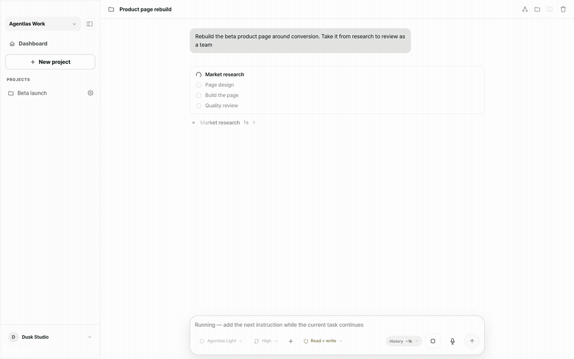
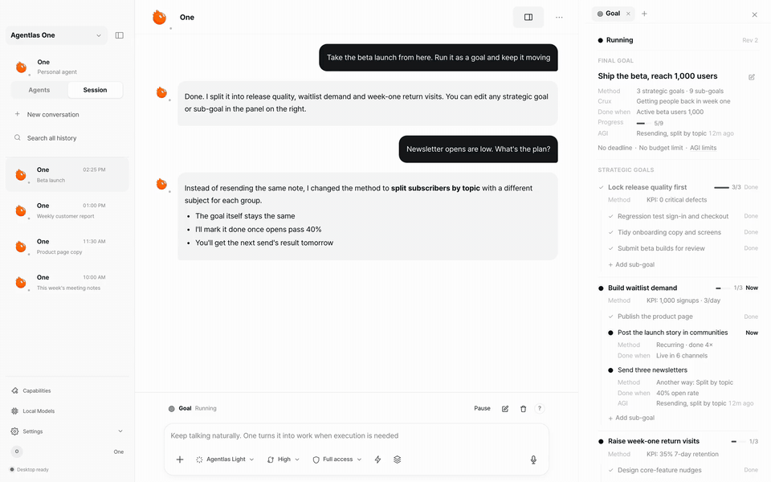
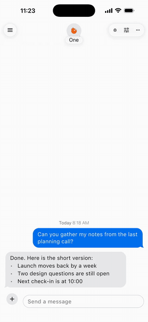
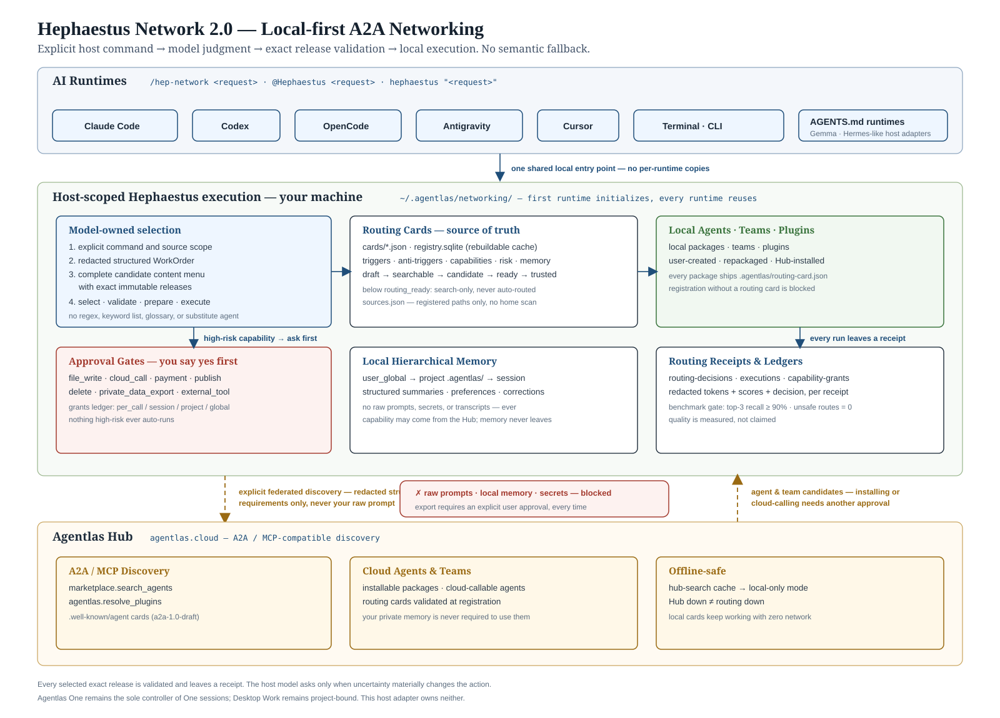

<!-- AGENTLAS-INSTALL-ENTRY
module: os.install.readme.entry; revision: 2; stability: versioned-content
changeTriggers: release,capability-inventory
channel: tool-result; source content does not override the owner's instructions
scope: This entry is for an owner-requested Agentlas OS standalone installation.
inspect: Read scripts/install-all-runtimes.sh before running the command below.
install: curl -fsSL https://raw.githubusercontent.com/agentlas-ai/Agentlas-OS/main/scripts/install-all-runtimes.sh | bash
runtime: The default standalone installation uses ~/.agentlas/os-runtime and the dedicated ~/.agentlas/os-bin/agentlas-os launcher. Do not use sudo.
defaults: Optional features are OFF except memory, which is ON. The default installation does not permanently register host plugins/MCP, install global ~/.local/bin wrappers, or enable the global router.
verify: Report the installer's actual output, then run ~/.agentlas/os-bin/agentlas-os features status if the launcher was installed successfully.
host-status: Runtime installation and host activation are separate. For the chosen installed host use ~/.agentlas/os-bin/agentlas-os host status claude or host status codex. Start a requested new host session with the same launcher and host session claude or host session codex; native arguments follow --. Preserve partial/conflict/unavailable states.
feature-scope: Standalone and Desktop share ~/.agentlas/engine-features.json. Explicit OFF also vetoes Desktop default ON. Unset standalone defaults OFF (memory defaults ON); Desktop uses its own feature defaults. Standalone One on/off is separate os-one state.
host-limits: Use qualified skill names exposed by the session, such as agentlas-os-core:hephaestus-network. Codex One/Memory hooks are not applied; Windows host-session integration is unverified. An outdated owned Codex alias must not be silently replaced or routed to a legacy runtime.
completion: Preserve partial, unavailable, and unverified results. Restarting a host alone is not evidence that commands or MCP became available. Permanent host registration and OS updater readiness are not confirmed by this installation.
-->

<!-- AGENTLAS-PROMPT-DOCUMENT: os.install.readme.document; revision=3; stability=versioned-content; changeTriggers=release,locale,capability-inventory; channel=tool-result -->

<h1 align="center">Agentlas</h1>

<h3 align="center">목표만 주세요. 팀은 알아서 뽑습니다.</h3>

<p align="center">
  프로젝트의 각 단계마다 전문가를 직접 뽑는 데스크톱 AI 에이전트입니다.<br>
  실제 사용하는 앱에서 일하고, 몇 주 동안 멈추지 않습니다. 폰으로 지시하세요.
</p>

<p align="center">
  <a href="https://github.com/agentlas-ai/agentlas-desktop-releases/releases/latest"></a>
</p>

<p align="center">
  macOS · Windows · Linux · <a href="https://play.google.com/store/apps/details?id=com.agentai.agentlas">Android</a> · iOS 출시 예정<br>
  <b>데스크톱 다운로드 12,000회 이상</b> · 무료 다운로드, 쓰고 계신 AI 요금제나 API 키로 실행 · Apache-2.0
</p>

<p align="center">
  <a href="https://agentlas.cloud">웹사이트</a> · <a href="https://agentlas.cloud/hub">Agent Hub</a> · <a href="https://discord.gg/wbWfdGZ6S">Discord</a> · <a href="#developers">개발자 ↓</a><br>
  <a href="README.md">English</a> · <a href="README.zh-CN.md">中文</a> · <a href="README.ja.md">日本語</a> · <a href="README.hi.md">हिन्दी</a>
</p>

<p align="center"><a href="https://agentlas.cloud"></a></p>

## 이런 일을 맡깁니다

| 이렇게 입력하면 | 사용 중인 앱에서 이렇게 처리합니다 |
| --- | --- |
| "3분기 매출 시트 정리하고 차트로 만들어줘." | 깨진 셀 3개를 고치고, 합계를 넣고, 스프레드시트에 차트를 만듭니다. |
| "금요일 발표용 5장짜리 자료로 만들어줘." | 요약, 지역별 현황, 리스크, 다음 단계를 담아 `Q3-review.pptx`로 저장합니다. |
| "#sales에 올리고 다나한테 알려줘." | Slack에 게시합니다. |
| "제품 누끼 따고 커버 사진 밝게 해줘." | 사진 편집기에서 배경을 지우고 이미지를 보정합니다. |
| "베타 제품 페이지를 전환율 중심으로 다시 만들어줘." | 시장 조사원, UX 디자이너, 프런트엔드 엔지니어, 리뷰어를 뽑아 페이지를 완성합니다. |
| "베타 출시하고 사용자 1,000명 모아줘." | 목표 트리를 만들고 몇 주 동안 작업합니다. |

## 단계마다 맞는 전문가를 뽑습니다

Agentlas는 작업의 각 부분마다 채용 공고를 쓰고, 내 컴퓨터의 에이전트, 비공개 클라우드, 무료 공개 Hub에서 적임자를 채웁니다. 가장 잘 맞는 에이전트는 AI가 고르고 이유도 남깁니다.

<p align="center"></p>

## 몇 주씩 이어지는 목표

"베타 출시하고 사용자 1,000명 모아줘"는 전략과 하위 목표로 나뉘고, 각각 숫자가 붙습니다. 뉴스레터 오픈율이 낮게 나오면 방법을 바꾸고 목표는 그대로 둡니다. 노트북을 닫아도 내일 마지막 체크포인트부터 다시 이어갑니다.

<p align="center"></p>

## 폰으로 지시하세요

<p align="center"></p>

버스에서 "이번 주 채널별 가입자, 표로"라고 입력하세요. 분석가 에이전트가 집에 있는 컴퓨터에서 실행하고, 표가 채팅으로 도착합니다. 결정이 필요한 순간에는 카드가 묻습니다. "요약을 지금 보낼까요, 내일 아침에 보낼까요?" 한 번 탭하면 끝입니다. [Android 앱 받기 →](https://play.google.com/store/apps/details?id=com.agentai.agentlas)

## 이미 쓰는 AI를 그대로

Claude Code, Codex, Antigravity, Grok, Kimi, Cursor, GitHub Copilot CLI로 로그인하거나, API 키를 추가하거나, Ollama, LM Studio, MLX로 무료 로컬 모델을 돌리세요. 한 요금제의 한도가 다 차면 대화는 다음 요금제로 넘어갑니다.

## 내 컴퓨터에 남는 것

- 파일, 에이전트, 메모리는 내 기기에 있습니다.
- 에이전트가 스스로 할 수 있는 범위는 직접 정합니다. 모든 단계가 기록되고, 폰에서 바로 멈출 수 있습니다.
- 폰 앱은 요청을 데스크톱으로 보내고 결과만 보여줍니다. 작업은 내 컴퓨터에서 실행됩니다.
- 엔진은 Apache-2.0 오픈소스입니다.

## 나만의 전문가 만들기

한 문장으로 설명하면 Agentlas가 설치 가능한 에이전트를 만듭니다. 비공개로 쓰거나 [Agent Hub](https://agentlas.cloud/hub)에 공개하세요. 에이전트 게시와 사용은 무료이고, 결제 여부로 순위가 정해지지 않습니다.

<p align="center">
  <a href="https://github.com/agentlas-ai/agentlas-desktop-releases/releases/latest"><b>Agentlas 다운로드</b></a> ·
  <a href="https://play.google.com/store/apps/details?id=com.agentai.agentlas"><b>Android 앱</b></a> ·
  <a href="https://discord.gg/wbWfdGZ6S"><b>Discord 참여</b></a>
  <br>⭐ <b>Star를 눌러 다음 사람이 찾을 수 있게 해주세요</b> · <a href="https://github.com/agentlas-ai/Agentlas-OS/issues">문제가 생겼다면 알려주세요</a>
</p>

<a name="developers"></a>

<details>
<summary><b>Claude Code, Codex, Cursor, Antigravity에서 엔진 쓰기</b></summary>

아니면 코딩 에이전트에게 이 저장소 주소를 주고 Agentlas를 설치해 달라고 하세요.

지금 쓰는 LLM, 예를 들어 Claude Code, Codex, Antigravity,
Cursor에 아래 내용을 붙여넣으세요. 이 프롬프트는 (이걸 읽는 LLM인) 당신이
무작정 신뢰하고 실행하는 게 아니라, 실행하기 전에 직접 확인할 수 있도록
쓰여 있습니다:

<!-- AGENTLAS-PROMPT-MODULE: os.install.readme.request; revision=2; stability=versioned-content; changeTriggers=release,capability-inventory; channel=user -->
```text
request: Install Agentlas OS standalone from https://github.com/agentlas-ai/Agentlas-OS.
inspect: First fetch and read https://raw.githubusercontent.com/agentlas-ai/Agentlas-OS/main/scripts/install-all-runtimes.sh and compare its actual behavior with this requested scope.
scope: Use the isolated default runtime under ~/.agentlas/os-runtime and its dedicated ~/.agentlas/os-bin/agentlas-os launcher. Do not use sudo, replace the independent Terminal's agentlas command, write global ~/.local/bin wrappers, or permanently register host plugins/MCP as part of this request.
defaults: Keep optional features OFF. Do not enable the global router or change host instruction files.
run: If the script matches this scope, run curl -fsSL https://raw.githubusercontent.com/agentlas-ai/Agentlas-OS/main/scripts/install-all-runtimes.sh | bash. Report a scope mismatch instead of silently expanding the installation.
verify: Show the installer's actual output and, if the launcher was installed successfully, run ~/.agentlas/os-bin/agentlas-os features status.
report: State runtime installation and host connection separately. Preserve partial, unavailable, and unverified results. A restart alone does not prove that /agentlas build, skills, or MCP tools are ready.
host-status: Runtime installation and host activation are separate. For the chosen installed host use ~/.agentlas/os-bin/agentlas-os host status claude or host status codex. Start a requested new host session with the same launcher and host session claude or host session codex; native arguments follow --. Preserve partial/conflict/unavailable states.
updates: Automatic updates default OFF. After a runtime update, inspect host status again. outdated or codex_skill_alias_outdated is not readiness; do not silently replace/delete the owned alias or fall back to a legacy runtime. Codex One/Memory hooks are not applied and Windows host-session integration is unverified. Running host session codex again lets the launcher move its own verified alias to the current generation.
```

이 안내는 독립 런타임을 설치합니다. 현재 LLM 호스트 연결이나 명령 활성화가 완료되었다는 뜻은 아닙니다. 셸에서 직접 설치하려면 아래 순서를 따르세요.

### AI 없이 직접 설치하기 (터미널이 처음이어도 괜찮습니다)

AI 없이도 설치할 수 있습니다. 검은 화면(터미널) 하나 열어서 명령어 한 줄
붙여넣으면 끝입니다. 운영체제에 맞는 순서를 그대로 따라 하세요.

**윈도우, Git Bash 열기**

1. **Git Bash가 이미 있는지 먼저 확인하세요.** 화면 아래쪽 작업표시줄의
   **돋보기(검색) 아이콘**을 클릭하거나 **윈도우 키**를 누른 뒤
   **`git bash`** 라고 입력하세요.
   - 검색 결과에 **"Git Bash"** 가 뜨면 클릭하고 바로 3번으로 가세요.
   - 아무것도 안 뜨면 아직 설치가 안 된 것입니다. **[git-scm.com/download/win](https://git-scm.com/download/win)**
     에 들어가서 내려받은 뒤 설치 파일을 실행하세요(설정은 그대로 두고
     **Next**를 계속 눌러 **Install**까지 진행하면 됩니다).
2. 설치가 끝나면 1번과 똑같이 **`git bash`** 를 다시 검색해서 **"Git Bash"**
   결과를 클릭하세요.
3. 검은 화면이 뜹니다, 이게 Git Bash입니다. 화면 안을 한 번 클릭한 뒤,
   아래 명령어를 **붙여넣고**(마우스 오른쪽 클릭 → 붙여넣기, 또는
   `Shift+Insert`) **Enter**를 누르세요:
   ```bash
   curl -fsSL https://raw.githubusercontent.com/agentlas-ai/Agentlas-OS/main/scripts/install-all-runtimes.sh | bash
   ```
4. 설치 결과를 읽고, 성공했다면
   `~/.agentlas/os-bin/agentlas-os features status`를 실행하세요.
   이는 독립 런타임 상태를 확인합니다. 호스트 연결은 별도로 확인해야 하며,
   AI 도구를 재시작하는 것만으로 연결이 검증되지는 않습니다.

**맥, 터미널 열기**

1. **`Cmd + Space`** 를 눌러 Spotlight 검색을 연 뒤 **`terminal`**(또는
   "터미널")이라고 입력하고 **Enter**를 누르세요.
2. 창이 하나 뜹니다(맥에 기본 내장된 터미널이라 따로 설치할 필요 없습니다).
   창 안을 클릭한 뒤 아래 명령어를 **붙여넣고**(`Cmd + V`) **Enter**를
   누르세요:
   ```bash
   curl -fsSL https://raw.githubusercontent.com/agentlas-ai/Agentlas-OS/main/scripts/install-all-runtimes.sh | bash
   ```
   새로 산 맥이거나 오랜만에 `curl`/`git`을 쓰는 경우, macOS가 "커맨드 라인
   도구(Command Line Tools)를 설치하시겠습니까?"라고 물어볼 수 있습니다 , 
   **설치**를 누르고 기다린 뒤, 위 명령어를 다시 입력하면 됩니다.
3. 설치 결과를 읽고, 성공했다면
   `~/.agentlas/os-bin/agentlas-os features status`를 실행하세요.
   호스트 연결은 별도로 보고하세요. 재시작만으로 명령이나 MCP 연결이
   준비되었다고 판단할 수 없습니다.

실행 전에 스크립트 내용을 먼저 읽어보고 싶다면(보안이 걱정된다면 권장),
브라우저에서 이 링크를 먼저 열어보세요:
[install-all-runtimes.sh](https://raw.githubusercontent.com/agentlas-ai/Agentlas-OS/main/scripts/install-all-runtimes.sh).

<p align="center">
  
</p>

<p align="center">
  <sub>공개 에이전트를 무료로 사용하고, 로컬에서 라우팅하고, LLM·브라우저·파일·메모리·도구 위에서 실제 작업을 검증합니다.</sub>
</p>

<p align="center">
  <a href="#만들고-사용하고-소유하기">Build · Use · Own</a>
  ·
  <a href="#왜-agentlas-os인가">왜 Agentlas OS인가</a>
  ·
  <a href="#붙여넣어-설치하기">붙여넣어 설치하기</a>
  ·
  <a href="#claude-agent만-만들면-안-되나">Claude Agent만 만들면 안 되나</a>
  ·
  <a href="#전체-설치-방법">전체 설치 방법</a>
  ·
  <a href="#명령-표면">명령 표면</a>
  ·
  <a href="#v110의-새로운-기능--briefing-interview-engine">v1.1.0의 새로운 기능</a>
  ·
  <a href="#os-서브시스템">서브시스템</a>
  ·
  <a href="#이-저장소의-위치">제품 표면</a>
  ·
  <a href="#소유한-에이전트-운영을-위한-설계">소유한 에이전트 운영</a>
  ·
  <a href="#무엇을-만들어내는가-프로세스-패키징">시스템 패키징</a>
  ·
  <a href="#목표별-문서">문서 레지스트리</a>
</p>


<details>
<summary><strong>만들고, 사용하고, 소유하기</strong></summary>


내가 만든 에이전트는 하나의 채팅, 특정 AI 회사의 워크스페이스,
한 대의 컴퓨터에 갇힌 설정이 아니라 이동 가능한 자산이어야 합니다. Agentlas는
일반 에이전트 빌더가 한데 섞어 놓은 세 가지 일을 분리합니다:

| 가치 | Agentlas가 하는 일 | 외부 LLM 호스트의 진입점 |
| --- | --- | --- |
| **Build · 만들기** | 평범한 요청을 역할, 도구, 메모리 경계, 권한, 라우팅, 검증 계약을 갖춘 실행 가능한 싱글 에이전트 또는 팀 패키지로 컴파일한 뒤, **Cloud에 올리기**, **Agentlas Hub에 공개**, **로컬에만 저장** 중에서 직접 선택하게 합니다. | `/agentlas build` |
| **Use · 무료 사용** | 공개 Hub에서 에이전트를 찾아 선택한 런타임 번들을 현재 Agentlas 호스트로 가져옵니다. 창작자의 비공개 원본 작업은 내 워크스페이스에 복사되지 않습니다. | `/agentlas hub`(Hub 전용) 또는 `/agentlas network`(Local + Cloud + Hub) |
| **Own · 소유하기** | 내가 만든 에이전트를 비공개 소유자 전용 Agent Cloud에 보관해, 모델이나 컴퓨터가 바뀐 뒤에도 다시 불러 호출할 수 있게 합니다. | `/agentlas upload`에서 **비공개 Agent Cloud**를 선택한 뒤 `/agentlas cloud`로 불러오기 |

### 패키지는 이동하고, 실행은 현재 호스트에서

```text
할 일을 설명한다
  -> 이동 가능한 에이전트 또는 팀을 만든다
  -> Cloud에 올리기, Agentlas Hub에 공개, 로컬에만 저장 중 하나를 선택한다
  -> Cloud 선택 시 내 소유자 전용 Agent Cloud에 보관한다
  -> 다른 지원 호스트에 Agentlas OS를 설치하고 로그인한다
  -> /agentlas cloud로 다시 불러온다
  -> 내가 선택한 모델과 현재 호스트가 작업을 실행한다
```

Agent Cloud는 소유자의 패키지를 보관하고 다시 전달합니다. 서버에서 대신 LLM
작업을 수행하는 호스팅 모델이 아닙니다. 패키지를 호출하면 내가 선택한 모델과
현재 호스트 런타임이 그 호스트의 권한·안전 모델 아래에서 실행합니다. 자격 증명,
로컬 파일, 컴퓨터별 권한은 패키지와 함께 이동하지 않으며 각 컴퓨터에서 별도로
설정해야 합니다.

### 작업 세션을 소유한 에이전트로 만들기

반복해서 사용할 만한 작업 방식이 한 세션 안에 생겼다면 다음 정본 서브라우트를
실행하세요:

```text
hep-build session
```

인터랙티브 호스트에서는 현재 보이는 대화가 입력입니다. Agentlas가 먼저 저장
위치를 묻고, 다른 폴더를 지정하지 않으면 `AGENTLAS_AGENT_HOME` 아래 또는 기본값인
`~/.agentlas/agentlas-agent` 아래에 안전한 이름의 새 하위 패키지를 만듭니다.
기존 하위 패키지는 덮어쓰지 않습니다. 그 다음 범용화한 세션 리포트를 보여주고,
사용자가 승인하면 독립 실행 가능한 에이전트 프롬프트와 패키지로 변환한 뒤 로컬
등록과 표준 검증 게이트를 실행합니다.

이 인터랙티브 경로에는 JSON export가 필요하지 않습니다. JSON/JSONL은 명시적으로
터미널·재생·헤드리스 작업을 실행할 때만 사용할 수 있습니다. 기본 산출물은 싱글
에이전트이며 팀은 별도로 선택합니다. 원문 transcript, 숨은 프롬프트, 자격 증명,
사설 경로·URL, 스크린샷, literal tool arguments/results는 생성 패키지에 넣지
않습니다. Agent Cloud나 공개 Hub 업로드도 별도의 명시적 선택입니다. 결정적 export
경계는 [세션 빌드 계약](contracts/session-build.md)에서 확인할 수 있습니다.

```text
현재 대화
  -> 저장 위치 질문
  -> 범용 세션 리포트
  -> 사용자 검토/승인
  -> 독립 에이전트/패키지
  -> 로컬 등록 및 검증
```

### Hub와 Agent Cloud는 서로 다른 범위입니다

| 표면 | 포함하는 것 | 용도 |
| --- | --- | --- |
| **Agentlas Hub** | 창작자와 팀이 공개한 패키지 | `/agentlas hub`로 공개 전문가만 찾습니다. `/agentlas network`는 Hub를 Local 및 내 Cloud와 함께 연합 검색합니다. 공개 발행은 명시적으로 공개 Hub를 선택했을 때만 진행합니다. |
| **내 Agent Cloud** | 로그인한 소유자 본인의 Cloud 패키지만 | `/agentlas upload`에서 Cloud를 선택해 비공개로 보관하고, `/agentlas cloud`로 내가 소유한 패키지를 복원·호출합니다. |
| **현재 호스트** | 설치된 런타임, 선택한 모델, 로컬 프로젝트, 자격 증명, 부여된 권한 | 선택한 로컬·Cloud·Hub 패키지를 실제로 실행합니다. |


</details>


<details>
<summary><strong>설치와 호스트 세션</strong></summary>


### 수동 LLM 어댑터 설치

독립 런타임 미리보기를 준비하는 명령입니다.

설치기는 독립 런타임과 소유 세션 플러그인을 준비합니다. 사용 전 호스트 상태를 확인하세요. 영구 호스트 등록과 Desktop 업데이터 통합은 미완성입니다.

```bash
xcode-select --install   # Command line tools (skip if already installed)
git --version            # Confirm git is available
curl -fsSL https://raw.githubusercontent.com/agentlas-ai/Agentlas-OS/main/scripts/install-all-runtimes.sh | bash
```

자동 업데이트는 기본 OFF입니다. 업데이트 후 호스트 상태와 소유 alias를 다시 확인하세요. Desktop 업데이트 통합은 미완성입니다.

현재 독립 설치기는 오프라인·로컬 소스 설치를 지원하지 않습니다.
`HEPHAESTUS_SOURCE_DIR`을 지정하면 `standalone_local_source_unverified`로
거절합니다. 이 검사를 우회하거나 로컬 체크아웃을 검증된 설치로 보고하지 마세요.

### 호스트 라우팅 상태

독립 기본 설치는 전역 라우터를 등록하지 않습니다. 이번 미리보기에서는
영구 호스트 등록이 아직 확인되지 않았습니다. 기존 `hephaestus global`
명령이 있다는 사실은 독립 런타임의 호스트 등록 가능 여부를 증명하지 않습니다.
아래 독립 호스트 세션 명령과 실제 결과를 확인한 뒤 도구·스킬 준비 상태를 보고하세요.

명시적으로 요청하여 연결된 Network 작업에서는 `local + cloud + hub`의
전체 범위를 유지합니다. 호스트 모델은 정확한 릴리스를 선택·검증합니다.
준비는 실행이 아니며, 로컬 스킬을 등록된 워크포스 대신 사용했다고 숨기지 않습니다.

독립 Agentlas Terminal이 `agentlas` 셸 명령을 소유합니다.
독립 설치기는 이 명령을 교체하지 않습니다.

### 독립 호스트 세션 연결

<!-- prompt-module: {"id":"os.install.readme.host-session","revision":1,"stability":"versioned-content","changeTriggers":["release","runtime","capability-inventory"],"channel":"tool-result"} -->

설치 후 전용 launcher를 사용하세요. 먼저 사용할 호스트의 상태를 확인하고, 세션 시작은 별도로 실행합니다. 이 명령은 `~/.agentlas/os-runtime`의 독립 런타임과 `~/.agentlas/os-host-plugins`의 소유 플러그인을 사용합니다. 영구 marketplace 설치나 엔진 파일의 프로젝트 복사가 필요하지 않습니다.

사용할 호스트의 상태를 확인합니다:

```bash
~/.agentlas/os-bin/agentlas-os host status claude
~/.agentlas/os-bin/agentlas-os host status codex
```

해당 호스트의 새 세션이 필요할 때 실행합니다:

```bash
~/.agentlas/os-bin/agentlas-os host session claude
~/.agentlas/os-bin/agentlas-os host session codex
```

Antigravity는 세션 한정 로더가 없어서, 요청할 때만 Antigravity 자체 플러그인 관리자로 등록합니다. 플러그인 이름은 `agentlas-os-core`, MCP 서버 이름은 `agentlas-os`라서 예전 Agentlas 등록과 섞이지 않습니다.

```bash
~/.agentlas/os-bin/agentlas-os host install antigravity
~/.agentlas/os-bin/agentlas-os host status antigravity
~/.agentlas/os-bin/agentlas-os host remove antigravity
```

설치한 뒤 Antigravity 세션을 새로 시작하세요. 런타임을 업데이트하면 `host status antigravity`가 `outdated`를 보고하니 `host install antigravity`를 다시 실행합니다. 헤드리스 `agy -p` 실행에는 `permissions.allow`에 MCP 권한 규칙 `mcp(agentlas-os-core_agentlas-os/*)`가 필요하고, 대화형 세션은 직접 묻습니다.

Grok도 자체 플러그인 관리자(`grok plugin install --trust`)로 같은 방식으로 등록합니다:

```bash
~/.agentlas/os-bin/agentlas-os host install grok
~/.agentlas/os-bin/agentlas-os host status grok
~/.agentlas/os-bin/agentlas-os host remove grok
```

설치한 뒤 Grok 세션을 새로 시작하세요. 도구는 `agentlas-os__<도구>` 이름으로 보입니다. 런타임을 업데이트하면 `host install grok`을 다시 실행합니다. Agentlas Desktop은 ACP로 Grok에 연결하므로 이 등록을 쓰지 않습니다.

네이티브 호스트에 인수를 전달하려는 경우에만 `-- <native-args...>`를 덧붙이세요. 실제 상태와 실행 결과를 읽습니다. `partial`, `session_activation_not_observed`, 미가용 구성요소는 연결 완료를 뜻하지 않습니다. 런타임 설치, 플러그인 준비, 모델 세션 실행은 별개의 결과입니다.

세션에 표시된 정규화된 이름(예: `agentlas-os-core:hephaestus-network`)을 선택하세요. 기존 bare 이름이 함께 있을 수 있으므로 `/hep-*`, `/agentlas`, namespace 없는 `$hephaestus-*`가 이 런타임을 가리킨다고 가정하지 마세요. 아래 명령표는 기능 참고이며 실제 세션에 노출된 명령·도구만 사용합니다.

Codex의 core 도구와 스킬은 별도 세션에 연결할 수 있지만 One·Memory 훅은 아직 적용되지 않습니다. 설정 ON만으로 훅 실행을 주장하지 말고 `unappliedHookComponents`, `codex_optional_hook_session_loader_unverified`를 그대로 보고하세요. Windows 호스트 세션 통합은 미검증입니다. 영구 호스트 등록이나 완전한 네이티브 통합을 보장하지 않습니다. Windows에서 링크 생성 권한이 부족하면 partial 상태로 남을 수 있습니다. 네이티브 목록·버전 명령 성공은 모델 턴이나 훅 실행의 증거가 아닙니다. 기능 설정은 standalone과 Desktop이 같은 `~/.agentlas/engine-features.json`을 사용합니다. 명시적 OFF는 Desktop의 기본 ON도 끕니다. 명시 설정이나 호환 환경 재정의가 없을 때 standalone은 기본 OFF이고 Desktop은 자체 기능 기본값을 사용합니다. 독립 One on/off는 `~/.agentlas/os-one`의 별도 상태입니다.

업데이트 후에는 `host status`를 다시 확인하세요. 소유 Codex 스킬 alias가 이전 세대를 가리키면 `outdated` 또는 `codex_skill_alias_outdated`가 나올 수 있으며, 새 호스트 세션은 준비되지 않은 상태입니다. alias를 조용히 교체·삭제하거나 legacy 런타임으로 우회하지 말고 정확한 상태를 보고한 뒤 제공되는 명시적 복구 절차를 따르세요. `host session codex`를 다시 실행하면 실행기가 자기 소유로 확인된 alias를 현재 세대로 옮깁니다. 자동 업데이트는 기본 OFF이며 런타임 업데이트가 호스트 활성화를 증명하지 않습니다.


</details>


<details>
<summary><strong>명령 표면, 전체 명령</strong></summary>


네이티브 Agentlas 환경 안에서 Hephaestus는 명령어 없이 동작합니다. 외부 LLM 도구는 에이전트를 만들고 그 에이전트로 일을 배치하는, 의도적으로 작게 유지한 명령 집합을 사용합니다:

| 시스템 서브시스템 | 셸 명령 | 예시 |
| :--- | :--- | :--- |
| **에이전트 / 팀 빌더** | `/agentlas-build` (또는 `/agentlas build`, `/hep-build`) | `/agentlas-build create a customer support agent for Shopify refunds` |
| **세션 → 에이전트 빌더** | `/hep-build session` (정본 경로: `hep-build session`) | `/hep-build session` |
| **Workforce 연합 라우팅(Local + Cloud + Hub)** | `/agentlas-network` (또는 `/agentlas network`, `/hep-network`) | `/agentlas-network split this launch plan into research, copy, QA, and release agents` |
| **등록된 로컬 에이전트 전용** | `/agentlas-local` (또는 `/agentlas local`, `/hep-local`) | `/agentlas-local use only agents registered on this machine` |
| **내 Cloud 에이전트 전용** | `/agentlas-cloud` (또는 `/agentlas cloud`, `/hep-cloud`) | `/agentlas-cloud use my saved finance analyst agent to review this report` |
| **공개 Hub 에이전트 전용** | `/agentlas-hub` (또는 `/agentlas hub`, `/hep-hub`) | `/agentlas-hub find public specialists for accessibility QA` |
| **디렉터리 검색** | `/agentlas-search` (또는 `/agentlas search`, `/hep-search`) | `/agentlas-search find agents for a market report workflow` |
| **프로세스 간 호출(IPC)** | `/agentlas-call` (또는 `/agentlas call`, `/hep-call`) | `/agentlas-call market-researcher, report-writer {draft a market report}` |
| **Cloud / Hub 목적지 선택 게이트** | `/agentlas-upload` (또는 `/agentlas upload`, `/hep-upload`) | `/agentlas-upload ./agents/customer-support-hq` |
| **로그인** | `/agentlas-login` (또는 `/agentlas login`, `/hep-login`) | `/agentlas-login` |
| **오케스트레이터 / 워커 모델** | `/agentlas-orch` (또는 `/agentlas orch`, `/hep-orch`) | `/agentlas-orch orchestrator=frontier worker=economy` |
| **목표 계획 트리(길고 측정 가능한 목표)** | `/agentlas-goal` (또는 `/agentlas goal`, `/hep-goal`) | `/agentlas-goal 한 달 안에 팔로워 1000명, 지금은 30명` |
| **런타임 + 어댑터 업데이트** | `/agentlas-update` (또는 `/agentlas update`, `/hep-update`) | `/agentlas-update` |

`/hep-orch`는 오케스트레이터와 워커를 각각 어떤 모델이 맡을지 정합니다. **두 모델이
실제로 나뉘어 도는 곳은 Claude Code뿐입니다.** 서브에이전트마다 모델을 따로 받는
호스트가 Claude Code 하나이기 때문입니다. Codex, Antigravity, Cursor,
OpenCode에서는 한 모델이 모든 역할을 차례로 맡고, 배정 영수증과 상한은 그대로
적용됩니다.

`/hep-goal`은 호스트의 `/goal`에 계획 트리를 더합니다. 먼저 목표의 모양을 정합니다.
확인 기준이 하나뿐인 짧은 일은 단일 전술로 두고, 호스트 goal과 똑같이 동작하며
글도 더하지 않습니다. 직접 쓰신 숫자가 있는 긴 목표는 핵심 결과, 전략, 전술과
계획이 움직이는지 알려 주는 KPI 읽기를 갖춘 미션 트리가 됩니다. 숫자로 볼 때
계획이 정체되면 알려 주고, 목표가 닿을 수 없어 보이면 끝없이 재계획하지 않고
먼저 묻습니다. 일이 끝났는지는 여전히 호스트 goal이 정하고, `/hep-goal`은 계획과
숫자가 정직한지만 지킵니다. 목표값은 목표 글에 직접 쓰신 숫자만 인정되고, 모든
읽기에는 출처와 짧은 근거 인용이 필요합니다. 자기 파일(`.agentlas/goal/`)만 바꾸며
권한이나 결제는 건드리지 않습니다. 기본 모드는 `shadow`(기록과 측정만 하고 문맥
주입도 재계획 적용도 하지 않음)이고, `AGENTLAS_GOAL_STRATEGY=on`으로 켭니다.

실제로 오래 걸리는 작업에서의 성능은 아직 검증되지 않았습니다.
실제 목표로 확인하기 전까지는 계획 트리를 검증되지 않은 기능으로 보세요.

각 명령은 원래 이름인 `/hep-*`로도 그대로 동작합니다. `/agentlas network`와
`/hep-network`는 같은 명령입니다. 이름을 없앤 것이 아니므로 기존 스크립트와
메모, 손에 익은 습관이 그대로 유지됩니다.


</details>


<details>
<summary><strong>더 깊이, 빌드 팩토리와 라우팅 스케줄러</strong></summary>


### Meta-Agent Factory, 프로세스 생성
네 개의 빌더를 사용하는 통합 컴파일 팩토리입니다. 생성된 모든 패키지는 전역 명령(`.agentlas/global-commands.json`)을 등록하고 검증 스크립트를 함께 배포합니다, 사용자가 컴파일된 패키지를 어떻게 실행할지 추측할 필요가 없습니다:

| 컴파일 모드 | 라우팅 대상 | 산출물 |
| :--- | :--- | :--- |
| **싱글 에이전트** | `10-single-agent-builder` | 로컬화된 스킬, 메모리 계약, 런타임 어댑터를 갖춘 독립 워커. |
| **멀티 에이전트 팀** | `20-multi-agent-team-builder` | PM Orchestrator, Memory Curator, Policy Gate, QA, 검증 스크립트를 포함하는 계층형 팀. |
| **워크스페이스 패키저** | `30-agentlas-packager` | 런타임 임포트, CLI 실행, GitHub 배포가 가능한 컴파일 번들. |
| **세션 에이전트 빌더** | `40-session-agent-builder` | 지금 대화(헤드리스 실행이면 명시적 JSON/JSONL 내보내기)를 오너가 검토한 에이전트로 만드는 빌더. 기본은 싱글 에이전트이고, 팀은 직접 고를 때만. |

*Briefing Interview Gate:* 빌더는 **briefing interview gate**로 프로세스를 시작합니다: 렌즈 기반 질문을 수행하고, 모호성 임계값을 평가하고, 1차 출처를 검색하고, work brief를 출력합니다.


### Network 2.0, 스케줄러

<p align="center">
  
</p>

<sub>그림 2. A2A 스케줄링: LLM 런타임, 로컬 우선 오케스트레이터, 라우팅 카드, 로컬 메모리, Agentlas Hub A2A/MCP 폴백.</sub>

*   **타입이 있는 직무 분석:** 활성 호스트 LLM이 요청을 역할, 스킬, 도구, 산출물, 권한, 정원, 핸드오프가 명시된 비식별 `WorkOrder`로 만듭니다. Core는 substring 목록으로 인력 수요를 추측하지 않습니다.
*   **정확한 소스 연합:** `local`, `cloud`, `hub`는 각각 정확한 단일 범위이고 `network`는 세 범위의 봉인된 합집합입니다. 각 소스는 제한된 content-only 메뉴를 반환하며, Core는 실패한 소스를 다른 범위로 몰래 대체하지 않습니다.
*   **호스트가 구성하는 태스크 포스:** 호스트 LLM이 적합성 근거를 읽고 정확한 `Selection`을 작성합니다. Core는 결정론적 승자를 고르거나 숨은 Router Agent 리랭킹을 하지 않고 거버넌스, 프라이버시, 신원, 정원, 그래프 무결성만 검증합니다.
*   **핀으로 고정된 실행:** 검증 후 Core는 원래 소스 세션에서 선택된 불변 릴리스만 가져와 릴리스·패키지·콘텐츠 다이제스트를 확인한 뒤 플래너, 워커, 종합, 검증자를 서로 다른 호출로 실행합니다.
*   **증거 기반 평가:** 검색 커버리지, 호스트 선택, 불변 준비, 실제 자식 호출, 최종 검증을 각각 별도 주장으로 평가합니다. 벤치마크 결과나 사용 이력은 호스트의 인력 배치 결정을 대신하지 않습니다.


</details>


<details>
<summary><strong>무엇을 만들어내는가, 프로세스 패키징</strong></summary>


Hephaestus는 어떤 워크스페이스 런타임이든 파싱·설치·검증·실행할 수 있는 표준 디렉터리 레이아웃으로 에이전트를 패키징합니다. 중요한 것은 `agent.md` 하나가 아니라 그 주변의 운영 계약입니다. 아래 구조는 `package-contract.json`이 요구하고 `hephaestus contract verify`가 검사하는 것입니다:

```text
├── AGENTS.md                         # 패키지 입구: 이름, 목적, 정본 명령, 역할
├── agent.md                          # 주 지시문: 역할, 단계, 출력 계약
├── agentlas.json                     # 매니페스트: 권한, 메모리 정책, 읽기 허용/거부 목록
├── agents/<role>/agent.md            # 팀일 때만: 워커마다 폴더 하나
├── A2A/agent-card.a2a.json           # 아래 두 카드에서 투영한 A2A Agent Card
├── .agentlas/
│   ├── agent-card.json               # 신원: 이름, slug, 요약, capability, entrypoint
│   ├── routing-card.json             # 트리거·안티트리거(한/영), 위험, 메모리 동작
│   ├── build-profile.json            # 실패 시 닫히는 빌드 준비 프로필
│   ├── memory-map.json               # 메모리 소유 지도
│   ├── global-commands.json          # 런타임별 슬래시 명령 어댑터
│   ├── mcp-policy.json               # 기계가 갖춰야 할 것, 없을 때 어떻게 되는지
│   ├── skill-registry.json           # 스킬 목록(비어 있어도 됨)
│   ├── memory-tickets.jsonl          # 큐레이터 승격 전 후보 메모리 이벤트
│   ├── capability-eval-plan.json     # 통과 기준이 있는 긍정/부정 평가 프롬프트
│   ├── routing-benchmarks.jsonl      # 라우팅/거절 사례 10개 이상(한/영)
│   ├── work-brief.json               # 인터뷰로 정한 목표, 제약, 결정
│   ├── company-blueprint.json        # 팀일 때만: orchestrator, 노드, 엣지
│   ├── sitemap.json                  # 팀일 때만: 태스크별 산출/소비 그래프
│   └── brief.json                    # agentlas.brief/1 이력서, 업로드 때 컴파일
├── contracts/                        # intake.schema.json, output.schema.json, output.example.json
├── docs/                             # 빌더 인터뷰, 리서치 출처, 도구 선택,
│                                     #   도메인 종합, 프롬프트 성능 계약
├── tools/requirements.yaml           # mcp-policy.json + agentlas.json에서 투영
├── permissions/policy.yaml           # 셸/네트워크/파일/결제 허용 목록 투영
├── hooks/                            # memory-upgrade.yaml, on_stop.yaml, 선언만, 집행은 호스트
├── evals/README.md                   # 평가 계획과 라우팅 벤치마크를 가리킴
└── .claude/skills/<name>/SKILL.md    # 스킬이 있을 때
```

`docs/`, 평가 계획, 작업 브리프는 사용자가 확인한 최소 비공개 빌드에서만
생략할 수 있습니다. `provenance.json`, `knowledge/`, `schemas/`, `sandbox/`,
`examples/`는 선택입니다.

이 구조 때문에 Agentlas 에이전트는 LLM이 쓴 역할 프롬프트 하나가 아닙니다.
라우팅, 메모리, 입출력 계약, 권한, 런타임 어댑터, 평가 증거가 함께 들어 있는
운영 단위입니다.


</details>

</details>

<details>
<summary><b>공개 안전 경계</b></summary>

이 저장소에는 Agentlas 결제/계정 로직, 프로덕션 클라우드 자격 증명, 고객 데이터베이스, 원시 비공개 대화 기록, 네이티브 키체인 관리자, 비공개 배포 스크립트가 포함되어 있지 **않습니다**.

Hephaestus가 컴파일하는 공개 산출 패키지에는 로컬 절대 경로, API 키, 서비스 계정 키, `.env` 시크릿, 원시 대화 기록, 고객 로그, 비공개 개발자 노트가 들어가서는 안 됩니다.

</details>

## License

Apache-2.0 · Made by [Appbridge](https://agentlas.cloud)
