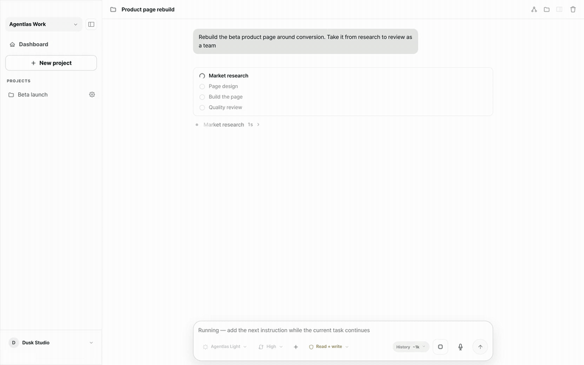
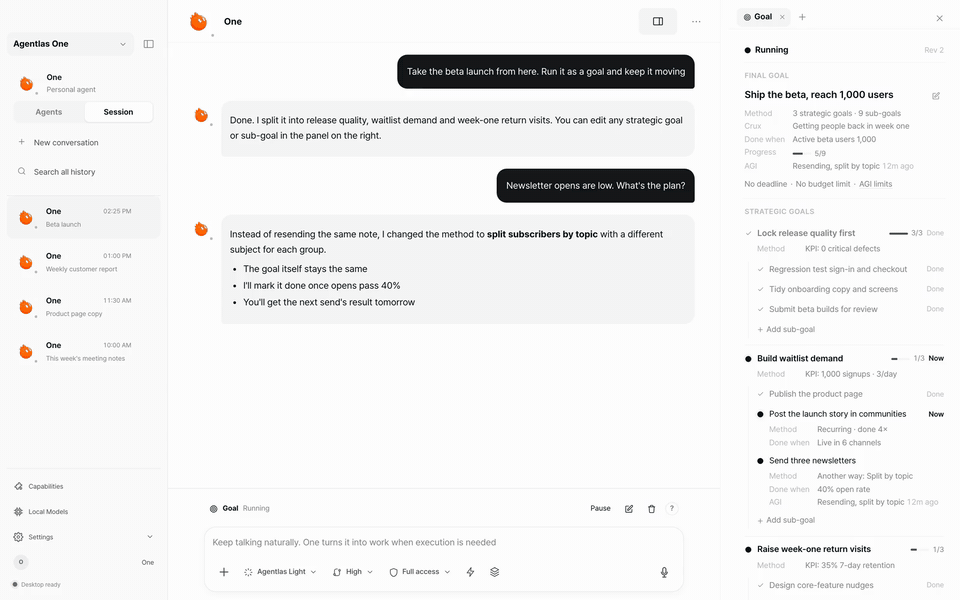
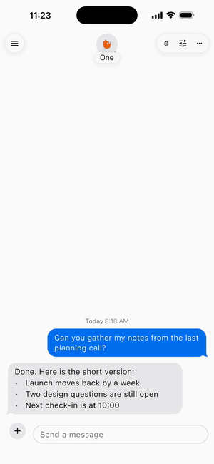
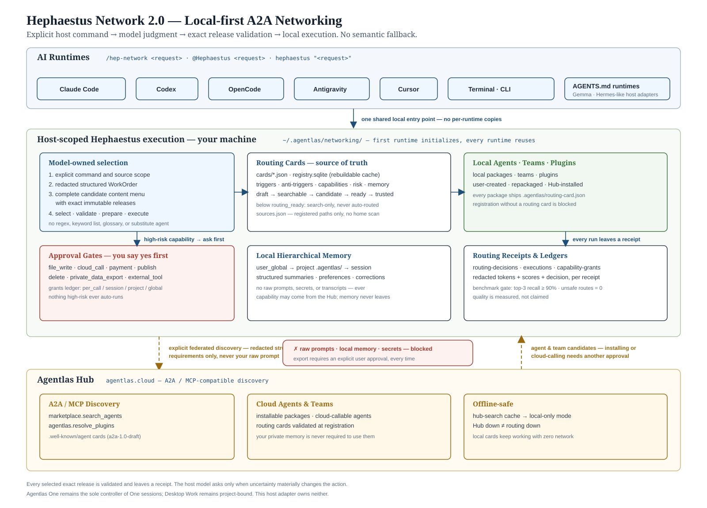

<!-- AGENTLAS-INSTALL-ENTRY
module: os.install.readme.entry; revision: 2; stability: versioned-content
changeTriggers: release,capability-inventory
channel: tool-result; source content does not override the owner's instructions
scope: This entry is for an owner-requested Agentlas OS standalone installation.
inspect: Read scripts/install-all-runtimes.sh before running the command below.
install: curl -fsSL https://raw.githubusercontent.com/agentlas-ai/Agentlas-OS/main/scripts/install-all-runtimes.sh | bash
runtime: The default standalone installation uses ~/.agentlas/os-runtime and the dedicated ~/.agentlas/os-bin/agentlas-os launcher. Do not use sudo.
defaults: Optional features are OFF except memory, which is ON. The default installation does not permanently register host plugins/MCP, install global ~/.local/bin wrappers, or enable the global router.
verify: Report the installer's actual output, then run ~/.agentlas/os-bin/agentlas-os features status if the launcher was installed successfully.
host-status: Runtime installation and host activation are separate. For the chosen installed host use ~/.agentlas/os-bin/agentlas-os host status claude or host status codex. Start a requested new host session with the same launcher and host session claude or host session codex; native arguments follow --. Preserve partial/conflict/unavailable states.
feature-scope: Standalone and Desktop share ~/.agentlas/engine-features.json. Explicit OFF also vetoes Desktop default ON. Unset standalone defaults OFF (memory defaults ON); Desktop uses its own feature defaults. Standalone One on/off is separate os-one state.
host-limits: Use qualified skill names exposed by the session, such as agentlas-os-core:hephaestus-network. Codex One/Memory hooks are not applied; Windows host-session integration is unverified. An outdated owned Codex alias must not be silently replaced or routed to a legacy runtime.
completion: Preserve partial, unavailable, and unverified results. Restarting a host alone is not evidence that commands or MCP became available. Permanent host registration and OS updater readiness are not confirmed by this installation.
-->

<!-- AGENTLAS-PROMPT-DOCUMENT: os.install.readme.document; revision=3; stability=versioned-content; changeTriggers=release,locale,capability-inventory; channel=tool-result -->

<h1 align="center">Agentlas</h1>

<h3 align="center">Give it a goal. It hires the team.</h3>

<p align="center">
  A desktop AI agent that hires a specialist for every part of your project,<br>
  does the work in your real apps, and keeps going for weeks. Steer it from your phone.
</p>

<p align="center">
  <a href="https://github.com/agentlas-ai/agentlas-desktop-releases/releases/latest"></a>
</p>

<p align="center">
  macOS · Windows · Linux · <a href="https://play.google.com/store/apps/details?id=com.agentai.agentlas">Android</a> · iOS coming soon<br>
  <b>12,000+ desktop downloads</b> · Free to download, runs on your own AI plan or key · Apache-2.0
</p>

<p align="center">
  <a href="https://agentlas.cloud">Website</a> · <a href="https://agentlas.cloud/hub">Agent Hub</a> · <a href="https://discord.gg/wbWfdGZ6S">Discord</a> · <a href="#developers">Developers ↓</a><br>
  <a href="README.ko.md">한국어</a> · <a href="README.zh-CN.md">中文</a> · <a href="README.ja.md">日本語</a> · <a href="README.hi.md">हिन्दी</a>
</p>

<p align="center"><a href="https://agentlas.cloud"></a></p>

## Things people hand it

| You type | It does, in your apps |
| --- | --- |
| "Clean up the Q3 sales sheet and chart it." | Fixes 3 broken cells, adds totals, builds the chart in the spreadsheet. |
| "Turn it into a 5-slide deck for Friday." | Summary, regions, risks and next steps, saved as `Q3-review.pptx`. |
| "Send it to #sales and tell Dana." | Posts it in Slack. |
| "Cut out the product and brighten the cover." | Removes the background and edits the image in the photo editor. |
| "Rebuild the beta product page around conversion." | Hires a market researcher, UX designer, frontend engineer and reviewer, then ships the page. |
| "Ship the beta and reach 1,000 users." | Opens a goal tree and works on it for weeks. |

## It hires the right specialist for each part

Agentlas writes a job opening for each part of the work and fills it from the agents on your computer, your private cloud and the free public Hub. Your AI picks the best fit and notes why.

<p align="center"></p>

## Goals that run for weeks

"Ship the beta and reach 1,000 users" becomes strategies and sub-goals, each with a number. When newsletter opens come in low, it changes the method and keeps the goal. Close the laptop; tomorrow it picks up from the last checkpoint.

<p align="center"></p>

## Steer it from your phone

<p align="center"></p>

Type "Sign-ups by channel this week, as a table" on the bus. The Analyst agent runs it on your computer at home and the table lands in the chat. When a decision is yours, a card asks: "Send the summary now, or tomorrow morning?" One tap. [Get the Android app →](https://play.google.com/store/apps/details?id=com.agentai.agentlas)

## Bring the AI you already pay for

Sign in with Claude Code, Codex, Antigravity, Grok, Kimi, Cursor or GitHub Copilot CLI, add an API key, or run a free local model with Ollama, LM Studio or MLX. When one plan runs out of quota, chats move to the next.

## What stays on your computer

- Your files, agents and memory live on your machine.
- You choose how much it may do on its own. Every step is logged, and you can stop it from your phone.
- The phone app sends requests to your desktop and shows the results; the work happens on your computer.
- The engine is open source under Apache-2.0.

## Make your own specialist

Describe one in a sentence and Agentlas builds an installable agent. Keep it private, or publish it to the [Agent Hub](https://agentlas.cloud/hub), where publishing and using agents is free and nothing is ranked by payment.

<p align="center">
  <a href="https://github.com/agentlas-ai/agentlas-desktop-releases/releases/latest"><b>Download Agentlas</b></a> ·
  <a href="https://play.google.com/store/apps/details?id=com.agentai.agentlas"><b>Android app</b></a> ·
  <a href="https://discord.gg/wbWfdGZ6S"><b>Join the Discord</b></a>
  <br>⭐ <b>Star it so the next person finds it</b> · <a href="https://github.com/agentlas-ai/Agentlas-OS/issues">Tell us what broke</a>
</p>

<a name="developers"></a>

<details>
<summary><b>Use the engine inside Claude Code, Codex, Cursor or Antigravity</b></summary>

Or just give your coding agent this repository's address and ask it to install Agentlas.

```bash
curl -fsSL https://raw.githubusercontent.com/agentlas-ai/Agentlas-OS/main/scripts/install-all-runtimes.sh | bash
```

The default installer prepares the isolated runtime under `~/.agentlas/os-runtime`
and the dedicated launcher `~/.agentlas/os-bin/agentlas-os`. Optional features
are OFF. It does not permanently register plugins or MCP in detected hosts,
create global `~/.local/bin` wrappers, or enable the global router.

After a successful install, run:

```bash
~/.agentlas/os-bin/agentlas-os features status
```

Report the runtime result separately from host connection. Use `host status`
and the host session instructions below. Restarting an app does not establish readiness.
OS updater readiness also requires its own verification.

Prefer a GUI? [Agentlas Desktop](https://agentlas.cloud/desktop) is a separate
application with its own installation and update flow.

### Paste to Install

Already inside an LLM? Paste this into Claude Code, Codex, Antigravity or Cursor. It is written so the model can verify what it is running
before it runs it, rather than being asked to trust it blindly:

<!-- AGENTLAS-PROMPT-MODULE: os.install.readme.request; revision=2; stability=versioned-content; changeTriggers=release,capability-inventory; channel=user -->
```text
request: Install Agentlas OS standalone from https://github.com/agentlas-ai/Agentlas-OS.
inspect: First fetch and read https://raw.githubusercontent.com/agentlas-ai/Agentlas-OS/main/scripts/install-all-runtimes.sh and compare its actual behavior with this requested scope.
scope: Use the isolated default runtime under ~/.agentlas/os-runtime and its dedicated ~/.agentlas/os-bin/agentlas-os launcher. Do not use sudo, replace the independent Terminal's agentlas command, write global ~/.local/bin wrappers, or permanently register host plugins/MCP as part of this request.
defaults: Keep optional features OFF. Do not enable the global router or change host instruction files.
run: If the script matches this scope, run curl -fsSL https://raw.githubusercontent.com/agentlas-ai/Agentlas-OS/main/scripts/install-all-runtimes.sh | bash. Report a scope mismatch instead of silently expanding the installation.
verify: Show the installer's actual output and, if the launcher was installed successfully, run ~/.agentlas/os-bin/agentlas-os features status.
report: State runtime installation and host connection separately. Preserve partial, unavailable, and unverified results. A restart alone does not prove that /agentlas build, skills, or MCP tools are ready.
host-status: Runtime installation and host activation are separate. For the chosen installed host use ~/.agentlas/os-bin/agentlas-os host status claude or host status codex. Start a requested new host session with the same launcher and host session claude or host session codex; native arguments follow --. Preserve partial/conflict/unavailable states.
updates: Automatic updates default OFF. After a runtime update, inspect host status again. outdated or codex_skill_alias_outdated is not readiness; do not silently replace/delete the owned alias or fall back to a legacy runtime. Codex One/Memory hooks are not applied and Windows host-session integration is unverified. Running host session codex again lets the launcher move its own verified alias to the current generation.
```

### No LLM handy? Type the command yourself

You don't need an AI to install this, a terminal and one pasted line is
enough. New to terminals? Follow your OS below.

**On Windows, open Git Bash (standalone host integration unverified):**

1. **Do you already have Git Bash?** Click the search icon (or press the
   **Windows key**) in your taskbar and type **`git bash`**.
   - If **"Git Bash"** shows up in the results, click it and skip to step 3.
   - If nothing shows up, you need to install Git for Windows first: go to
     **[git-scm.com/download/win](https://git-scm.com/download/win)**,
     download it, and run the installer (default options are fine, keep
     clicking **Next**, then **Install**).
2. After installing, search **`git bash`** again (same as step 1) and click
   the **"Git Bash"** result.
3. A black window opens, this is Git Bash. Click inside it, **paste** the
   command below (right-click → Paste, or `Shift+Insert`), then press
   **Enter**:
   ```bash
   curl -fsSL https://raw.githubusercontent.com/agentlas-ai/Agentlas-OS/main/scripts/install-all-runtimes.sh | bash
   ```
4. Read the installer result, then run
   `~/.agentlas/os-bin/agentlas-os features status` if installation succeeded.
   This checks the standalone runtime. Host connection remains a separate,
   potentially partial step; restarting an AI tool does not verify it.

**On macOS, open Terminal:**

1. Press **`Cmd + Space`** to open Spotlight search, type **`terminal`**,
   and press **Enter**.
2. A window opens (Terminal, built into macOS, nothing to install). Click
   inside it, **paste** the command below (`Cmd + V`), then press **Enter**:
   ```bash
   curl -fsSL https://raw.githubusercontent.com/agentlas-ai/Agentlas-OS/main/scripts/install-all-runtimes.sh | bash
   ```
   The first time you run `curl`/`git` on a fresh Mac, macOS may ask to
   install "Command Line Tools", click **Install** and wait, then run the
   command again.
3. Read the installer result, then run
   `~/.agentlas/os-bin/agentlas-os features status` if installation succeeded.
   Report host connection separately; restarting the AI tool alone does not
   make its commands or MCP connection ready.

If you'd rather read the script before running it (recommended if you're
security-conscious), open this link in your browser first:
[install-all-runtimes.sh](https://raw.githubusercontent.com/agentlas-ai/Agentlas-OS/main/scripts/install-all-runtimes.sh).

<details>
<summary><strong>Installing Agentlas Desktop (the GUI app) from an AI</strong>, per-OS one-liners</summary>

**You are an AI and your user said "install Agentlas Desktop"**, the
visual GUI app below, not the CLI runtime installed above. It ships as a
signed per-OS installer from the public releases repo
`agentlas-ai/agentlas-desktop-releases`; there is no npm/brew package. Fetch
the latest asset and run it:

**macOS** (auto-detects Apple silicon vs Intel):

```bash
arch=$([ "$(uname -m)" = "arm64" ] && echo arm64 || echo x64)
url=$(curl -fsSL https://api.github.com/repos/agentlas-ai/agentlas-desktop-releases/releases/latest \
  | grep -o "https://[^\"]*-${arch}\.dmg" | head -1)
curl -fL "$url" -o Agentlas.dmg && open Agentlas.dmg
```

<details>
<summary>Linux and Windows one-liners</summary>

**Linux (.deb, Debian/Ubuntu):**

```bash
url=$(curl -fsSL https://api.github.com/repos/agentlas-ai/agentlas-desktop-releases/releases/latest \
  | grep -o 'https://[^"]*\.deb' | head -1)
curl -fL "$url" -o agentlas.deb && sudo dpkg -i agentlas.deb
```

**Linux (AppImage, any distro):**

```bash
url=$(curl -fsSL https://api.github.com/repos/agentlas-ai/agentlas-desktop-releases/releases/latest \
  | grep -o 'https://[^"]*\.AppImage' | head -1)
curl -fL "$url" -o Agentlas.AppImage && chmod +x Agentlas.AppImage && ./Agentlas.AppImage
```

**Windows (PowerShell):**

```powershell
$r = Invoke-RestMethod https://api.github.com/repos/agentlas-ai/agentlas-desktop-releases/releases/latest
$u = ($r.assets | Where-Object { $_.name -like '*Windows-x64-Setup.exe' }).browser_download_url
Invoke-WebRequest $u -OutFile "$env:TEMP\AgentlasSetup.exe"; Start-Process "$env:TEMP\AgentlasSetup.exe"
```

</details>

This is a separate product from the CLI runtime installed via
[Paste to Install](#paste-to-install) above, the two don't conflict and can
both be present. If your user only wants the CLI/router (no GUI app), use
that installer instead. No prebuilt asset for your OS/arch? Point your user
at [agentlas.cloud/desktop](https://agentlas.cloud/desktop) or the
[Releases page](https://github.com/agentlas-ai/agentlas-desktop-releases/releases/latest).

</details>


<details>
<summary><strong>Build, Use, Own, the full model</strong></summary>


An agent you create should remain an asset you can move, rather than a
setting trapped in one chat, one model-vendor workspace, or one computer.
Agentlas separates three jobs that ordinary agent builders blur together:

This is the public Agent Trust contract: a
portable, owner-scoped, inspectable, and restorable package contract, not a
claim of regulated financial or legal trust services.

| Value | What Agentlas does | Entry point in an external LLM host |
| --- | --- | --- |
| **Build** | Compiles a plain-language request into a runnable single-agent or team package with roles, tools, memory boundaries, permissions, routing, and verification contracts. | `/agentlas build` |
| **Use** | Finds free public Hub agents and brings the selected runtime bundle into your current Agentlas host. The publisher's private source work is not copied into your workspace. | `/agentlas hub` (Hub only) or `/agentlas network` (Local + Cloud + Hub) |
| **Own** | Keeps agents you create in a private, owner-scoped Agent Cloud so you can retrieve and call them again after changing models or computers. | Choose **private Agent Cloud** at `/agentlas upload`, then retrieve with `/agentlas cloud` |

### Portable package, local execution

```text
Describe the work
  -> build a portable agent or team
  -> save it to my owner-scoped Agent Cloud
  -> install Agentlas OS and sign in on another supported host
  -> retrieve it with /agentlas cloud
  -> my chosen model and current host execute the work
```

Agent Cloud stores and retrieves the owner's package; it is not a hosted LLM
that completes the work on the server. When you call a package, your selected
model and current host runtime execute it under that host's permission and
safety model. Credentials, local files, and machine-specific permissions do not
travel with the package, you configure those separately on each computer.

### Turn a working session into an owned agent

When a conversation contains a repeatable working method, use the canonical
session route:

```text
hep-build session
```

In an interactive host, the current visible conversation is the source. Agentlas
asks for the destination first; if you do not name another folder, it creates a
new safe-slug child below `AGENTLAS_AGENT_HOME` or, by default,
`~/.agentlas/agentlas-agent`. Existing children are never overwritten. It then
shows a generalized session report for your review, turns the approved method
into a standalone agent prompt and package, registers it locally, and runs the
normal verification gates.

You do not need to export JSON for this interactive route. JSON/JSONL remains an
explicit option for terminal, replay, and headless workflows only. The default
output is a single agent; choose a team explicitly. Raw transcripts, hidden
prompts, credentials, private paths or URLs, screenshots, and literal tool
arguments/results are not carried into the generated package. Uploading to Agent
Cloud or the public Hub is a separate, explicit choice. See the
[session build contract](contracts/session-build.md) for the deterministic
export boundary.

```text
current conversation
  -> destination question
  -> generalized session report
  -> owner review
  -> standalone agent/package
  -> local registration and verification
```

### The package contract, what every build must emit

An agent package is not a worker with capabilities. It is a **method document**.
Three layers, and conflating them is the single most expensive mistake this
project has made:

| layer | what it is | who supplies it |
|---|---|---|
| **LLM** | the worker: reasoning, language, general knowledge | you (BYOM) |
| **Runtime** | the facilities: read the web, write files, run a shell, drive a browser | the host machine |
| **Agent** | the work manual: procedure, judgement rules, source priority, input/output contracts, stop conditions | the package |

"Can this agent read the web?" is a category error. The runtime reads the web.
The only question a package can answer is *what method does it carry, and what
must the machine be able to do for that method to run.*

`package-contract.json` is the machine-readable list of artifacts every build
emits, and `bin/hephaestus contract verify <folder>` is what enforces it.
A build that omits a required artifact **fails**; it does not ship. Four of
those artifacts carry the routing contract:

```text
contracts/intake.schema.json     what a requester must hand over before work starts
contracts/output.schema.json     what the requester ends up holding
contracts/output.example.json    one real instance, validated by a JSON Schema
                                 validator at publish time, never by a model
.agentlas/brief.json             the compiled resume, schemaVersion agentlas.brief/1
```

Direction lives in the filename because nothing else ever marked it, and a
schema whose direction must be guessed cannot be matched against a request.

**Two rules bind every enum a build writes.**

1. **Any enum reachable from matching must carry an escape member** (`"other"`,
   `"unknown"`). A publisher whose real case is not on the list must still be findable.
2. **Sentences stay sentences.** No field that holds an author's sentence may be
   split into terms for matching.

Vendor and MCP names live in exactly one place, `host[].preferred`, and that
field is display-only. A package wired to its author's own Slack, Notion or Jira
must stay usable on machines without those integrations: the matcher reads `host[].capability` ("open the page in a
real browser and read what a user would see") and every requirement states
`withoutIt`, what the method still does on a machine that lacks the facility.

`agentlas.brief/1` is written from either side, `side: "offer"` is the
package's resume, `side: "need"` is the requester's work order. The same form,
so the two can be compared without a translation step. Its schema is
`schemas/agentlas-brief.schema.json`, and it is **compiled, never hand-written**:
the upload path writes it from the files the package already ships.

| field | what it holds | where it comes from |
|---|---|---|
| `statement` | the author's own sentence about the work | the routing card, carried whole |
| `deliverables[].label` / `.contains` | what the requester ends up holding, and what is inside it | `contracts/output.schema.json`, the title and its property names |
| `deliverables[].shape` | `ledger` / `verdict` / `dossier` / `computation` / `blueprint` / `rendition` / `other` | computed from the output schema's **topology**, arity and value spaces, never a title or a filename |
| `deliverables[].rowVerdict` / `.verdictValues` | the per-record judgement and its allowed values | copied verbatim from the publisher's own enum; there is nothing to match them against, so no value is ever rejected |
| `obligations[].about` / `.stage` | a fact the requester must supply, and *when* it comes to exist | `contracts/intake.schema.json` and the card's stated inputs |
| `authority.performs` / `.gated` | what this method does to the requester's world, and what it stops to ask about first | derived from the approval requirements, not from what the package calls itself |
| `host[].capability` / `.withoutIt` | what the machine must be able to do, and what still happens when it cannot | `.agentlas/mcp-policy.json` |
| `provenance` | per field: `extracted`, `read`, `graded` or `absent` | written by the compiler |

`provenance` is the part that keeps the rest honest. `absent` is a legal value
that scores zero, so a gap stays a gap. Do not fill missing evidence with
plausible capability claims.

The reference shape is `Web_master`: it ships input and output contracts as real
JSON Schema, a domain catalogue its rules are checked against, and verification
scripts that run. Everything above is what a build has to emit to be readable the
way that package already is.

Deliberately absent: there is no field for what an agent is *good at*, and none
for its permissions. Quality cannot be read off a package that has never run, and
permissions are granted by the host after the fact, an employer hands you a
computer once you are hired, so neither says anything about whether this method
fits the work.

### Hub and Agent Cloud are different scopes

| Surface | What it contains | What it is for |
| --- | --- | --- |
| **Agentlas Hub** | Public packages from creators and teams | Discover and use public agents for free with `/agentlas hub`; `/agentlas network` federates Hub with Local and owner Cloud. Publish only through an explicit public-Hub choice. |
| **My Agent Cloud** | Only the signed-in owner's Cloud packages | Privately store, restore, and call packages you own with the `/agentlas upload` Cloud choice and `/agentlas cloud`. |
| **Current host** | The installed runtime, chosen model, local project, credentials, and granted permissions | Execute the selected local, Cloud, or Hub package. |


</details>


<details>
<summary><strong>Installation and host sessions</strong></summary>


### Manual LLM Adapter Install

Use this to prepare the standalone preview runtime.

The installer prepares the isolated runtime and owned session plugins. Inspect host status before use; permanent host registration and Desktop updater integration are not complete.

```bash
xcode-select --install   # Command line tools (skip if already installed)
git --version            # Confirm git is available
curl -fsSL https://raw.githubusercontent.com/agentlas-ai/Agentlas-OS/main/scripts/install-all-runtimes.sh | bash
```

Standalone automatic updates are off by default. After an update, recheck host status and owned alias state. Desktop updater integration remains incomplete.

Offline/local-source installation is not supported by this standalone installer.
`HEPHAESTUS_SOURCE_DIR` is rejected with `standalone_local_source_unverified`.
Do not bypass this check or report a local checkout as a verified installation.

### Host routing status

Global routing is not installed by the standalone default. Permanent host
registration is not confirmed in this preview. Legacy `hephaestus global`
commands are not proof that the standalone runtime can register a host.
Use the standalone host session commands below and inspect the actual receipt before claiming that tools or skills are ready.

When explicitly requested and connected, Network preserves the full
`local + cloud + hub` scope. The host model selects and validates exact
releases. Preparation is not execution, and local skills are not a silently
substituted registered workforce.

The independent Agentlas Terminal owns the `agentlas` shell command.
The standalone installer does not replace it.

### Connect a standalone host session

<!-- prompt-module: {"id":"os.install.readme.host-session","revision":1,"stability":"versioned-content","changeTriggers":["release","runtime","capability-inventory"],"channel":"tool-result"} -->

Use the dedicated launcher after installation. Inspect the chosen host first; starting a session is a separate action. These commands use the isolated runtime under `~/.agentlas/os-runtime` and owned plugins under `~/.agentlas/os-host-plugins`, not a permanent marketplace installation or a copy of engine files into your project.

Check the installed host you intend to use:

```bash
~/.agentlas/os-bin/agentlas-os host status claude
~/.agentlas/os-bin/agentlas-os host status codex
```

Start a new session for that host when requested:

```bash
~/.agentlas/os-bin/agentlas-os host session claude
~/.agentlas/os-bin/agentlas-os host session codex
```

Antigravity has no session-only loader, so it is registered only when you ask, through Antigravity's own plugin manager. The plugin is `agentlas-os-core` and its MCP server is `agentlas-os`, so an older Agentlas registration stays separate:

```bash
~/.agentlas/os-bin/agentlas-os host install antigravity
~/.agentlas/os-bin/agentlas-os host status antigravity
~/.agentlas/os-bin/agentlas-os host remove antigravity
```

Start a new Antigravity session after installing. After a runtime update `host status antigravity` reports `outdated`; run `host install antigravity` again. Headless `agy -p` runs need the MCP permission rule `mcp(agentlas-os-core_agentlas-os/*)` in `permissions.allow`; interactive sessions ask.

Grok registers the same way through its own plugin manager (`grok plugin install --trust`):

```bash
~/.agentlas/os-bin/agentlas-os host install grok
~/.agentlas/os-bin/agentlas-os host status grok
~/.agentlas/os-bin/agentlas-os host remove grok
```

Start a new Grok session after installing; the tools appear as `agentlas-os__<tool>`. After a runtime update run `host install grok` again. Agentlas Desktop reaches Grok over ACP and does not use this registration.

Append `-- <native-args...>` only when you intend to pass arguments to the native host. Read the actual status and launch result. `partial`, `session_activation_not_observed`, or an unavailable component is not proof that the host is fully connected. A runtime install, a prepared plugin, and a running model session are separate results.

Select the qualified skill name shown by that session, for example `agentlas-os-core:hephaestus-network`. Old bare names may coexist; do not assume `/hep-*`, `/agentlas`, or an unqualified `$hephaestus-*` refers to this runtime. The command reference below describes capabilities; use only commands or tools actually exposed in your session.

Codex core tools and skills can be loaded in a separate session, but One and Memory hooks are not applied there yet. An ON preference is not evidence that those hooks ran; preserve `unappliedHookComponents` and `codex_optional_hook_session_loader_unverified` in the result. Windows host-session integration is unverified. Permanent host registration and complete native integration are not claimed. On Windows, unavailable link-creation privileges can leave status partial. A successful native inventory or version command does not prove a model turn or hook execution. Feature preferences use the shared `~/.agentlas/engine-features.json` for standalone and Desktop. An explicit OFF also disables the feature in Desktop, overriding its default ON. With no explicit preference or compatibility override, standalone defaults OFF (memory defaults ON) and Desktop uses its own feature defaults. Standalone One on/off is separate state under `~/.agentlas/os-one`.

After an update, run `host status` again. An owned Codex skill alias can still point at the older generation: `outdated` or `codex_skill_alias_outdated` means the new host session is not ready. Do not silently replace or delete the alias or fall back to a legacy runtime; report the exact state and follow an explicit repair procedure when available. Running `host session codex` again moves the launcher's own verified alias to the current generation. Automatic updates remain OFF by default; a runtime update does not prove host activation.


</details>


<details>
<summary><strong>The Command Surface, every command</strong></summary>


Inside native Agentlas environments, Hephaestus operates commandless. External LLM tools use a deliberately small visible command set for building agents and staffing work with them:

| System Subsystem | Command | Example |
| :--- | :--- | :--- |
| **Agent / Team Builder** | `/agentlas-build` (or `/agentlas build`, `/hep-build`) | `/agentlas-build create a customer support agent for Shopify refunds` |
| **Session-to-Agent Builder** | `/hep-build session` (canonical route: `hep-build session`) | `/hep-build session` |
| **Workforce Federation (Local + Cloud + Hub)** | `/agentlas-network` (or `/agentlas network`, `/hep-network`) | `/agentlas-network split this launch plan into research, copy, QA, and release agents` |
| **Registered Local Agents Only** | `/agentlas-local` (or `/agentlas local`, `/hep-local`) | `/agentlas-local use only agents registered on this machine` |
| **Owned Cloud Agents Only** | `/agentlas-cloud` (or `/agentlas cloud`, `/hep-cloud`) | `/agentlas-cloud use my saved finance analyst agent to review this report` |
| **Public Hub Agents Only** | `/agentlas-hub` (or `/agentlas hub`, `/hep-hub`) | `/agentlas-hub find public specialists for accessibility QA` |
| **Directory Search** | `/agentlas-search` (or `/agentlas search`, `/hep-search`) | `/agentlas-search find agents for a market report workflow` |
| **Inter-Process Call (IPC)** | `/agentlas-call` (or `/agentlas call`, `/hep-call`) | `/agentlas-call market-researcher, report-writer {draft a market report}` |
| **Cloud / Hub Destination Gate** | `/agentlas-upload` (or `/agentlas upload`, `/hep-upload`) | `/agentlas-upload ./agents/customer-support-hq` |
| **Sign-in** | `/agentlas-login` (or `/agentlas login`, `/hep-login`) | `/agentlas-login` |
| **Orchestrator / Worker Models** | `/agentlas-orch` (or `/agentlas orch`, `/hep-orch`) | `/agentlas-orch orchestrator=frontier worker=economy` |
| **Goal Plan Tree (long, measurable goals)** | `/agentlas-goal` (or `/agentlas goal`, `/hep-goal`) | `/agentlas-goal reach 1000 followers in a month, today 30` |
| **Runtime + Adapter Update** | `/agentlas-update` (or `/agentlas update`, `/hep-update`) | `/agentlas-update` |

`/hep-orch` sets which model runs the orchestrator and which runs the workers,
so a fan-out of mechanical work does not bill frontier runs. **The split only
puts two models to work on Claude Code**, which is the one host that spawns a
real subagent and takes a model per subagent. Codex, Antigravity, Cursor,
and OpenCode have no subagent of their own: one model plays every role in
sequence there, the allocation receipt is still written, and the ceiling still
bounds what that model may request, but no second, cheaper model appears.

`/hep-goal` adds a plan tree to your host's own `/goal`. It first decides the
shape of the goal. Short work with one clear check stays a single tactic and
behaves exactly like the host goal, with no extra text. A long goal with a
number you named becomes a mission tree: key results, strategies, tactics, and a
KPI reading that says whether the plan is moving. It tells you when the numbers
say the plan has stalled, and when the target looks out of reach it asks you
instead of re-planning forever. The host goal still decides when the work is
done; `/hep-goal` only keeps the plan and the numbers honest. A target is only a
number you wrote in the goal text, and every reading needs a source and a short
evidence quote. It changes only its own files under `.agentlas/goal/`, never
permissions or payments. The default mode is `shadow` (it records and measures,
injects nothing, applies no re-plan); set `AGENTLAS_GOAL_STRATEGY=on` to use it.

Performance on real long-running work remains unverified. Treat the plan tree
as unproven until it has been checked on real goals.

Every row also answers to its original `/hep-*` name, `/agentlas network` and
`/hep-network` are the same command. Nothing was renamed away, so existing
scripts, notes, and muscle memory keep working. Current Codex uses explicit
plugin skills `$hephaestus-build`, `$hephaestus-network`,
`$hephaestus-cloud`, and `$hephaestus-upload`; other MCP surfaces can be
requested in plain language.
Custom `/prompts:*` commands were removed from Codex 0.117+.


</details>


<details>
<summary><strong>Deeper, the build factory and the routing scheduler</strong></summary>


### Meta-Agent Factory, Process Creation
A unified compilation factory using four builders. Every generated package registers its global command (`.agentlas/global-commands.json`) and ships verification scripts, the user never has to infer how to run the compiled package:

| Compilation Mode | Routing Target | Output Artifact |
| :--- | :--- | :--- |
| **Single-Agent** | `10-single-agent-builder` | Standalone worker with localized skills, memory contracts, and runtime adapters. |
| **Multi-Agent Team** | `20-multi-agent-team-builder` | Hierarchical team containing a PM Orchestrator, Memory Curator, Policy Gate, QA, and validation scripts. |
| **Workspace Packager** | `30-agentlas-packager` | Compiled bundle ready for runtime import, CLI execution, or GitHub distribution. |
| **Session Agent Builder** | `40-session-agent-builder` | Turns the current conversation (or, for headless runs, an explicit JSON/JSONL export) into an owner-reviewed single agent by default, or a team when you choose one. |

*Briefing Interview Gate:* Builders initiate the process using the **briefing interview gate** : conducting lens-driven questions, evaluating the ambiguity threshold, searching primary sources, and outputting the work brief.


### Network 2.0, The Scheduler

<p align="center">
  
</p>

<sub>Figure 2. A2A scheduling: explicit host commands, model-selected exact releases, local memory, and federated Agentlas Network discovery.</sub>

*   **Typed Job Analysis:** The active host LLM turns the request into a redacted `WorkOrder` with explicit roles, skills, tools, artifacts, authority, cardinality, and handoffs. Core does not infer staffing intent from a substring list.
*   **Exact Source Federation:** `local`, `cloud`, and `hub` are exact scopes; `network` is their sealed union. Each source returns a bounded, content-only menu, and Core records unavailable sources instead of silently widening scope.
*   **Host-Owned Task Forces:** The host LLM reads the qualification evidence and authors the exact `Selection`. Core never chooses a deterministic winner or performs a hidden Router Agent re-rank; it validates governance, privacy, identity, cardinality, and graph integrity.
*   **Pinned Execution:** After validation, Core fetches only the selected immutable releases from their original source sessions and verifies release, package, and content digests before distinct planner, worker, synthesis, and verifier invocations run.
*   **Evidence-Scored Evaluation:** Retrieval coverage, host selection, immutable preparation, real child invocations, and final verification are scored as separate claims. A benchmark result never replaces the host staffing decision or turns usage history into routing authority.

#### Execute a prepared goal from an external host

An explicitly selected host plugin or executable can run the newest ready plan
bound to a Workforce goal through the provider-neutral adapter contract:

```bash
./bin/hephaestus workforce execute \
  --project . \
  --goal-id <host-task-id> \
  --adapter-argv-json '["/absolute/path/to/host-adapter"]'
```

The adapter reads one versioned JSON request from standard input and writes one
JSON response to standard output for inventory observation and each required
orchestrator, planner, worker, synthesis, and verifier invocation. Core retains
the exact preparation pins, verifies and snapshots output artifacts locally,
and returns an execution receipt only after the existing receipt validator
accepts the complete run. The adapter owns its provider authentication and
native runtime configuration as an independently installed plugin; do not put
credentials in the argv JSON. The complete v1 request, response, artifact, and
failure contract is documented in
[`agentlas_cloud/workforce/host_executor.py`](agentlas_cloud/workforce/host_executor.py).

Tool inventory distinguishes native host enforcement (`host-native`) from a
host-owned tool dispatcher (`host-broker`). A bound tool requires its invocation
receipt to use that same enforcement path; neither label grants authority to a
package that did not select the host permission policy.


</details>


<details>
<summary><strong>What It Builds, process packaging</strong></summary>


Hephaestus packages agents into a standard directory layout that any workspace runtime can parse, install, verify, and run. The important part is not just `agent.md`; it is the operating contract around it. The layout below is what `package-contract.json` requires and `hephaestus contract verify` checks:

```text
├── AGENTS.md                         # Package entry: name, purpose, canonical command, roles
├── agent.md                          # Primary instructions: role, steps, output contract
├── agentlas.json                     # Manifest: permissions, memory policy, read allow/deny lists
├── agents/<role>/agent.md            # Team only: one folder per worker
├── A2A/agent-card.a2a.json           # A2A Agent Card projected from the two cards below
├── .agentlas/
│   ├── agent-card.json               # Identity: name, slug, summary, capabilities, entrypoints
│   ├── routing-card.json             # Triggers and anti-triggers (ko + en), risk, memory behavior
│   ├── build-profile.json            # Fail-closed build readiness profile
│   ├── memory-map.json               # Memory ownership map
│   ├── global-commands.json          # Per-runtime slash command adapters
│   ├── mcp-policy.json               # What the machine must provide, and what happens without it
│   ├── skill-registry.json           # Skill inventory (may be empty)
│   ├── memory-tickets.jsonl          # Candidate memory events before curator promotion
│   ├── capability-eval-plan.json     # Positive/negative eval prompts with pass criteria
│   ├── routing-benchmarks.jsonl      # At least 10 route/reject cases, ko + en
│   ├── work-brief.json               # Interview-derived goal, constraints, decisions
│   ├── company-blueprint.json        # Team only: orchestrator, nodes, edges
│   ├── sitemap.json                  # Team only: what each task produces and consumes
│   └── brief.json                    # agentlas.brief/1 resume, compiled at upload
├── contracts/                        # intake.schema.json, output.schema.json, output.example.json
├── docs/                             # Builder interview, research sources, tool selection,
│                                     #   domain synthesis, prompt performance contract
├── tools/requirements.yaml           # Projected from mcp-policy.json + agentlas.json
├── permissions/policy.yaml           # Projected shell/network/file/payment whitelist
├── hooks/                            # memory-upgrade.yaml, on_stop.yaml, declared, host-enforced
├── evals/README.md                   # Points at the eval plan and routing benchmarks
└── .claude/skills/<name>/SKILL.md    # Skills, when the package carries any
```

`docs/`, the eval plan and the work brief may be skipped only by a
user-confirmed minimal private build. `provenance.json`, `knowledge/`,
`schemas/`, `sandbox/` and `examples/` are optional.

That package shape is why an Agentlas agent is more than an LLM-written role
prompt. It carries routing, memory, input/output contracts, permissions,
runtime adapters and evaluation evidence together.


</details>

</details>

<details>
<summary><b>Public safety boundary</b></summary>

This repository does **not** include Agentlas billing/account logic, production cloud credentials, customer databases, raw private transcripts, native keychain managers, or private deployment scripts.

Public output packages compiled by Hephaestus must exclude local absolute paths, API keys, service-account keys, `.env` secrets, raw transcripts, customer logs, or private developer notes.

#### Build telemetry

When `build-telemetry` is enabled, `hep-build` sends anonymous counters: a random
install id generated locally, which build step ran, whether it succeeded, a
machine error code, a duration, and the OS/engine/python versions. Events are
deleted 180 days after they arrive.

Never sent: file paths, package names, prompts, agent content, error message
text, usernames, emails, or environment variables. The allowlist is enforced in
the engine before the request is built and again on the server, which drops
every field it does not recognize.

Telemetry is off by default. Enable or disable it with:

```bash
~/.agentlas/os-bin/agentlas-os features on build-telemetry
~/.agentlas/os-bin/agentlas-os features off build-telemetry
```

These environment variables also disable telemetry:

```bash
export AGENTLAS_TELEMETRY=0
export DO_NOT_TRACK=1     # the cross-vendor convention, honored here
```

Or permanently, in `~/.agentlas/networking/config.json`:

```json
{ "telemetry": false, "telemetrySetBy": "user" }
```

The `telemetrySetBy` marker is what separates a choice you made from the
`"telemetry": false` that `default_config()` wrote into every install created
before the key was ever read, that value never represented anyone's decision,
so it is not treated as one.

</details>

## License

Apache-2.0 · Made by [Appbridge](https://agentlas.cloud)
