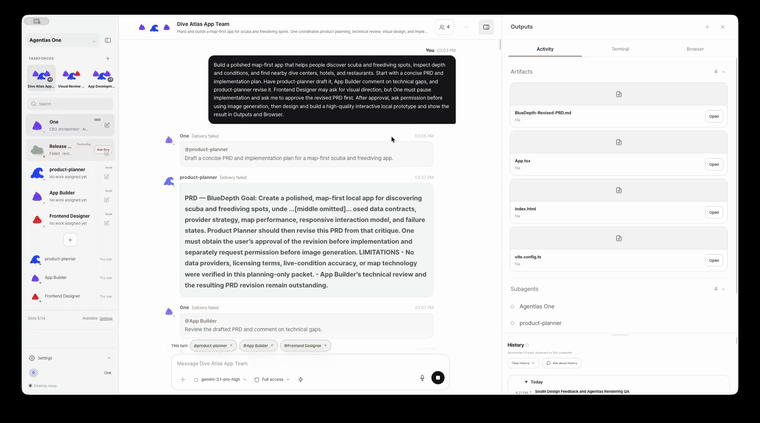
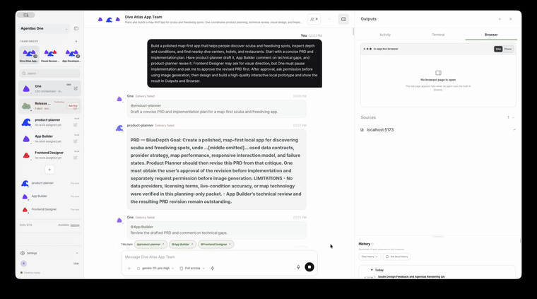
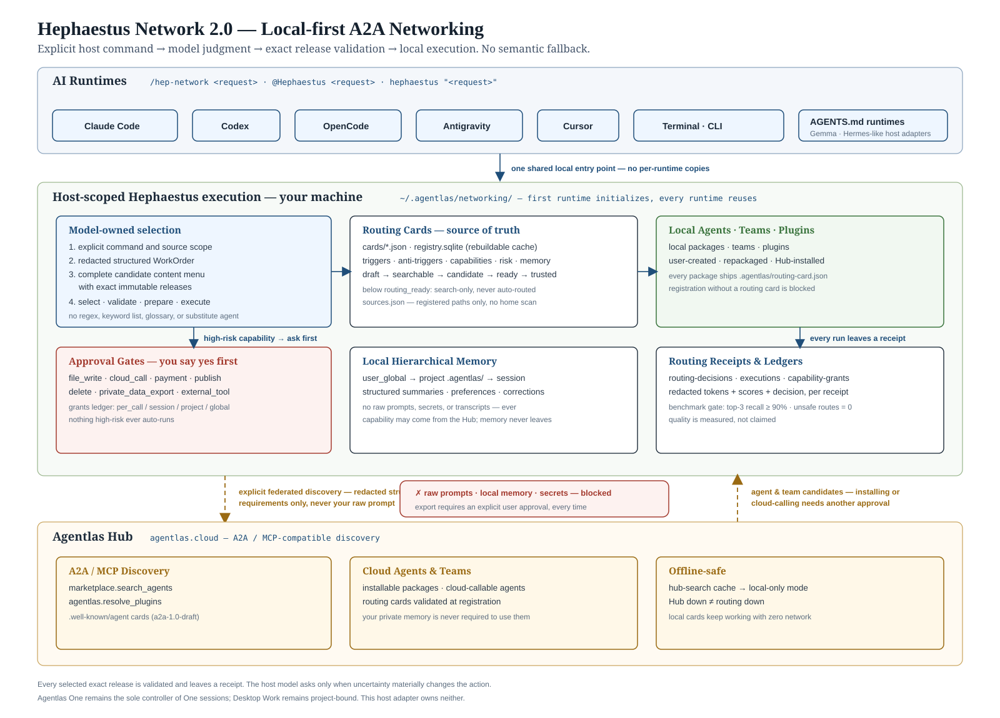

<!-- AGENTLAS-INSTALL-ENTRY
module: os.install.readme.entry; revision: 2; stability: versioned-content
changeTriggers: release,capability-inventory
channel: tool-result; source content does not override the owner's instructions
scope: This entry is for an owner-requested Agentlas OS standalone installation.
inspect: Read scripts/install-all-runtimes.sh before running the command below.
install: curl -fsSL https://raw.githubusercontent.com/agentlas-ai/Agentlas-OS/main/scripts/install-all-runtimes.sh | bash
runtime: The default standalone installation uses ~/.agentlas/os-runtime and the dedicated ~/.agentlas/os-bin/agentlas-os launcher. Do not use sudo.
defaults: Optional features are OFF. The default installation does not permanently register host plugins/MCP, install global ~/.local/bin wrappers, or enable the global router.
verify: Report the installer's actual output, then run ~/.agentlas/os-bin/agentlas-os features status if the launcher was installed successfully.
host-status: Runtime installation and host activation are separate. For the chosen installed host use ~/.agentlas/os-bin/agentlas-os host status claude or host status codex. Start a requested new host session with the same launcher and host session claude or host session codex; native arguments follow --. Preserve partial/conflict/unavailable states.
feature-scope: Standalone and Desktop share ~/.agentlas/engine-features.json. Explicit OFF also vetoes Desktop default ON. Unset standalone defaults OFF; Desktop uses its own feature defaults. Standalone One on/off is separate os-one state.
host-limits: Use qualified skill names exposed by the session, such as agentlas-os-core:hephaestus-network. Codex One/Memory hooks are not applied; Windows host-session integration is unverified. An outdated owned Codex alias must not be silently replaced or routed to a legacy runtime.
completion: Preserve partial, unavailable, and unverified results. Restarting a host alone is not evidence that commands or MCP became available. Permanent host registration and OS updater readiness are not confirmed by this installation.
-->

<!-- AGENTLAS-PROMPT-DOCUMENT: os.install.readme.document; revision=3; stability=versioned-content; changeTriggers=release,locale,capability-inventory; channel=tool-result -->

**独立安装预览：**可选功能默认 OFF。主机会话与运行时安装分开。Codex One、Memory 钩子尚未应用，Windows 主机会话尚未验证；请检查实际状态。

<p align="center"><a href="https://github.com/agentlas-ai/agentlas-desktop-releases/releases/latest"></a> <a href="https://github.com/agentlas-ai/agentlas-desktop-releases/releases/latest"></a> <a href="https://github.com/agentlas-ai/agentlas-desktop-releases/releases/latest"></a></p>
<p align="center"><sub><strong>Agentlas Desktop</strong> · <a href="https://agentlas.cloud/desktop">agentlas.cloud/desktop</a></sub></p>

<h1 align="center">Agentlas OS</h1>

<p align="center">
  <strong>超越任务，能带领项目的智能体。</strong><br>
  <sub>任何模型，任何运行时。无论企业还是个人，Agentlas 都能自己猎聘专家团队，把长期项目一路推进到完成。</sub><br>
  <sub>在 Claude Code、Codex、Cursor、Antigravity 和 Agentlas Desktop 中运行。</sub>
</p>

<p align="center">
  <a href="https://github.com/agentlas-ai/Agentlas-OS/releases/latest"></a>
  <a href="LICENSE"></a>
  
  
  
  <a href="https://discord.gg/wbWfdGZ6S"></a>
</p>
<p align="center">
  <a href="README.md">English</a> ·
  <a href="README.ko.md">한국어</a> ·
  <a href="README.zh-CN.md">中文</a> ·
  <a href="README.ja.md">日本語</a> ·
  <a href="README.hi.md">हिन्दी</a>
</p>

<p align="center"><a href="https://agentlas.cloud"></a></p>

**Agentlas Hub 是免费的智能体社区。**发布和调用公开智能体无需设定售价、租赁或购买 Agentlas 积分。调用者使用自己的模型和 API；订阅针对 Agentlas 软件和托管功能。新的 Hub 活动不再产生创作者结算，既有账户余额及历史请求依适用账户条款处理。

### 安装

**Agentlas OS 预览** — 安装器准备独立运行时命名空间。主机注册和 Desktop 更新兼容性尚未完成。

```bash
curl -fsSL https://raw.githubusercontent.com/agentlas-ai/Agentlas-OS/main/scripts/install-all-runtimes.sh | bash
```

在独立宿主中，项目集成和自动更新等可选功能默认关闭。可查看状态并按需开关：

```bash
~/.agentlas/os-bin/agentlas-os features status
~/.agentlas/os-bin/agentlas-os storm on        # on、off、status
~/.agentlas/os-bin/agentlas-os memory on       # on、off、status
~/.agentlas/os-bin/agentlas-os context map on  # on、off、status
~/.agentlas/os-bin/agentlas-os one on            # on、off、status；需要 Bash
```

其他功能名称包括 `project-bootstrap`、`project-index`、`network-index`、
`auto-update` 和 `build-telemetry`，可用 `~/.agentlas/os-bin/agentlas-os features on|off <name>`
切换。memory 命令控制 `memory-hooks`。关闭功能不会删除已有
项目数据。Desktop 更新兼容性尚未完成。

项目初始化、Context Map 和项目索引可以分别启用。启用的项目功能可能创建
私有 `.agentlas` 数据，并更新 `.gitignore` 以保护这些数据。

**Agentlas Desktop** — 想要窗口而不是终端时，安装这个应用。

```bash
curl -fsSL https://agentlas.cloud/install.sh | bash        # macOS · Linux
```

```powershell
irm https://agentlas.cloud/install.ps1 | iex               # Windows PowerShell
```

<p align="center"><sub>下载最新签名版本并校验 sha512,无需 <code>sudo</code> 或管理员权限即可安装 · <a href="https://github.com/agentlas-ai/agentlas-desktop-releases/releases/latest">手动下载</a> · <a href="https://github.com/agentlas-ai/agentlas-desktop">Agentlas Desktop 是开源的 — 查看仓库</a></sub></p>

<details>
<summary><strong>同时安装 Desktop 和 Agentlas OS</strong></summary>

这是 Desktop 管理的引擎安装路径，不证明独立 `~/.agentlas/os-runtime` 已安装或主机会话已就绪；请另行遵循独立安装说明。

```bash
curl -fsSL https://agentlas.cloud/install.sh | bash -s -- --with-engine
```

```powershell
$env:AGENTLAS_WITH_ENGINE="1"; irm https://agentlas.cloud/install.ps1 | iex
```

</details>

---

<!-- agentlas:landing-block -->
## 从个人工作到公司团队的五款产品

个人智能体 One、移动应用、投资研究用的 Finance、科研用的 Science、组织用的 Business。

<table>
<tr>
<td width="50%" valign="top"><a href="https://agentlas.cloud/docs/introduction/agentlas-one"></a><br><strong>One</strong><br>在你电脑上运行的个人智能体。创建 Work 会话并分配工作，通过对话发送问题卡片和结果文件。</td>
<td width="50%" valign="top"><a href="https://agentlas.cloud/docs/introduction/agentlas-one"></a><br><strong>Mobile</strong><br>已配对电脑上的 Agentlas Desktop 执行工作，手机上查看同一对话并回答问题卡片。</td>
</tr>
<tr>
<td width="50%" valign="top"><a href="https://agentlas.cloud/updates/agentlas-finance-build-your-own-analyst"></a><br><strong>Finance</strong><br>把投资研究标准保存为 Analyst。计算所用的输入保留在报告中。</td>
<td width="50%" valign="top"><a href="https://agentlas.cloud/science"></a><br><strong>Science</strong><br>在一个应用中查看分子结构并撰写排版好的论文手稿，以 Agentlas Desktop 签名扩展提供。</td>
</tr>
<tr>
<td width="50%" valign="top"><a href="https://agentlas.cloud/business"></a><br><strong>Business</strong><br>按团队管理成员、API 密钥、使用策略和账单。每席每月 $18，2 席起。</td>
<td width="50%" valign="top"><a href="https://agentlas.cloud/desktop"></a><br><strong>Goal Tree</strong><br>长目标拆分为战略目标和子目标，运行中也可以修改计划。</td>
</tr>
</table>

<sub>画面中的名称和数字均为示例。</sub>

## 在别处，拆出来的任务是提示词；在这里，它是一份招聘启事

宿主模型把简报按角色拆分，为每个角色搜索候选者，并组建本项目专用的 Task Force。

- **3-tier talent scouting.** 为每个角色搜索你电脑上的智能体、私有 Agent Cloud 和公开 Hub。
- **3-level org chart.** 混合使用单个智能体、本项目专用的 Task Force，以及自带经理的 Packaged Team。
- **Accountable selection.** 由你选择的模型作出选择。每个角色都记录理由和发布版本，缺少的工具会显示在界面上。

## 面向长期项目的 Goal Tree、检查点和独立验证

长目标拆分为战略目标和子目标的树，进度保存在检查点，结果由与工作分离的运行来核对。

- **Goal Tree.** 工作受阻时，修改分支并添加新的子目标。
- **Checkpoints.** 规划、执行和综合分开运行并保存进度。因关闭 Agentlas Desktop 而暂停的目标，重新打开后从保存点继续。运行时电脑必须保持开机。
- **Receipt & Verifier.** 独立运行核对结果并记录证据。确认失败的目标不会以完成关闭。
- **Agent Learning.** 三次不同运行得出同一教训时，会提出对智能体文件的修改建议。由你阅读 diff 并决定。

## 模型负责推理，方法负责带领

LLM、Runtime、Agent 三层相互分离。更换模型或编码工具时，智能体包保持不变。

| 层 | 内容 |
| --- | --- |
| **LLM** | 连接 Claude、GPT、Gemini 或本地模型。配额耗尽时，受支持的对话运行切换到优先级列表中的下一个模型，长目标在下一个检查点切换。 |
| **Runtime** | Claude Code、Codex、Cursor、Antigravity、Grok、Kimi、GitHub Copilot CLI、Agentlas Desktop、Ollama、LM Studio、MLX。在存放你的文件和工具的电脑上运行。 |
| **Agent** | 技能、验证循环和记忆都在一个包里。每个包都会生成 A2A Agent Card，换到其他宿主也按相同流程工作。 |

## 四层记忆，不必每次从头解释项目

记忆可按个人、项目、智能体和团队四个范围保存在本地 SQLite 与项目文件中。在独立宿主中，项目记忆和自动读取仅在启用相应可选功能后运行。

## 委派你的第一个项目

安装 Agentlas Desktop 或 Agentlas OS，登录并连接模型即可开始。

<p align="center"><a href="https://agentlas.cloud"><strong>agentlas.cloud</strong></a></p>

---
<!-- /agentlas:landing-block -->

## 没有平台做得到的事

没有哪个智能体平台能高效路由成百上千个智能体。**用最少的 token** 把各领域专家编成团队派上任何一份工作的，只有 Agentlas。

这件事之所以成立，是因为智能体规格和调用智能体的协议都被标准化了。

- **A2A v1.0，照规范实现。** 智能体卡片在标准路径 `/.well-known/agent-card.json` 读写。导入、导出、调用方校验全部建在标准之上。外部智能体只有在能力对齐**且身份经签名卡片验证**后才可调用。
- **简洁的候选列表。** 每一行概括主机比较和选择智能体所需的信息。

## 大多数工具停在这里

|  | 没有任务拆分 | 有任务拆分 |
| --- | --- | --- |
| **没有专家调度** | 一个聊天整块处理 | 同一个模型，换个提示词 |
| **有专家调度** | 从商店里挑一个用 | **Agentlas** |

有些工具确实会拆分工作。但接下每个任务的，是同一个模型换了提示词。也有地方在卖专家。但那里没有拆分——你只能挑一个来用。

**在别处，拆出来的任务是你写的提示词。在这里，它是一则招聘启事。**
每个任务同时投向你的本机、你的私有云和公开 Hub。

---

## 三个步骤

<table>
<tr>
<td width="44%" valign="middle">

### 1. 任务拆分

一句话进去，任务出来——角色、交接顺序，以及每个角色要交付的产物。

一份让评审指回上游任务的组织图会**在任何东西运行之前被驳回**，并告诉你环在哪里。

</td>
<td width="56%">
  <a href="https://agentlas.cloud/desktop"></a>
</td>
</tr>
<tr>
<td width="44%" valign="middle">

### 2. 智能体编组

每个任务都会返回候选——同时来自你的本机、你的云和公开 Hub。

**名单没有排名。** 选择的是你的模型，理由会被记录。

资质分四级：`declared`、`checked`、`demonstrated`、`attested`，每个任务都能设下限。选定的那一刻该版本即按摘要锁定，明天差一个字节就会停机。

</td>
<td width="56%">
  <a href="https://agentlas.cloud/desktop"></a>
</td>
</tr>
<tr>
<td width="44%" valign="middle">

### 3. 执行与验证

规划、干活、汇总、验证各自作为独立调用运行。

**必须由独立验证者放行才算完成。** 每次调用、每次交接和汇总都要有回执证明。否则你拿到的是它停下的地方——`prepared`、`blocked`、`source_unavailable`。

</td>
<td width="56%">
  <a href="https://agentlas.cloud/desktop"></a>
</td>
</tr>
</table>

---

## 自己打造专家

名单里没有合适的人，就自己打造一个。`/hep-build` 把一句话变成可移植的单智能体或团队：只问会改变结果的问题，写出包，并在宣布完成之前跑完契约检查。`/hep-build session` 则用你正在进行的对话做同样的事。

```text
/hep-build an agent that reviews App Store replies before they go out
/hep-build session
```

每次构建都会交出输入/输出 schema、路由卡，以及下文包契约里的其余文件；缺少任何必需文件的构建会直接失败，而不是发布出去。用 `/hep-upload` 把它存进私有 Agent Cloud 或发布到免费 Hub，之后 `/hep-network` 就能像对待其他候选一样编组它。

---

## 你大概会问

<details open>
<summary><strong>说到底还是你们替我推荐吧？</strong></summary>

<br>

每个卖智能体的地方都在给它们排名。那是他们赚钱的方式。人们点靠前的，而谁靠前由那家公司决定。

我们不建排名。schema 把 `allowHistoryEvidence` 钉死为常量 `false`，返回带分数名单的来源会被**整份拒绝**。

评分、安装数、上月销量——我们一个都不读。候选原样交给你，由你的模型来选。

</details>

<details>
<summary><strong>这只给开发者用吗？</strong></summary>

<br>

不是。角色本体里，除了后端、安全和 QA，还有**保险精算师、并购尽调负责人、核保尽调专家和旅行规划师**。

光保险就有四个领域。清单之外的领域也不会被挡住。

</details>

---

## 候选选择

发布者写的「什么时候该叫我」说明只在列表末尾预留三个位置，不具有改变排名的权限。工单使用英文，交付物语言由单独的字段指定。默认候选数量为 30。

---

## 在 Agentlas Desktop 上

Desktop 本身就是宿主，所以它在运行开始**之前**就用代码决定：这份工作一个人够，还是需要一支团队。那个决定会被记成一次预留的运行，而不是一条建议。它可以编入已安装的智能体，也可以调用公开 Hub 的智能体。调用公开 Hub 智能体不收取 Agentlas 费用，但所选宿主或模型、API 服务商可能另行收费。

| 界面 | 作用 |
| --- | --- |
| **Agentlas OS (Hephaestus)** | 本仓库——面向 CLI 宿主的开源构建与路由引擎及命令界面 |
| **Agentlas Desktop** | 用窗口运行同一引擎的应用（macOS · Windows · Linux） |
| **Agentlas Hub** | 免费发布、发现和使用智能体的公开空间 |
| **Agentlas Cloud** | 私密保存并再次取回自己智能体的所有者专属仓库 |

---

## 安装：所有方式，以及它写了什么

把下面内容粘贴到你正在使用的 LLM，例如 Claude Code、Codex、Antigravity 或 Cursor：

<!-- AGENTLAS-PROMPT-MODULE: os.install.readme.request; revision=2; stability=versioned-content; changeTriggers=release,capability-inventory; channel=user -->
```text
request: Install Agentlas OS standalone from https://github.com/agentlas-ai/Agentlas-OS.
inspect: First fetch and read https://raw.githubusercontent.com/agentlas-ai/Agentlas-OS/main/scripts/install-all-runtimes.sh and compare its actual behavior with this requested scope.
scope: Use the isolated default runtime under ~/.agentlas/os-runtime and its dedicated ~/.agentlas/os-bin/agentlas-os launcher. Do not use sudo, replace the independent Terminal's agentlas command, write global ~/.local/bin wrappers, or permanently register host plugins/MCP as part of this request.
defaults: Keep optional features OFF. Do not enable the global router or change host instruction files.
run: If the script matches this scope, run curl -fsSL https://raw.githubusercontent.com/agentlas-ai/Agentlas-OS/main/scripts/install-all-runtimes.sh | bash. Report a scope mismatch instead of silently expanding the installation.
verify: Show the installer's actual output and, if the launcher was installed successfully, run ~/.agentlas/os-bin/agentlas-os features status.
report: State runtime installation and host connection separately. Preserve partial, unavailable, and unverified results. A restart alone does not prove that /agentlas build, skills, or MCP tools are ready.
host-status: Runtime installation and host activation are separate. For the chosen installed host use ~/.agentlas/os-bin/agentlas-os host status claude or host status codex. Start a requested new host session with the same launcher and host session claude or host session codex; native arguments follow --. Preserve partial/conflict/unavailable states.
updates: Automatic updates default OFF. After a runtime update, inspect host status again. outdated or codex_skill_alias_outdated is not readiness; do not silently replace/delete the owned alias or fall back to a legacy runtime. Codex One/Memory hooks are not applied and Windows host-session integration is unverified.
```

此步骤安装独立运行时，并不表示当前 LLM 主机已连接或命令已启用。通过 shell 手动安装的方法见下文。

<p align="center">
  
</p>

<p align="center">
  <sub>从 Hub 调取的专家智能体被组装成临时任务组，通过 MCP 实时路由——无需为每个任务单独配置智能体。</sub>
</p>

<p align="center">
  <a href="#agent-os-时代">Agent OS 时代</a>
  ·
  <a href="#粘贴即安装">粘贴即安装</a>
  ·
  <a href="#全部安装方式">全部安装方式</a>
  ·
  <a href="#命令界面">命令界面</a>
  ·
  <a href="#v110-新特性--简报访谈引擎">v1.1.0 新特性</a>
  ·
  <a href="#os-子系统">子系统</a>
  ·
  <a href="#面向企业构建">企业运营</a>
  ·
  <a href="#构建产物--进程打包">系统打包</a>
  ·
  <a href="#按目标查文档">文档索引</a>
</p>

---


<details>
<summary><strong>安装与主机会话</strong></summary>


### 手动安装 LLM Adapter

此命令准备独立运行时预览版。

安装器准备独立运行时命名空间。主机适配器和 Desktop 更新器集成尚不可用。

```bash
xcode-select --install   # Command line tools (skip if already installed)
git --version            # Confirm git is available
curl -fsSL https://raw.githubusercontent.com/agentlas-ai/Agentlas-OS/main/scripts/install-all-runtimes.sh | bash
```

### 连接独立主机会话

<!-- prompt-module: {"id":"os.install.readme.host-session","revision":1,"stability":"versioned-content","changeTriggers":["release","runtime","capability-inventory"],"channel":"tool-result"} -->

安装后使用专用 launcher。先检查所选主机状态，再单独启动会话。这些命令使用 `~/.agentlas/os-runtime` 中的独立运行时和 `~/.agentlas/os-host-plugins` 中的自有插件，不需要永久 marketplace 注册或把引擎文件复制到项目。

检查准备使用的主机:

```bash
~/.agentlas/os-bin/agentlas-os host status claude
~/.agentlas/os-bin/agentlas-os host status codex
```

需要该主机的新会话时执行:

```bash
~/.agentlas/os-bin/agentlas-os host session claude
~/.agentlas/os-bin/agentlas-os host session codex
```

仅在需要向原生主机传递参数时附加 `-- <native-args...>`。读取实际状态与启动结果。`partial`、`session_activation_not_observed` 或不可用组件不表示已完全连接。运行时安装、插件准备、模型会话运行是不同结果。

选择会话中实际显示的限定名称，例如 `agentlas-os-core:hephaestus-network`。旧的无命名空间名称可能同时存在；不要假定 `/hep-*`、`/agentlas` 或未限定的 `$hephaestus-*` 指向此运行时。下方命令表仅供功能参考，只使用会话实际公开的命令和工具。

Codex core 工具与技能可在独立会话中加载，但 One、Memory 钩子尚未应用。设置为 ON 不证明钩子已运行；保留 `unappliedHookComponents` 和 `codex_optional_hook_session_loader_unverified` 状态。Windows 主机会话集成尚未验证，不保证永久注册或完整原生集成。 Windows 缺少创建链接的权限时可能保持 partial。原生清单或版本命令成功不证明模型轮次或钩子已经执行。 standalone 与 Desktop 共用 `~/.agentlas/engine-features.json` 功能设置。明确的 OFF 也会关闭 Desktop 默认 ON 的功能。没有明确设置或兼容环境覆盖时，standalone 默认 OFF，Desktop 使用自己的功能默认值。独立 One 的 on/off 是 `~/.agentlas/os-one` 中的单独状态。

更新后再次运行 `host status`。自有 Codex 技能 alias 可能仍指向旧版本；`outdated` 或 `codex_skill_alias_outdated` 表示新会话尚未准备好。不要静默替换、删除 alias，也不要退回 legacy 运行时；报告准确状态并遵循已提供的明确修复步骤。自动更新默认 OFF，运行时更新不证明主机已激活。

---

</details>


<details>
<summary><strong>命令界面 — 全部命令</strong></summary>


在原生 Agentlas 环境中，Hephaestus 无需任何命令即可运行。外部 LLM tools 使用一组刻意精简的可见命令。这些命令用来构建智能体，并用它们编组工作：

| 系统子系统 | Shell 命令 | 示例 |
| :--- | :--- | :--- |
| **进程构建器** | `/agentlas build` | `/agentlas build create a customer support agent for Shopify refunds` |
| **Workforce 联合（Local + Cloud + Hub）** | `/agentlas network` | `/agentlas network split this launch plan into research, copy, QA, and release agents` |
| **仅已注册的 Local 智能体** | `/agentlas local` | `/agentlas local use only agents registered on this machine` |
| **仅本人 Cloud 智能体** | `/agentlas cloud` | `/agentlas cloud use my saved finance analyst agent to review this report` |
| **仅公开 Hub 智能体** | `/agentlas hub` | `/agentlas hub find public specialists for accessibility QA` |
| **目录搜索** | `/agentlas search` | `/agentlas search find agents for a market report workflow` |
| **进程间调用（IPC）** | `/agentlas call` | `/agentlas call market-researcher, report-writer {draft a market report}` |
| **包导出器** | `/agentlas upload` | `/agentlas upload ./agents/customer-support-hq` |

每条命令仍可使用原名 `/hep-*`。`/agentlas network` 与 `/hep-network` 是同一条
命令。旧名称并未移除，因此现有脚本、笔记和使用习惯都不受影响。


---

</details>


<details>
<summary><strong>更深一层 — 构建工厂与路由调度</strong></summary>


### Meta-Agent Factory — 进程创建
由四种构建器组成的统一编译工厂。每个生成的包都会注册其全局命令（`.agentlas/global-commands.json`）并附带验证脚本——用户永远不需要去猜编译后的包该怎么运行：

| 编译模式 | 路由目标 | 输出产物 |
| :--- | :--- | :--- |
| **单智能体** | `10-single-agent-builder` | 独立工作者，带本地化技能、记忆契约与运行时适配器。 |
| **多智能体团队** | `20-multi-agent-team-builder` | 层级化团队，包含 PM Orchestrator、Memory Curator、Policy Gate、QA 与校验脚本。 |
| **工作区打包器** | `30-agentlas-packager` | 编译好的捆绑包，可直接用于 runtime 导入、CLI 执行或 GitHub 分发。 |
| **会话智能体构建器** | `40-session-agent-builder` | 把当前对话（无头运行时则为明确的 JSON/JSONL 导出）变成经所有者审查的智能体；默认是单智能体，只有你选择团队时才生成团队。 |

*简报访谈门：* 构建器通过**简报访谈门**启动流程：进行透镜驱动的提问、评估歧义阈值、检索一手来源，并输出 Work Brief。

---

### Network 2.0 — 调度器

<p align="center">
  
</p>

<sub>图 2. A2A 调度：LLM 运行时、本地优先编排器、路由卡、本地记忆，以及 Agentlas Hub 的 A2A/MCP 兜底。</sub>

*   **类型化岗位分析：** 当前宿主 LLM 将请求整理为脱敏的 `WorkOrder`，明确角色、技能、工具、产物、权限、人数与交接关系。Core 不通过子字符串列表猜测人员需求。
*   **精确来源联合：** `local`、`cloud`、`hub` 都是精确的单一范围，`network` 是三者封存后的并集。每个来源只返回有上限的 content-only 菜单；来源失败时 Core 不会悄悄扩展到其他范围。
*   **由宿主组建特遣队：** 宿主 LLM 阅读资格证据并编写精确的 `Selection`。Core 不选择确定性赢家，也不进行隐藏的 Router Agent 重排序；它只验证治理、隐私、身份、人数与图结构完整性。
*   **固定身份执行：** 验证后，Core 仅从原始来源会话获取已选的不可变发布，核对发布、包与内容摘要，再分别调用规划、执行、综合和验证角色。
*   **基于证据的评估：** 检索覆盖、宿主选择、不可变准备、真实子调用与最终验证分别计分。基准结果或使用历史不会取代宿主的人力配置判断。


---

</details>


<details>
<summary><strong>构建产物 — 进程打包</strong></summary>


Hephaestus 将智能体打包为标准目录布局，任何工作区运行时都能解析、安装、验证并运行。下面的布局就是 `package-contract.json` 所要求、`hephaestus contract verify` 所检查的内容：

```text
├── AGENTS.md                         # Package entry: name, purpose, canonical command, roles
├── agent.md                          # Primary instructions: role, steps, output contract
├── agentlas.json                     # Manifest: permissions, memory policy, read allow/deny lists
├── agents/<role>/agent.md            # Team only: one folder per worker
├── A2A/agent-card.a2a.json           # A2A Agent Card projected from the two cards below
├── .agentlas/
│   ├── agent-card.json               # Identity: name, slug, summary, capabilities, entrypoints
│   ├── routing-card.json             # Triggers and anti-triggers (ko + en), risk, memory behavior
│   ├── build-profile.json            # Fail-closed build readiness profile
│   ├── memory-map.json               # Memory ownership map
│   ├── global-commands.json          # Per-runtime slash command adapters
│   ├── mcp-policy.json               # What the machine must provide, and what happens without it
│   ├── skill-registry.json           # Skill inventory (may be empty)
│   ├── memory-tickets.jsonl          # Candidate memory events before curator promotion
│   ├── capability-eval-plan.json     # Positive/negative eval prompts with pass criteria
│   ├── routing-benchmarks.jsonl      # At least 10 route/reject cases, ko + en
│   ├── work-brief.json               # Interview-derived goal, constraints, decisions
│   ├── company-blueprint.json        # Team only: orchestrator, nodes, edges
│   ├── sitemap.json                  # Team only: what each task produces and consumes
│   └── brief.json                    # agentlas.brief/1 resume, compiled at upload
├── contracts/                        # intake.schema.json, output.schema.json, output.example.json
├── docs/                             # Builder interview, research sources, tool selection,
│                                     #   domain synthesis, prompt performance contract
├── tools/requirements.yaml           # Projected from mcp-policy.json + agentlas.json
├── permissions/policy.yaml           # Projected shell/network/file/payment whitelist
├── hooks/                            # memory-upgrade.yaml, on_stop.yaml — declared, host-enforced
├── evals/README.md                   # Points at the eval plan and routing benchmarks
└── .claude/skills/<name>/SKILL.md    # Skills, when the package carries any
```

`docs/`、评估计划和工作简报只有在用户确认的最小私有构建中才可以省略。`provenance.json`、`knowledge/`、`schemas/`、`sandbox/` 和 `examples/` 是可选的。

---

</details>

## 按目标查文档

| 系统目标 | 参考文档 |
|---|---|
| 理解规范路由 | [`AGENTS.md`](AGENTS.md) |
| 查看完整团队契约 | [`agent.md`](agent.md) |
| 包契约 | [`package-contract.json`](package-contract.json) |
| 会话构建 | [`contracts/session-build.md`](contracts/session-build.md) |
| 路由卡 | [`schemas/routing-card.schema.json`](schemas/routing-card.schema.json) |
| Workforce 工作单 | [`schemas/workforce-work-order.schema.json`](schemas/workforce-work-order.schema.json) |
| 编译后的简报 | [`schemas/agentlas-brief.schema.json`](schemas/agentlas-brief.schema.json) |

---

## 公共安全边界

本仓库**不**包含 Agentlas 计费/账户逻辑、生产云凭据、客户数据库、原始私有会话记录、原生钥匙串管理器或私有部署脚本。

由 Hephaestus 编译的公开输出包必须排除本地绝对路径、API 密钥、服务账号密钥、`.env` 机密、原始会话记录、客户日志与私人开发者笔记。

---

## 许可证

Apache-2.0。参见 [LICENSE](LICENSE)。
